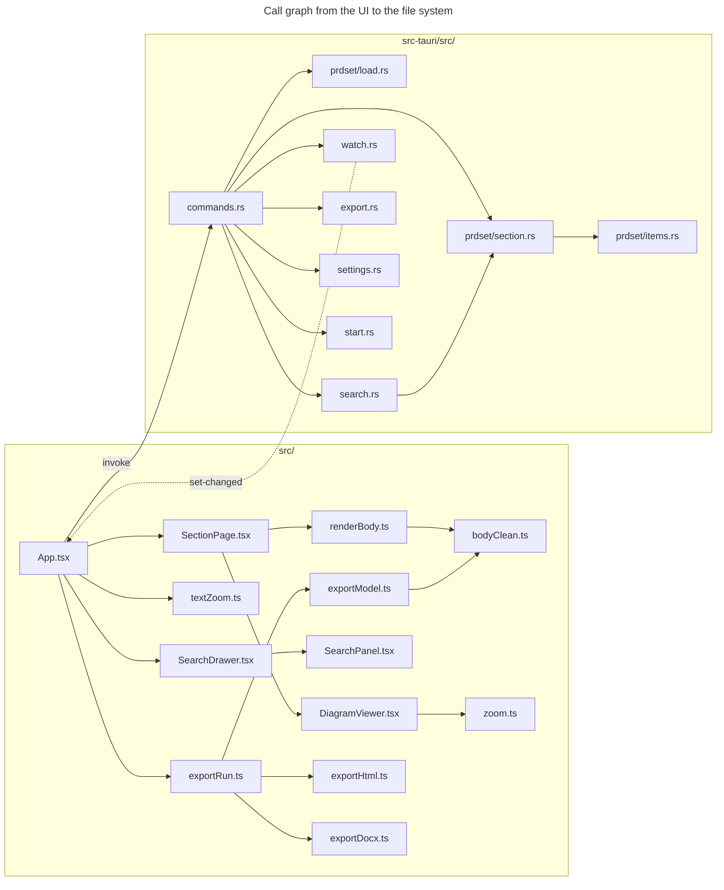

# PRD Forge Viewer code walkthrough

This walkthrough is the guided tour of the code at tag `v0.4.0` (commit
`61a8643`). Every listing is quoted from that commit and cites `path:line`.
The design document in `docs/designs/current_design_doc.md` gives the
architecture. Where the code and the design documents differ, the code wins and
section 6 reports the gap.

## 1. orientation

### 1.1 The system in three sentences

The PRD Forge Viewer is a read-only macOS desktop app that opens a PRD Forge
set, shows its documents, grades, and items, and searches them in one or more
categories from a drawer at the right. A Rust core
reads every file, checks every path, keeps a SQLite full-text index, and
watches the set for changes. A React UI renders the content safely, shows each
diagram as a drawing that opens in a zoom and pan window, shows the findings
behind a grade, links each requirement to the backlog stories that build it,
lets the author change the text size, and builds themed PDF
and Word exports with the diagrams as images, which the Rust core writes outside
the set.

### 1.2 Directory map

| Path | What lives there | Why |
|------|------------------|-----|
| `src-tauri/src/lib.rs` | App builder, plugins, managed state, command list | The one place that wires Tauri. |
| `src-tauri/src/commands.rs` | All 22 Tauri commands | The only IPC surface. Thin wrappers over the modules. |
| `src-tauri/src/prdset/` | Front matter, set, item, and section parsing, grade notes, and the backlog next to a set | Pure code with no Tauri import, so it is easy to test. |
| `src-tauri/src/search.rs` | FTS5 index and BM25 ranking | ADR-003. |
| `src-tauri/src/watch.rs` | File watcher | ADR-005. |
| `src-tauri/src/export.rs` | Export path guard, file writes, headless Chrome | ADR-002 and OUT-001. |
| `src-tauri/src/settings.rs`, `start.rs`, `locate.rs`, `launcher.rs` | Settings file (with the text size and drawer pin since 0.4.0), start view, set discovery, `prdf` | ADR-004. |
| `src-tauri/tests/` | Rust integration tests | Start rules and set loading through the public API. |
| `src/App.tsx` | All UI state and every IPC call | The only UI file that imports Tauri. |
| `src/*.tsx` | Views and dialogs | Pure components with props. |
| `src/renderBody.ts` | Markdown to safe HTML | NFR-010. |
| `src/bodyClean.ts` | Removes the details block and each wireframe sketch that a drawing follows | One rule set for the viewer and the export, copied from `prd_export.py`. |
| `src/DiagramViewer.tsx`, `src/zoom.ts` | Diagram window and its zoom math | The math is pure, so a unit test covers it. |
| `src/SearchDrawer.tsx`, `src/SearchPanel.tsx` | The search drawer, and the term box, category checkboxes, and results inside it | New in 0.3.0. The drawer has no Tauri import. `App.tsx` owns its open and pinned state. |
| `src/textZoom.ts` | The text size steps | New in 0.3.0. Pure, so a unit test covers it. |
| `src/styles.css` | Color tokens, dark mode, fonts, layout | The 0.2.0 visual design. |
| `src/export*.ts`, `src/themes.ts` | Export model, Motion block model, HTML and Word writers, fonts, themes | ADR-002. |
| `public/fonts/` | Source Serif 4, Source Sans 3, Source Code Pro | Embedded in every export. |
| `e2e/` | MCP-driven checks of the debug build | One check per PRD acceptance criterion. |
| `scripts/build.ts` | Bun bundle of the UI into `dist/` | Used by Tauri `beforeBuildCommand`. |
| `src-tauri/icons/` | App icon in every size, from `source/icon.svg` | `tauri icon` makes the sizes. Edit only the SVG. |

### 1.3 Architecture in one diagram

The diagram follows the real imports and `invoke` calls.



## 2. Execution-order tour

### 2.1 Process start

The binary calls the library. `run()` reads the first argument, registers two
plugins, three state values, and the commands
(`src-tauri/src/lib.rs:15-52`).

```rust
let first_arg = std::env::args().nth(1).map(std::path::PathBuf::from);
tauri::Builder::default()
    // A second launch (prdf while the viewer is open) sends its path to this window.
    .plugin(tauri_plugin_single_instance::init(|app, argv, _cwd| {
        let settings = settings::load_settings(&commands::settings_path(app));
        let view = start::start_view(argv.get(1).map(std::path::Path::new), &settings);
        let _ = app.emit("start", view);
```

`src-tauri/src/lib.rs:16-22`

- **Receives.** The process arguments. `prdf` passes the folder as the first
  argument (`src-tauri/src/launcher.rs:13-15`).
- **Why.** `prdf` runs `open -n`, which always starts a new process. The
  single-instance plugin turns that process into an event on the open window,
  so the author has one window.
- **Can fail.** `.expect("error while running the PRD Forge Viewer")` ends the
  process if Tauri cannot start (`src-tauri/src/lib.rs:51`).

The MCP test bridge is compiled in only with the `mcp-bridge` feature and binds
to `127.0.0.1` (`src-tauri/src/lib.rs:35-39`).

### 2.2 The UI asks what to show

On mount, `App` loads the themes and calls `startup`
(`src/App.tsx:186-193`).

```tsx
void invoke<StartView>("startup").then(showStart);
const unlisten = listen<StartView>("start", (e) => showStart(e.payload));
```

`src/App.tsx:188-189`

`startup` takes the stored argument once, so a page reload does not reopen the
launch folder (`src-tauri/src/commands.rs:33-37`).

```rust
pub fn startup(app: AppHandle, arg: State<StartArg>) -> StartView {
    let arg = arg.0.lock().unwrap().take();
    start_view(arg.as_deref(), &load_settings(&settings_path(&app)))
}
```

`src-tauri/src/commands.rs:34-37`

### 2.3 The start rules

`start_view` is the decision table of FR-002, FR-021, FR-022, and FR-024
(`src-tauri/src/start.rs:22-47`).

```rust
let arg = &canon(arg);
let folder = arg.display().to_string();
if arg.join("prd.md").is_file() {
    return StartView::Open { folder };
}
let sets = find_sets(arg);
match sets.len() {
    0 => StartView::NotFound { folder, known: known(settings) },
    1 => StartView::Open { folder: sets[0].folder.clone() },
    _ => match sets.iter().find(|s| Some(s.folder.as_str()) == last) {
        Some(s) => StartView::Open { folder: s.folder.clone() },
        None => StartView::Choose { folder, sets, known: known(settings) },
    },
}
```

`src-tauri/src/start.rs:33-46`

- **Why canonical paths.** `prdf .` and a symlinked folder must match the saved
  last set, which `open_and_remember` stores in canonical form
  (`src-tauri/src/start.rs:23-26`, `src-tauri/src/commands.rs:17`).
- **Returns.** A tagged enum. Serde writes it as `{ "kind": "choose", ... }`
  in camel case (`src-tauri/src/start.rs:8-9`), which matches the `StartView`
  union in `src/types.ts:38-42`.

In the UI, `showStart` either opens the folder or shows `StartScreen`
(`src/App.tsx:151-159`).

### 2.4 Open a set

`open_and_remember` loads first and saves the settings only on success
(`src-tauri/src/commands.rs:16-24`).

```rust
let folder = std::fs::canonicalize(folder).map(|p| p.display().to_string()).unwrap_or_else(|_| folder.to_string());
let set = load_set(Path::new(&folder)).map_err(|e| e.to_string())?;
// ponytail: a failed save only loses the reopen; it must not stop the set from opening.
if let Err(e) = update_settings(settings_path, |s| remember(s, &folder)) {
    eprintln!("settings not saved to {}: {e}", settings_path.display());
}
Ok(set)
```

`src-tauri/src/commands.rs:17-23`

`load_set` reads only front matter. It puts the root first, sorts the children
by `order`, and turns a child that fails to read into an `unreadable` entry
instead of an error (`src-tauri/src/prdset/load.rs:91-129`).

```rust
for child in children {
    let file = child.path.trim_start_matches("./").to_string();
    let order = child.order.unwrap_or(0);
    documents.push(match read_header(&dir.join(&file)) {
        Ok(h) => entry(file, &h, order),
        Err(why) => DocEntry {
            file,
            title: child.title,
            section: child.section,
            order,
            status: "unreadable".into(),
            grade: None,
            unreadable: Some(why),
        },
    });
}
```

`src-tauri/src/prdset/load.rs:106-121`

- **Why.** FR-003 says a set with a broken section still opens, and the broken
  file is named.
- **Can fail.** Only a missing or unreadable root fails the whole open
  (`src-tauri/src/prdset/load.rs:92-96`).

Front matter parsing strips a BOM and CRLF line ends before it looks for the
fences (`src-tauri/src/prdset/header.rs:52-60`).

### 2.5 Per-set setup in the UI

A change of `set.folder` resets the page and starts three calls, then asks for
the backlog (`src/App.tsx:99-121`).

```tsx
if (set) {
    void invoke("watch_set", { folder: set.folder }).catch((e) => setError(`Live updates are off: ${e}`));
    void invoke<ItemRef[]>("item_index", { folder: set.folder }).then(setIndex).catch(() => setIndex([]));
    void invoke<Category[]>("categories", { folder: set.folder }).then(setCategories).catch(() => setCategories([]));
}
```

`src/App.tsx:105-109`

The backlog call comes second. When there is a backlog, two more calls load
its item index and its story links (FR-028).

```tsx
if (set) {
    void invoke<Backlog | null>("backlog", { folder: set.folder }).then((b) => {
        setBacklog(b);
        if (!b) return;
        void invoke<ItemRef[]>("item_index", { folder: b.folder }).then(setBacklogIndex).catch(() => {});
        void invoke<StoryLink[]>("story_links", { folder: b.folder }).then(setLinks).catch(() => {});
    }).catch(() => {});
}
```

`src/App.tsx:113-120`

- **Why reuse `item_index`.** The backlog has the same shape as a PRD set: a
  root document whose front matter lists its children. `listed` takes
  `backlog.md` as the root when a folder has no `prd.md`, so `item_index` and
  `read_section` work on the backlog folder unchanged
  (`src-tauri/src/prdset/section.rs:47-56`).
- **Can fail.** Each failure is silent. The set still opens with no
  **Backlog** section.

The overview shows `SetOverview` and `GradesTable`. `GradesTable` lists every
document with a section number, and shows "Not graded" for a document with no
score (`src/GradesTable.tsx:4-37`).

### 2.6 Read a section

`read_section` checks the file against the root's list first, then reads it
through `inside` (`src-tauri/src/prdset/section.rs:59-75`).

```rust
pub(crate) fn inside(dir: &Path, rel: &str) -> Result<std::path::PathBuf, String> {
    let root = fs::canonicalize(dir).map_err(|e| e.to_string())?;
    let path = fs::canonicalize(root.join(rel)).map_err(|_| format!("{rel} was not found"))?;
    if path.starts_with(&root) { Ok(path) } else { Err(format!("{rel} is outside the PRD set")) }
}
```

`src-tauri/src/prdset/section.rs:35-39`

- **Why two checks.** `listed` limits reads to the documents of the set.
  `inside` stops a listed `../outside.md` or a symlink that points out of the
  folder (NFR-010).
- **Returns.** A `Section` with the body Markdown and every item from
  `items_of` (`src-tauri/src/prdset/section.rs:64-74`).

`items_of` walks the front matter tree. A mapping with an item ID becomes an
`Item`, and its children record it as `parent`
(`src-tauri/src/prdset/items.rs:75-97`).

```rust
let here = id.as_deref().or(parent);
for (_, child) in m {
    walk(child, here, out);
}
```

`src-tauri/src/prdset/items.rs:89-92`

In the UI, `SectionPage` renders the body once per section and then loads
images (`src/SectionPage.tsx:93-120`).

```tsx
for (const img of Array.from(el.querySelectorAll<HTMLImageElement>("img[data-asset]"))) {
    const rel = img.dataset.asset!;
    img.removeAttribute("data-asset");
    loadAsset?.(rel).then((url) => (img.src = url)).catch(() => {
        // Show the wireframe sketch that the drawing replaced, if there is one.
        const p = img.closest(".diagram")?.parentElement;
        if (p?.previousElementSibling?.matches("[data-sketch]")) p.previousElementSibling.removeAttribute("hidden");
        img.replaceWith(`[image not found: ${img.alt}]`);
    });
}
```

`src/SectionPage.tsx:102-111`

`read_asset` returns the image as a `data:` URL, which the CSP allows
(`src-tauri/src/prdset/section.rs:137-148`, `src-tauri/tauri.conf.json:22`).

- **Why the sibling.** Marked wraps the diagram button in a paragraph `p`.
  `cleanForView` put the hidden sketch `div` just before that paragraph, so
  the sketch is the paragraph's previous sibling (section 2.7).

#### Open a diagram

The same click listener that follows `.md` links also opens diagrams. It
finds the `img` inside the nearest `[data-diagram]` button and stores its `src`
and alt text (`src/SectionPage.tsx:112-117`).

```tsx
const img = (e.target as HTMLElement).closest<HTMLElement>("[data-diagram]")?.querySelector("img");
if (img?.src) setDiagram({ src: img.src, alt: img.alt });
```

`src/SectionPage.tsx:115-116`

- **Why `img.src`.** By the time of the click, `src` is the `data:` URL that
  `read_asset` returned, so the window needs no second read.
- **Can fail.** When the image did not load, the `img` was replaced by text,
  and the click does nothing.

`DiagramViewer` renders the image in a stage and moves it with one CSS
transform (`src/DiagramViewer.tsx:69-70`). The zoom math lives in `zoom.ts`:

```ts
export function zoomAt(v: View, factor: number, px: number, py: number): View {
    const scale = Math.min(MAX_SCALE, Math.max(MIN_SCALE, v.scale * factor));
    const k = scale / v.scale;
    return { scale, x: px - (px - v.x) * k, y: py - (py - v.y) * k };
}
```

`src/zoom.ts:16-20`

- **Why this formula.** The content point under the pointer is
  `(px - x) / scale`. Scaling the offset from the pointer by `k` keeps that
  point the same, so the diagram zooms about the pointer.
- **Input.** The wheel sends `exp(-deltaY * 0.002)`, or `exp(-deltaY * 0.01)`
  for a pinch, which arrives with `ctrlKey` (`src/DiagramViewer.tsx:34-38`).
- **Close.** Escape fires `cancel`. The handler prevents the native close and
  calls `onClose`, so the state in `SectionPage` stays the only record
  (`src/DiagramViewer.tsx:59`).

#### Show the findings behind a grade

FR-025 is new in 0.4.0. `App` gives `SectionPage` a `loadFindings` function
for a document of the PRD set, and none for a backlog document
(`src/App.tsx:298`). `useFindings` owns the button and the panel:

```tsx
const [shown, setShown] = useState<{ open: boolean; html?: string | null }>({ open: false });
const toggle = async () => {
    if (shown.open || !load) return setShown({ open: false });
    const md = await load().catch(() => null);
    setShown({ open: true, html: md ? renderHtml(md) : null });
};
```

`src/SectionPage.tsx:74-79`

- **Why `renderHtml`.** The note is Markdown from the set, so it is untrusted
  like a body. It goes through the same `renderBody` and DOMPurify path
  (NFR-010).
- **Why load on click.** Most readers never open the findings. The note is
  read only when asked, and read again on each open, so it is never stale.
- **Reset.** An effect on `section.file` closes the panel when another section
  opens (`src/SectionPage.tsx:95-96`).

In Rust, `read_grade` limits the name, then reads through `inside`:

```rust
if file.contains('/') || !file.ends_with(".md") {
    return Err(format!("{file} is not a section file"));
}
let path = match inside(dir, &format!("grades/{file}")) {
    Ok(p) => p,
    Err(_) if !dir.join("grades").join(file).exists() => return Ok(None),
    Err(e) => return Err(e),
};
```

`src-tauri/src/prdset/section.rs:153-160`

- **Returns.** `None` when there is no note, so the UI can say "No findings
  are recorded for this section". Otherwise the body after the front matter,
  trimmed (`src-tauri/src/prdset/section.rs:161-162`).
- **Can fail.** A note that exists but resolves outside the set, such as a
  symlink, is an error, not `None`. `useFindings` turns any error into the
  "no findings" text (`src/SectionPage.tsx:77`).

### 2.7 Render a body safely

`renderBody` cleans the Markdown, rewrites images and links while Marked
renders, then runs DOMPurify (`src/renderBody.ts:11-25`,
`src/renderBody.ts:35-56`). The cleaner has one function for the viewer and
one for the export:

```ts
const DETAILS = /<!-- prd-forge:details -->[\s\S]*?<!-- \/prd-forge:details -->\n?/g;
// A wireframe sketch, then (captured) the path of the image on the next non-blank line.
const SKETCH = /^```wireframe\n[\s\S]*?^```\n(?=\s*!\[[^\]]*\]\(([^)\s]+)\)\s*$)/gm;

/** For an export: drop each sketch whose drawing the export has. */
export const cleanForExport = (md: string, hasDrawing: (path: string) => boolean = () => true) =>
    md.replace(DETAILS, "").replace(SKETCH, (sketch, path: string) => (hasDrawing(path) ? "" : sketch));
```

`src/bodyClean.ts:6-12`

```ts
export const cleanForView = (md: string) =>
    md.replace(DETAILS, "").replace(SKETCH, (sketch) => `<div class="sketch" data-sketch hidden>\n\n${sketch}\n</div>\n`);
```

`src/bodyClean.ts:18-19`

- **Why a lookahead.** The image line stays in the body. Only the sketch
  above it is matched. A sketch with no drawing after it never matches, so no
  content is lost. The lookahead captures the image path for `hasDrawing`.
- **Why two functions.** The export knows which drawings it has before it
  builds the Markdown, so `cleanForExport` decides at once
  (`src/exportModel.ts:40`). The viewer learns only when the image loads or
  fails, so `cleanForView` keeps the sketch, hidden, and `SectionPage` shows
  it on a failure (section 2.6). Both still share one `SKETCH` and one
  `DETAILS` pattern, so the screen and the export match the same parts.
- **Why the blank lines.** A blank line ends the HTML block that the `div`
  opens, so Marked parses the sketch as a fenced code block, not as raw text
  (`src/bodyClean.ts:14-17`). The test
  `the_viewer_renders_the_sketch_hidden_as_a_code_block` checks it
  (`src/bodyClean.test.ts:38-45`).
- **Is it safe.** `hidden` and `data-sketch` are plain attributes, and
  DOMPurify keeps them. `class` is allowed by the HTML profile
  (`src/renderBody.ts:52`).

A local image becomes a button that opens the diagram window:

```ts
if (remote(href)) return `<span class="image-blocked">[image: ${esc(text || "remote image")}]</span>`;
// A local image is a button that opens it in the diagram window, with its alt text as a caption.
return `<button type="button" class="diagram" data-diagram aria-label="Open diagram: ${esc(text || "image")}"><span class="caption">${esc(text)}</span></button>`;
```

`src/renderBody.ts:14-16`

```ts
purify.addHook("afterSanitizeAttributes", (node) => {
    if (node.nodeName === "IMG") {
        const src = node.getAttribute("src");
        node.removeAttribute("src");
        if (src && !remote(src)) node.setAttribute("data-asset", src.replace(/^\.\//, ""));
    }
    if (node.nodeName === "A") node.removeAttribute("href");
});
```

`src/renderBody.ts:43-50`

- **Why the hook.** Raw HTML in a body skips the Marked renderer. The hook
  catches raw `` and `<a>` too, inside the sanitizer, so nothing changes
  its output afterwards.
- **Can fail.** With no working DOMPurify, the function returns the Markdown as
  plain text in `<pre>` (`src/renderBody.ts:38-42`).

### 2.8 Follow a reference

`linkify` splits text on the ID pattern. Each odd part is an ID, and it becomes
a button only when `known` has it. `known` holds the IDs of the set index and
the backlog index (`src/SectionPage.tsx:9-17`, `src/App.tsx:142`). The click
goes to `openItem`, which looks up the file in the set index first, then in
the backlog index (`src/App.tsx:132-137`).

```tsx
const openItem = useCallback((id: string) => {
    const ref = index.find((r) => r.id === id);
    if (ref) return void openDoc(ref.file, id);
    const story = backlog && backlogIndex.find((r) => r.id === id);
    if (story) void openDoc(story.file, id, backlog.folder);
}, [index, backlog, backlogIndex, openDoc]);
```

`src/App.tsx:132-137`

- **Why the set first.** When an ID is in both indexes, the PRD document
  wins. PRD Forge uses different prefixes for backlog items, such as `US-`.
- **The folder.** `openDoc` stores the backlog folder in `page.folder`. The
  section page then passes it on for `.md` links in the body, and the
  document list marks the current backlog document (`src/App.tsx:294`,
  `src/App.tsx:308`).

#### From a requirement to its stories (FR-028)

`story_links` reads the `requirements` field of each backlog item. It finds
the IDs by hand, with no regex crate:

```rust
// An id is 1 to 4 capitals, a hyphen, and 3 digits, such as FR-005.
let is_id = |w: &&str| matches!(w.split_once('-'), Some((a, n)) if (1..=4).contains(&a.len()) && a.bytes().all(|b| b.is_ascii_uppercase()) && n.len() == 3 && n.bytes().all(|b| b.is_ascii_digit()));
```

`src-tauri/src/prdset/section.rs:112-113`

The text splits on every character that is not ASCII alphanumeric or `-`
(`src-tauri/src/prdset/section.rs:119`). `App` turns the links around into
`builtBy`, a map from a requirement to its stories:

```tsx
const builtBy = new Map<string, string[]>();
for (const l of links) for (const r of l.requirements) builtBy.set(r, [...(builtBy.get(r) ?? []), l.id]);
```

`src/App.tsx:139-140`

`ItemView` shows the stories in a **built by** row above the fields, through
`linkify`, so each story is a button (`src/SectionPage.tsx:34-39`).

- **Why `backlog_of` looks only at a sibling.** PRD Forge writes the backlog
  of `docs/prd/<name>` to `docs/prd/<name>-backlog`. The viewer looks there
  and nowhere else, and needs a `backlog.md` in it
  (`src-tauri/src/prdset/section.rs:91-96`).

### 2.9 search

The `search` command passes the index path and the set to `SearchState`
(`src-tauri/src/commands.rs:93-96`). `SearchState::with` keeps one index open,
refreshes it before every query, and rebuilds it once on any error
(`src-tauri/src/search.rs:181-199`).

```rust
let (_, ix) = slot.as_mut().unwrap();
let first = ix.refresh().and_then(|_| f(ix));
if let Ok(v) = first {
    return Ok(v);
}
// The index is derived data: when it fails, delete it, build it again, and try once more.
*slot = None;
remove_files(db);
let mut ix = Index::open(db, set)?;
ix.refresh()?;
```

`src-tauri/src/search.rs:186-195`

`refresh` hashes front matter and body with FNV-1a and skips a document whose
hash is unchanged (`src-tauri/src/search.rs:96-104`). The query quotes each
word, so `NEAR`, `AND`, `*`, and quotes in the term are plain text
(`src-tauri/src/search.rs:66-69`).

```rust
"SELECT id, title, file, section, kind, bm25(items, 50.0, 10.0, 1.0) AS rank FROM items
 WHERE items MATCH ?1 AND (?2 = '' OR instr(?2, ',' || kind || ',') > 0) ORDER BY rank, rowid LIMIT 200",
```

`src-tauri/src/search.rs:144-145`

Since 0.3.0 the command takes `categories: Vec<String>`, not one category
string (`src-tauri/src/commands.rs:92-96`). `Index::search` joins the kinds
into `,a,b,` and binds it as `?2`. `instr()` then keeps a row whose `,kind,`
is in that string. An empty list binds `''`, which keeps every row
(`src-tauri/src/search.rs:149-150`). A kind is a slug, so it has no comma, and
the `ponytail:` comment on that line records the limit. The old `"all"` value
is gone from Rust and from the UI.

The weights make an ID match count most, then the title, then the text. This
is FR-008 criterion 3. `bm25()` is lower for a better match, so the score is
`|rank| / |best| * 100` (`src-tauri/src/search.rs:159-161`).

**The UI side.** `SearchPanel` keeps `picked`, the list of checked kinds. An
empty list means all, and the **All categories** box is checked only then.
Checking a kind rebuilds the list from `categories`, so the list stays in
reading order (`src/SearchPanel.tsx:58-70`).

```tsx
<input type="checkbox" value={c.kind} checked={picked.includes(c.kind)}
    onChange={() => setPicked((p) => (p.includes(c.kind) ? p.filter((k) => k !== c.kind) : categories.map((x) => x.kind).filter((k) => k === c.kind || p.includes(k))))} />{" "}
```

`src/SearchPanel.tsx:65-66`

Unchecking the last kind leaves an empty list, which checks **All
categories** again.

`App` wraps the panel in `SearchDrawer` and passes the list to the command
under the name `categories` (`src/App.tsx:277-286`). A click on a hit closes
the drawer unless it is pinned, then opens the section:

```tsx
onOpenHit={(hit) => { if (!searchPinned) setSearchOpen(false); openDoc(hit.file, hit.id); }}
```

`src/App.tsx:283`

`SearchDrawer` is always mounted. When closed it is `inert` and off screen,
so the results stay for the next open and the keyboard cannot reach it
(`src/SearchDrawer.tsx:32-33`). It moves the focus to the search box on open,
and closes on Escape only when it is unpinned and no modal `<dialog>` is open
(`src/SearchDrawer.tsx:17-30`).

```tsx
const onKey = (e: KeyboardEvent) => {
    if (e.key === "Escape" && !document.querySelector("dialog[open]")) onClose();
};
```

`src/SearchDrawer.tsx:25-27`

The drawer is `position: fixed` at `top: var(--header-h)`. `App` measures the
header with a `ResizeObserver` and writes that variable, because the header
wraps and grows with the text size (`src/App.tsx:55-63`,
`src/styles.css:222-230`). When the drawer is open and pinned, `main` gets the
`with-drawer` class, which pads the page by the drawer width
(`src/App.tsx:220`, `src/styles.css:238`).

### 2.9a Text size and the Command keys

`App` keeps the text size in `zoom`. One root font size scales the page,
because the styles use `rem` (`src/App.tsx:32-34`). Since 0.4.0 the size and
the drawer pin live in `settings.json`, not in `localStorage`:

```tsx
const prefsRead = useRef(false);
useEffect(() => {
    void invoke<{ textZoom: number; searchPinned: boolean }>("view_prefs").then((p) => {
        setZoom(readZoom(String(p.textZoom)));
        setSearchPinned(p.searchPinned);
        prefsRead.current = true;
    }).catch(() => { prefsRead.current = true; });
}, []);
useEffect(() => {
    if (prefsRead.current) void invoke("save_view_prefs", { textZoom: zoom, searchPinned }).catch(() => { /* the values still apply for this session */ });
}, [zoom, searchPinned]);
```

`src/App.tsx:41-51`

- **Why the ref.** The save effect also runs on the first render, with the
  defaults. Without the guard, every start would write size 1 and no pin over
  the stored values. The ref turns true only after the read, and a ref change
  does not render again.
- **Can fail.** A failed read leaves the defaults and still allows saves. A
  failed save is ignored, and the value applies for the session.

In Rust, `view_prefs` reads the file and `save_view_prefs` goes through the
locked `update_settings`, so a size change and a theme save do not lose each
other's write (`src-tauri/src/commands.rs:135-146`). `set_view` checks the
range:

```rust
pub fn set_view(s: &mut Settings, text_zoom: f64, search_pinned: bool) {
    s.text_zoom = (0.5..=3.0).contains(&text_zoom).then_some(text_zoom);
    s.search_pinned = search_pinned;
}
```

`src-tauri/src/settings.rs:29-32`

`readZoom` accepts a stored value only when it is one of `ZOOM_STEPS`, so a
hand-edited value cannot set an odd size (`src/textZoom.ts:13-16`). `nextZoom`
finds the next step with a small tolerance, and stops at 0.8 and 2:

```ts
export function nextZoom(zoom: number, dir: 1 | -1 | 0): number {
    if (dir === 0) return 1;
    const up = ZOOM_STEPS.find((s) => s > zoom + 1e-9);
    const down = [...ZOOM_STEPS].reverse().find((s) => s < zoom - 1e-9);
    return (dir === 1 ? up : down) ?? zoom;
}
```

`src/textZoom.ts:5-10`

One window `keydown` handler takes Command-plus (`=` or `+`), Command-minus,
Command-0, and Command-F. It ignores a key with Option or Control
(`src/App.tsx:64-80`). Command-F opens the drawer only when a set is open. The
handler is bound once, so it reads the `hasSet` ref, not the `set` state
(`src/App.tsx:53-54`, `src/App.tsx:68-72`). The header group **A−**, percent, **A+** calls the same
function. The percent button resets to 100%, and each end button is disabled
at its limit (`src/App.tsx:242-246`).

### 2.10 Live changes

`watch_set` clears the slot first, so the old watcher drops before the new one
starts (`src-tauri/src/commands.rs:183-195`).

```rust
let mut slot = state.0.lock().unwrap_or_else(|e| e.into_inner());
*slot = None;
let Some(folder) = folder else { return Ok(()) };
```

`src-tauri/src/commands.rs:186-188`

`SetWatcher::start` runs an OS event watcher and a 1 s poll at the same time
(`src-tauri/src/watch.rs:82-88`).

```rust
let on = only_new_content(root, on_change);
let events = start_with::<RecommendedWatcher>(folder, Default::default(), on.clone()).ok();
let poll = Self::poll_every(folder, Duration::from_secs(1), on)?;
```

`src-tauri/src/watch.rs:84-86`

- **Why both.** File events can stop with no error, for example in a sandbox.
  The poll keeps NFR-002 (`src-tauri/src/watch.rs:80-81`).
- **Why the content filter.** Both watchers see each save. `only_new_content`
  passes a file on only when its hash differs from the last one passed on, so
  the UI reloads once (`src-tauri/src/watch.rs:44-77`).
- **Can fail.** An OS watcher that fails to start is ignored (`.ok()`). A poll
  that fails to start fails the command.

In the UI, the listener drops a reply when a later event or another set has
arrived (`src/App.tsx:167-172`).

```tsx
const mine = ++seq;
// A later change, or another set, wins over this one.
const stale = () => mine !== seq || current.current.set?.folder !== open.folder;
setChanged((c) => applyChange(c, e.payload.files));
const fresh = await invoke<PrdSet>("reload_set", { folder: open.folder }).catch(() => undefined);
if (stale()) return;
```

`src/App.tsx:167-172`

`reloadedPage` keeps the selected item when the new version still has it, and
goes back to the overview with a message when the section is gone
(`src/live.ts:16-19`). A backlog page is never reloaded: the check
`!shown.folder` skips it, because the event names files of the set folder
only (`src/App.tsx:175`).

### 2.11 export

`runExport` asks for the save path before any work. Cancel returns `false`, and
the dialog says "Export cancelled. Nothing was saved."
(`src/exportRun.ts:60-67`, `src/ExportDialog.tsx:48`).

```ts
const path = await deps.save(format, exportFileName(set, format));
if (!path) return false;
const { markdown, images, title, fonts } = await themedExport(set, selected, options, deps);
if (format === "pdf") await deps.writePdf(path, renderThemedHtml(markdown, theme, title, fontFaceCss(fonts), images));
else await deps.writeDocx(path, toBase64(new Uint8Array(await (await exportDocx(markdown, theme, title, fonts, images)).arrayBuffer())));
return true;
```

`src/exportRun.ts:61-66`

`options` comes from the **Include grades** box in `ExportDialog`, which is
clear by default (`src/ExportDialog.tsx:22`, `src/ExportDialog.tsx:89-90`).
`buildExport` writes the first page, the contents table, and the selected
sections in reading order (`src/exportModel.ts:20-43`). The grade columns are
in the contents table only when the author includes them:

```ts
options.grades
    ? "| Section | Status | Score | Blocking defects |\n| --- | --- | --- | --- |\n" +
      docs.map((d) => `| ${cell(d.title)} | ${d.status} | ${d.grade?.score ?? "not graded"} | ${d.grade?.blocking ?? "not graded"} |`).join("\n")
    : "| Section | Status |\n| --- | --- |\n" + docs.map((d) => `| ${cell(d.title)} | ${d.status} |`).join("\n"),
```

`src/exportModel.ts:30-33`

`themedExport` loads the images before it builds the Markdown, so that
`buildExport` knows which drawings exist (`src/exportRun.ts:51-57`):

```ts
const bodies = await collectBodies(set, selected, deps.read);
// The images first, so a sketch stays in the export when its drawing cannot be read.
const images = await loadImages([...bodies.values()].map((b) => b.body).join("\n"), deps.asset);
const markdown = buildExport(set, bodies, selected, { ...options, hasDrawing: (p) => images.has(p) });
```

`src/exportRun.ts:52-55`

`loadImages` asks for each local image path as written:

```ts
export async function loadImages(md: string, asset: (rel: string) => Promise<string>): Promise<Map<string, string>> {
    const local = [...new Set([...md.matchAll(IMAGE)].map((m) => m[2] ?? "").filter((p) => p && !/^[a-z][a-z0-9+.-]*:/i.test(p)))];
    const pairs = await Promise.all(local.map(async (p) => [p, await asset(p.replace(/^\.\//, "")).catch(() => null)] as const));
    return new Map(pairs.filter((x): x is readonly [string, string] => !!x[1]));
}
```

`src/exportRun.ts:36-40`

In the app, `asset` is the `export_image` command (`src/App.tsx:207`). The
Rust side picks the picture:

```rust
pub fn export_image(dir: &Path, rel: &str) -> Result<String, String> {
    let png = rel.strip_suffix(".svg").map(|base| format!("{base}.png"));
    let modified = |r: &str| inside(dir, r).ok().and_then(|p| fs::metadata(p).ok()).and_then(|m| m.modified().ok());
    // ponytail: 2 s of slack, because a git checkout writes the pair in any order.
    let fresh = |png: &str| match (modified(png), modified(rel)) {
        (Some(p), Some(s)) => p + std::time::Duration::from_secs(2) >= s,
        (Some(_), None) => true,
        _ => false,
    };
    match png {
        Some(png) if fresh(&png) => read_asset(dir, &png),
        _ => read_asset(dir, rel),
    }
}
```

`src-tauri/src/prdset/section.rs:168-181`

- **Why the PNG first.** The PRD Forge exporter embeds the PNG that it renders
  next to each SVG, and every Word version draws a PNG.
- **Why the SVG when the PNG is older.** The viewer shows the SVG. A PNG that
  is older than its SVG is a drawing that `prd-diagrams.mjs` has not rendered
  again, and in 0.2.0 the export showed that older drawing. Now the export
  never shows an older drawing than the viewer.
- **Why 2 s of slack.** A git checkout writes the pair in any order, so a fresh
  PNG can be a little older than its SVG.
- **Why it is safe.** Both reads go through `read_asset`, so the `inside` path
  check and the image extension list still apply. `modified` also uses
  `inside`, so it reads no metadata outside the set.
- **Why a map.** The `data:` URLs stay out of the Markdown, which stays small
  to parse (`src/exportRun.ts:31-35`).
- **Can fail.** An image that cannot be read is not in the map. The HTML
  writer then prints the alt text, and the Word writer prints it in italics
  (`src/exportHtml.ts:75-79`, `src/exportDocx.ts:91`). `hasDrawing` returns
  `false` for that path, so `cleanForExport` keeps the wireframe sketch in the
  export, as `prd_export.py` does.

Both writers start from the same block list from `markdownToBlocks`
(`src/exportBlocks.ts:32-40`). A paragraph that holds only an image is an
`image` block (`src/exportBlocks.ts:57-62`). Word reads the size of a PNG from
its `IHDR` chunk, and the size of an SVG from its `viewBox` with `svgSize`,
then scales it down to fit 6.0 by 8.0 inches (`src/exportDocx.ts:66-84`).
An SVG goes in with a 1 by 1 blank PNG fallback for a Word older than 2016:

```ts
const run = m[1] === "png"
    ? new ImageRun({ type: "png", data, transformation: fitImage(pngSize(data)), altText })
    : new ImageRun({ type: "svg", data, fallback: { type: "png", data: BLANK_PNG }, transformation: fitImage(svgSize(new TextDecoder().decode(data))), altText });
```

`src/exportDocx.ts:94-96`

On the Rust side, both export commands build the list of known sets from the
open set and the settings file, not only from the window
(`src-tauri/src/commands.rs:157-160`).

```rust
fn known_sets(app: &AppHandle, folder: &str) -> Vec<PathBuf> {
    let s = load_settings(&settings_path(app));
    std::iter::once(folder.to_string()).chain(s.known).chain(s.last).map(PathBuf::from).collect()
}
```

`src-tauri/src/commands.rs:157-160`

`outside_set` then refuses any path in those sets
(`src-tauri/src/export.rs:10-21`). `export_pdf` writes the HTML to a job folder
in the app cache, runs Chrome with no network, and renames the result over the
target (`src-tauri/src/export.rs:65-98`).

```rust
.args(["--headless", "--disable-gpu", "--no-first-run", "--no-default-browser-check", "--disable-extensions", "--disable-background-networking", "--disable-sync"])
.args(["--no-pdf-header-footer", "--generate-pdf-document-outline", "--proxy-server=127.0.0.1:9", "--proxy-bypass-list=<-loopback>"])
```

`src-tauri/src/export.rs:74-75`

- **Why Chrome.** The macOS web view writes a PDF with no structure tree, so it
  cannot meet NFR-009. Chrome writes a tagged PDF with an outline (ADR-002
  implementation note).
- **Can fail.** No Chrome, a non-zero exit, or more than 60 s. In each case
  the code removes the temp file, and an earlier export at the path stays
  (`src-tauri/src/export.rs:32-39`, `src-tauri/src/export.rs:83-93`).

Print reuses the same HTML. `runPrint` puts the body in a hidden `#print-root`,
adds print-only CSS, and calls `print_page`, which calls `window.print()`
(`src/exportRun.ts:78-95`, `src-tauri/src/commands.rs:172-174`).

### 2.12 Themes and settings

`ThemeDialog` edits only custom themes and blocks the save while any theme has
a blank name or a bad hex color (`src/ThemeDialog.tsx:25-30`,
`src/ThemeDialog.tsx:71`). `save_themes` calls `update_settings`, which holds a
process-wide lock across load, change, and save
(`src-tauri/src/settings.rs:62-68`).

```rust
pub fn update_settings(path: &Path, change: impl FnOnce(&mut Settings)) -> io::Result<()> {
    static LOCK: std::sync::Mutex<()> = std::sync::Mutex::new(());
    let _guard = LOCK.lock().unwrap_or_else(|e| e.into_inner());
    let mut s = load_settings(path);
    change(&mut s);
    save_settings(path, &s)
}
```

`src-tauri/src/settings.rs:62-68`

`save_settings` writes a unique temp file and renames it, so a crash never
leaves half a file (`src-tauri/src/settings.rs:50-58`). When the UI reads the
themes back, `sanitizeCustomThemes` drops anything that is not a valid custom
theme (`src/themes.ts:161-173`).

Three writers share this one lock: `open_and_remember`, `store_themes`
(behind `save_themes`), and `save_view_prefs`. Each changes only its own
fields, so the text size, the pin, the themes, and the known locations never
overwrite each other (`src-tauri/src/commands.rs:16-24`,
`src-tauri/src/commands.rs:126-133`, `src-tauri/src/commands.rs:142-146`).

### 2.13 install `prdf`

After a confirm dialog (`src/App.tsx:214-217`), `install_prdf` writes
`~/.local/bin/prdf` and says whether that folder is on `PATH`
(`src-tauri/src/commands.rs:106-116`). `install_launcher` replaces only a file
that it wrote itself (`src-tauri/src/launcher.rs:21-35`).

```rust
if let Ok(meta) = fs::symlink_metadata(&path) {
    let ours = !meta.file_type().is_symlink()
        && fs::read(&path).map(|b| b.windows(MARKER.len()).any(|w| w == MARKER.as_bytes())).unwrap_or(false);
    if !ours {
        return Err(format!("{} already exists and is not the PRD Forge Viewer launcher. It was not changed.", path.display()));
    }
}
```

`src-tauri/src/launcher.rs:24-30`

### 2.14 Automation paths

There is no CI workflow in the repository at this tag. The automation is:

- `bun test src` for the UI unit tests (`package.json:9`). Since 0.2.1 this
  includes `src/interactive.test.tsx`, which renders React into a JSDOM
  document and sends real DOM events (section 4.14).
- `cargo test` for the Rust tests.
- `bin/worklog doc-verify --strict`, which checks every `path:line` citation in
  `docs/designs/` against the commit in the document's front matter. Since
  0.2.1 it reads citations under `src/`, `src-tauri/`, `e2e/`, `scripts/`, and
  `projects/` (`bin/doc_verify.py:38-39`). For a `path:line` citation it checks
  only that the line exists, not what the line holds.
- `bun run test:e2e`, which builds the MCP test build and runs each file in
  `e2e/checks/` in its own process (`e2e/run.mjs:1-15`).

The test build defines `__PFV_E2E__` as `true`
(`src-tauri/tauri.mcp.conf.json:3`, `scripts/build.ts:17`). Only then does the
UI read `window.__pfvSavePath` and `window.__pfvPrint`, because the checks
cannot drive the macOS save and print dialogs (`src/App.tsx:202-212`).

## 3. Load-bearing invariants

| Invariant | Enforced at | What breaks if it is violated |
|-----------|-------------|-------------------------------|
| The viewer never writes into a known PRD set. | `src-tauri/src/export.rs:10-21`, `src-tauri/src/commands.rs:157-160` | OUT-001. An export could overwrite a section. |
| An export write goes to a temp file and a rename, never through a link. | `src-tauri/src/export.rs:32-39` | A symlink or hard link at the target could change a set file. |
| Every read resolves inside the set folder. | `src-tauri/src/prdset/section.rs:35-39` | A child path or image could read any file on the Mac. |
| Only documents that the root lists are read as sections. The root is `prd.md`, or `backlog.md` in a folder with no `prd.md`. | `src-tauri/src/prdset/section.rs:47-63` | Grade files and other files would open as sections. |
| An export never shows an older drawing than the viewer. | `src-tauri/src/prdset/section.rs:168-181` | A stale PNG exports a drawing that the author has already changed. |
| A body is sanitized before it reaches the DOM. | `src/renderBody.ts:35-56` | NFR-010. A script or a remote load in a body. |
| Only `App.tsx` calls Tauri. | `src/App.tsx:2-4` | Components stop being testable without Tauri. |
| Settings change under one lock, with an atomic save. | `src-tauri/src/settings.rs:50-68` | A theme save and a set open could lose each other's change (NFR-008). |
| A built-in theme ID is never stored. | `src-tauri/src/settings.rs:38-42`, `src/themes.ts:133-139` | A custom theme could replace Clay or Ice Snowstorm (FR-017, FR-018). |
| The index is derived data. | `src-tauri/src/search.rs:191-198` | Do not store anything in it that cannot be rebuilt. |
| One watcher at a time, and the last `watch_set` wins. | `src-tauri/src/commands.rs:180-195` | Events from an old set would reload the wrong set. |
| The search term is never FTS syntax. | `src-tauri/src/search.rs:66-69` | A term such as `(export` would be a query error. |
| A grade note is read only from `grades/` of the set, by a plain file name. | `src-tauri/src/prdset/section.rs:152-163` | `read_grade` could read any `.md` file the web view names. |
| The view settings are not saved until they are read. | `src/App.tsx:39-51` | Each start would reset the stored text size and pin to the defaults. |
| A backlog page carries its folder in `page.folder`. | `src/App.tsx:85-86`, `src/App.tsx:123-131` | A link or a live reload would read the backlog file name from the set folder. |
| `src/types.ts` matches the serde output of the Rust types. | By hand only | The UI reads `undefined` with no compile error. |

## 4. Tests as executable specification

### 4.1 A listed path outside the set is refused

```rust
fn listed_paths_outside_the_set_are_refused() {
    let d = set_with_outside_files();
    let set = d.path().join("set");
    assert!(read_section(&set, "../outside.md").is_err());
    assert!(read_section(&set, "linked.md").is_err());
    assert!(!item_index(&set).iter().any(|r| r.file.contains("outside") || r.file.contains("linked")));
}
```

`src-tauri/src/prdset/section.rs:238-244`

**Rule.** A root that lists `../outside.md` or a symlink out of the folder
cannot make the viewer read that file, by section or by index. **Catches.** A
change that drops `inside` from `read`.

### 4.2 An ID match ranks first, and a title beats text

```rust
fn title_match_ranks_above_text_match() {
    let d = TempDir::new().unwrap();
    small_set(&d.path().join("s"), "Mentions export once");
    let mut ix = Index::open(&d.path().join("ix.sqlite"), &d.path().join("s")).unwrap();
    ix.refresh().unwrap();
    let ids: Vec<_> = ix.search("export", &[]).unwrap().into_iter().map(|h| h.id).collect();
    assert_eq!(ids, vec!["FR-002", "FR-001"]);
}
```

`src-tauri/src/search.rs:261-268`

**Rule.** FR-008 criterion 3. **Catches.** A change to the `bm25()` weights.
The companion test `an_id_search_puts_that_item_first` covers the ID column
(`src-tauri/src/search.rs:348-351`).

### 4.3 A broken index is rebuilt, even when it is open

```rust
for breakage in ["DROP TABLE items", "DELETE FROM items_data WHERE id > 10"] {
```

`src-tauri/src/search.rs:355`

**Rule.** Search recovers from a damaged index in a fresh state and in a state
that already holds the open index (`src-tauri/src/search.rs:354-365`).
**Catches.** A change that removes the retry in `SearchState::with`.

### 4.4 Two watchers, one reload, and no lost last save

```rust
fs::write(d.path().join("04.md"), "first").unwrap();
on(vec!["04.md".into()]);
fs::write(d.path().join("04.md"), "second").unwrap();
on(vec!["04.md".into()]);
on(vec!["04.md".into()]); // the other watcher sees the same save
assert_eq!(rx.try_iter().count(), 2);
```

`src-tauri/src/watch.rs:129-134`

**Rule.** The same content passed twice reloads once. New content always
reloads. **Catches.** A filter on time instead of content, which would drop the
last save of a burst.

### 4.5 A link at the export target is replaced, not written through

```rust
fs::write(s.join("08.md"), "set file").unwrap();
std::os::unix::fs::symlink(s.join("08.md"), d.path().join("out.docx")).unwrap();
fs::hard_link(s.join("08.md"), d.path().join("hard.docx")).unwrap();
write_export(&[s.clone()], &d.path().join("out.docx"), b"export").unwrap();
write_export(&[s.clone()], &d.path().join("hard.docx"), b"export").unwrap();
assert_eq!(fs::read_to_string(s.join("08.md")).unwrap(), "set file");
```

`src-tauri/src/export.rs:148-153`

**Rule.** OUT-001 holds even when the target is a link into the set.
**Catches.** A change from rename to `fs::write` on the target.

### 4.6 Every remote load path in a body is removed

```ts
const html = renderBody(md, win);
expect(html).not.toContain("example.com");
```

`src/renderBody.test.ts:49-50`

**Rule.** NFR-010 for `srcset`, `<picture>`, SVG `<image>`, `background`,
`poster`, media, `<input type="image">`, raw ``, and raw `<a>`
(`src/renderBody.test.ts:37-51`). **Catches.** A removed entry in
`FORBID_TAGS` or `FORBID_ATTR`.

### 4.7 Parallel opens and theme saves lose nothing

`theme_saves_and_opens_in_parallel_lose_nothing` runs eight threads, half
opening a set and half saving a theme, then checks that both changes are in
the file (`src-tauri/src/commands.rs:252-275`). **Rule.** NFR-008.
**Catches.** A removed lock in `update_settings`.

### 4.8 The export never says approved, and Draft follows status

The export model tests name their rule: `tr_005_draft_unless_every_document_is_final`,
`tr_007_the_export_never_says_approved`, and
`tr_010_a_blocking_defect_does_not_stop_the_export`
(`src/exportModel.test.ts:29`, `src/exportModel.test.ts:69`,
`src/exportModel.test.ts:74`).

### 4.9 End-to-end checks

Each e2e check is named after the PRD criterion it proves. Examples:
"FR-024 two sets and a last set reopens the last one"
(`e2e/checks/plans-1-2.mjs:73`), "NFR-002: 20 saves each show within 2 s"
(`e2e/checks/phase-3-live.mjs:44`), and "OUT-001: an export into the set
folder is refused" (`e2e/checks/phase-5-export.mjs:237`).

### 4.10 A sketch goes only when its drawing is there

```ts
test("an_export_keeps_a_sketch_whose_drawing_cannot_be_read", () => {
    expect(cleanForExport(page, () => false)).toContain("```wireframe");
});

test("a_wireframe_sketch_with_no_drawing_stays", () => {
    expect(cleanForExport(`${sketch}\n\nNo drawing here.\n`)).toContain("```wireframe");
    expect(cleanForView(`${sketch}\n\nNo drawing here.\n`)).not.toContain("data-sketch");
});
```

`src/bodyClean.test.ts:16-23`

- **Rule.** An export never removes a sketch whose drawing it cannot read, and
  neither function touches a sketch with no image line after it. The test
  before them proves that a sketch with a readable drawing goes and the image
  line stays (`src/bodyClean.test.ts:9-14`).
- **Catches.** A `SKETCH` pattern that drops the lookahead, or a
  `cleanForExport` that ignores `hasDrawing`. The 0.2.0 cleaner had the second
  gap.

### 4.11 Only a local image is loaded, and the export picks the newer drawing

```ts
test("each_local_image_is_asked_for_by_its_own_path", async () => {
    const asked: string[] = [];
    const images = await loadImages("\n\n\n", async (rel) => { asked.push(rel); return "data:image/png;base64,AAAA"; });
    expect(asked).toEqual(["diagrams/A.svg"]);
    expect([...images]).toEqual([["diagrams/A.svg", "data:image/png;base64,AAAA"]]);
});
```

`src/exportImages.test.ts:19-24`

- **Rule.** A remote image is never requested (NFR-010). The local path goes
  to `export_image` as written. Release 0.3.0 renamed the test, which in
  0.2.1 still said "png" from 0.2.0.
- **Catches.** A change that passes a URL to the image command. The HTML test
  in the same file proves that a missing image prints as its alt text and its
  path never reaches the HTML (`src/exportImages.test.ts:30-36`).

The Rust test pins the choice between the PNG and the SVG, with file times set
by hand:

```rust
at("new.svg", 100);
at("new.png", 200);
assert!(export_image(d.path(), "new.svg").unwrap().starts_with("data:image/png"));
at("old.svg", 200);
at("old.png", 100);
at("same.svg", 101);
at("same.png", 100);
assert!(export_image(d.path(), "same.svg").unwrap().starts_with("data:image/png"));
assert!(export_image(d.path(), "old.svg").unwrap().starts_with("data:image/svg+xml"));
at("only.svg", 100);
assert!(export_image(d.path(), "only.svg").unwrap().starts_with("data:image/svg+xml"));
assert!(export_image(d.path(), "../x.svg").is_err());
```

`src-tauri/src/prdset/section.rs:294-305`

- **Rule.** A newer PNG wins, a PNG 1 s older still wins (the 2 s slack), a
  PNG 100 s older loses to the SVG, a missing PNG gives the SVG, and a path
  outside the set is refused.
- **Catches.** A slack of 0, which would export SVGs after every checkout, and
  a lost `inside` check. The Word side has its own test: a stale PNG means an
  SVG in `word/media/` (`src/exportImages.test.ts:53-59`).

### 4.12 Grades are left out by default

```ts
test("fr_019_grades_are_left_out_by_default", () => {
    const md = buildExport(set, bodies, null);
    const contents = md.slice(md.indexOf("## Contents"));
    expect(contents).toContain("| Section | Status |");
    expect(contents).not.toContain("Score");
    expect(contents).not.toContain("Blocking");
});
```

`src/exportModel.test.ts:83-89`

- **Rule.** FR-019 as changed for 0.2.0: grades are in an export only when
  the author includes them.
- **Catches.** A default of `grades: true`, or a contents table that keeps the
  grade columns.

### 4.13 Zoom keeps the point under the pointer still

```ts
test("zoom_keeps_the_point_under_the_pointer_still", () => {
    const v = zoomAt({ scale: 1, x: 0, y: 0 }, 2, 100, 50);
    expect(v).toEqual({ scale: 2, x: -100, y: -50 });
    // The content point under the pointer is the same before and after.
    expect((100 - v.x) / v.scale).toBe(100);
});
```

`src/zoom.test.ts:10-15`

- **Rule.** The zoom formula in section 2.6.
- **Catches.** A zoom about the top left corner, which makes the diagram slide
  away from the pointer.

A second test pins the 0.2.1 fix: a diagram 10 times wider than the stage
opens at the 0.25 minimum, not below it (`src/zoom.test.ts:22-24`).

### 4.14 The diagram window and the sketch work with real DOM events

`src/interactive.test.tsx` installs a JSDOM window as the global DOM, renders
real components with `createRoot` inside `act`, and sends real events. JSDOM
has no modal dialogs, so the file gives `showModal` a stub that sets the
`open` attribute (`src/interactive.test.tsx:5-11`).

```tsx
await act(async () => { (host.querySelector("[aria-label='Zoom in']") as HTMLElement).click(); });
expect(scale(img)).toBeCloseTo(fitted * 1.25);
```

`src/interactive.test.tsx:42-43`

- **Rule.** The diagram window opens with focus on the stage, fits on load,
  zooms by 1.25 per button, pans with the arrow keys, fits again on `0`,
  zooms on the wheel, and calls `onClose` on `cancel`
  (`src/interactive.test.tsx:30-61`). A `loadAsset` that rejects shows the
  hidden sketch and the `[image not found: ...]` text
  (`src/interactive.test.tsx:63-75`).
- **Catches.** A handler that the static-markup tests cannot reach, such as a
  key binding that is lost, or a sketch that stays hidden after a failed load.

The e2e checks for this release are "The diagram window opens fitted, zooms,
pans, and closes with Escape" (`e2e/checks/phase-1-reading.mjs:137`) and
"Diagrams are images in the PDF, with no ASCII sketch and no details block"
(`e2e/checks/phase-5-export.mjs:91`).

### 4.15 Two categories give both kinds, and the drawer pins

```rust
fn two_categories_give_both_kinds_and_no_other() {
    let d = TempDir::new().unwrap();
    let cats = ["functional-requirements".to_string(), "scenarios".to_string()];
    let hits = open_real(&d).search("export", &cats).unwrap();
    assert!(hits.iter().any(|h| h.category == "functional-requirements"));
    assert!(hits.iter().any(|h| h.category == "scenarios"));
    assert!(hits.iter().all(|h| cats.contains(&h.category)));
}
```

`src-tauri/src/search.rs:244-251`

- **Rule.** A list of kinds gives hits from each kind and from no other. An
  empty list gives all kinds (`all_categories_include_scenarios`,
  `src-tauri/src/search.rs:253-258`).
- **Catches.** An `instr()` filter that matches part of a kind, or that drops
  the empty-list case.

In the UI, `search_uses_every_selected_category_and_all_clears_them` checks two
boxes, submits, and expects both kinds, then checks **All categories** and
expects an empty list (`src/interactive.test.tsx:77-100`).
`the_search_drawer_opens_with_focus_pins_and_closes_with_escape_only_when_unpinned`
proves that a closed drawer is `inert`, that opening it focuses the search box,
and that Escape closes it only when unpinned
(`src/interactive.test.tsx:102-132`). `src/textZoom.test.ts` pins the step
math and the stored value check.

`the_text_size_and_the_search_pin_survive_a_restart_and_keep_the_themes` saves a
size and a pin next to a custom theme, loads the file again, and checks all
three. It then shows that a size of 40 is not stored
(`src-tauri/src/settings.rs:158-173`).

The e2e checks are "The Search button opens the drawer with the focus in the
search box, and Escape closes it" (`e2e/checks/phase-2-search.mjs:47`), "A
pinned drawer stays open beside the document after a result opens, and Close
closes it" (`e2e/checks/phase-2-search.mjs:85`), and "Text size: the buttons
and Command-plus, Command-minus, and Command-0 change the text, and the size is
kept" (`e2e/checks/phase-1-reading.mjs:64`). The last one needs
`realKey(code, mods)`, which since 0.3.0 adds `using {command down}` to the
System Events key press (`e2e/harness.mjs:47-52`). Since 0.4.0 the check also
reads `settings.json` until `text_zoom` is 1.3, and the pin check reads
`search_pinned` (`e2e/checks/phase-1-reading.mjs:71-74`,
`e2e/checks/phase-2-search.mjs:88-90`).

### 4.16 Findings and backlog links

```rust
fn read_grade_is_none_with_no_note_and_refuses_other_paths() {
    assert_eq!(read_grade(real(), "prd.md").unwrap(), None);
    assert!(read_grade(real(), "../x.md").is_err());
    assert!(read_grade(real(), "grades.txt").is_err());
}
```

`src-tauri/src/prdset/section.rs:279-283`

- **Rule.** The root has no note, so the answer is `None`, not an error. A
  path and a name that is not `.md` are refused. The test before it proves
  that the body comes back without the front matter
  (`src-tauri/src/prdset/section.rs:270-276`).
- **Catches.** A `read_grade` that joins the name without the checks.

```rust
fn a_story_links_to_the_requirements_it_builds() {
    let b = backlog_of(real()).unwrap();
    let links = story_links(Path::new(&b.folder));
    assert!(links.iter().any(|l| l.id == "US-008" && l.requirements == vec!["FR-005".to_string()]));
}
```

`src-tauri/src/prdset/section.rs:258-262`

- **Rule.** The real backlog next to the PRD set links US-008 to FR-005.
  `the_backlog_next_to_the_set_is_found_and_read` proves that `listed`,
  `read_section`, and `item_index` work on the backlog folder
  (`src-tauri/src/prdset/section.rs:246-255`).
- **Catches.** A change to the ID rule or the backlog root.

In the UI, `fr_025_findings_show_the_grade_note_or_say_that_none_are_recorded`
clicks **Findings** with a note and without one
(`src/interactive.test.tsx:134-155`), and
`fr_028_a_requirement_lists_the_stories_that_build_it_and_none_without_a_backlog`
renders the **built by** row with and without `builtBy`
(`src/SectionPage.test.tsx:51-59`). The e2e checks "FR-025: Findings shows the
grade note of a section, and says when a document has none" and "FR-028:
FR-005 lists US-008, US-008 links back to FR-005, and the overview lists the
backlog" run against the real set (`e2e/checks/phase-1-reading.mjs:91`,
`e2e/checks/phase-1-reading.mjs:105`).

## 5. Junior engineer orientation

### 5.1 Five things to internalize

1. The viewer is read-only. Rust owns every write, and every write path goes
   through `outside_set`.
2. Front matter is the record. The viewer reads items from YAML, not from the
   Markdown body.
3. `App.tsx` is the only UI file with side effects. Everything else is a pure
   function or a component with props.
4. The search index is a cache. Delete it whenever you like.
5. `src/types.ts` must match the Rust types by hand.

### 5.2 Where to start debugging

| Symptom | Start at |
|---------|----------|
| A set does not open | `load_set` (`src-tauri/src/prdset/load.rs:91-129`) |
| The wrong start screen | `start_view` (`src-tauri/src/start.rs:22-47`) |
| An item is missing or has the wrong parent | `walk` and `item_id` (`src-tauri/src/prdset/items.rs:38-97`) |
| A search result is wrong | `Index::refresh` and `Index::search` (`src-tauri/src/search.rs:90-162`) |
| A save does not show | `only_new_content` (`src-tauri/src/watch.rs:47-77`) and the listener (`src/App.tsx:162-184`) |
| A body shows wrongly | `renderBody` (`src/renderBody.ts:35-56`), then `cleanForView` (`src/bodyClean.ts:18-19`) |
| A wireframe sketch shows, or does not show, beside a drawing | The failed-load handler in `SectionPage` (`src/SectionPage.tsx:105-110`) |
| A diagram is missing or old in an export | `loadImages` (`src/exportRun.ts:36-40`), then `export_image` (`src-tauri/src/prdset/section.rs:168-181`). Compare the times of the `.png` and the `.svg`. |
| The diagram window zooms wrongly | `zoomAt` and `fitView` (`src/zoom.ts:10-20`) |
| The search drawer does not open, close, or pin | `SearchDrawer` (`src/SearchDrawer.tsx:8-44`), then the drawer state in `App` (`src/App.tsx:35-54`) |
| The text size does not change or is not kept | The `zoom` state and the key handler (`src/App.tsx:32-80`), `nextZoom` (`src/textZoom.ts:5-10`), then `text_zoom` in `settings.json` and `set_view` (`src-tauri/src/settings.rs:28-32`) |
| **Findings** says that none are recorded | `read_grade` (`src-tauri/src/prdset/section.rs:150-163`). Check that `grades/<file>` exists in the set. |
| No **Backlog** section, or no **built by** row | `backlog_of` and `story_links` (`src-tauri/src/prdset/section.rs:90-123`). Check that `<set>-backlog/backlog.md` exists and that the story has a `requirements` field. |
| An export looks wrong | `buildExport` (`src/exportModel.ts:20-43`), then `markdownToBlocks` (`src/exportBlocks.ts:32-40`) |

### 5.3 Where common changes go

| Change | Files |
|--------|-------|
| A new command | `src-tauri/src/commands.rs`, the list in `src-tauri/src/lib.rs:42-49`, a type in `src/types.ts`, a call in `src/App.tsx` |
| A new item title key | `TITLE_KEYS` (`src-tauri/src/prdset/items.rs:21-24`) |
| A new built-in theme | `src/themes.ts:72` and `src-tauri/src/settings.rs:34` |
| A new forbidden tag | `FORBID_TAGS` (`src/renderBody.ts:27`) |
| A new part of a body to hide | `cleanForExport` and `cleanForView` in `src/bodyClean.ts`, with a test in `src/bodyClean.test.ts` |
| A new export option | `ExportOptions` (`src/exportModel.ts:18`), the box in `src/ExportDialog.tsx`, and `buildExport` |
| A color or font | The tokens on `:root` and the dark set (`src/styles.css:9-34`, `src/styles.css:35`). Keep every class name, role, and label that the e2e checks use. |
| A new search column or weight | `create` and the `bm25()` call, then bump `SCHEMA` (`src-tauri/src/search.rs:8`) |
| A new text size step | `ZOOM_STEPS` (`src/textZoom.ts:2`), with a test in `src/textZoom.test.ts`. `readZoom` then accepts the new value. |
| A new view setting | A field in `Settings` and `set_view` (`src-tauri/src/settings.rs:9-32`), `view_prefs` and `save_view_prefs` (`src-tauri/src/commands.rs:135-146`), and the two effects in `App` (`src/App.tsx:42-51`) |
| A new Command-key shortcut | The `keydown` handler in `App` (`src/App.tsx:64-80`). Add a real key check with `realKey(code, "command down")`. |

### 5.4 Risky files

- `src-tauri/src/export.rs`: the OUT-001 guard and the Chrome flags. A wrong
  flag can let Chrome reach the network.
- `src-tauri/src/prdset/section.rs`: the path checks behind NFR-010.
- `src/renderBody.ts`: the sanitizer settings behind NFR-010.
- `src/App.tsx`: the `set-changed` listener depends on refs and a sequence
  number. A change can show an old set after a fast switch.
- `src-tauri/tauri.conf.json`: the CSP.
- `src/bodyClean.ts`: a wrong pattern hides content in the viewer and in
  every export.
- `src/styles.css`: the e2e checks find elements by class name, and one check
  measures the diagram height (`e2e/checks/phase-1-reading.mjs:130`).

## 6. Gaps and design drift

### 6.1 Design claims the code does not support

- **ADR-005 says polling is a fallback.** The code runs the 1 s poll at all
  times, beside OS events (`src-tauri/src/watch.rs:80-88`). **Confirmed.** The
  code comment gives the reason: OS events can stop with no error.
- **ADR-002 leaves the print engine open.** The build uses an installed Google
  Chrome. The ADR-002 implementation note of 2026-10-29 records this.
  **Confirmed.**

### 6.2 Code behavior that the design documents do not describe

- `known_sets` refuses exports into every set in the settings file, not only the
  open set (`src-tauri/src/commands.rs:157-160`).
- An export of a `pending` section writes "This section is not written yet."
  (`src/exportModel.ts:38`).
- The search category list is the set of document kinds that hold items, in
  reading order (`src-tauri/src/search.rs:165-173`).
- The backlog is read once, when the set opens. The watcher covers only the
  set folder, so a backlog change shows only after the set opens again
  (`src/App.tsx:110-120`, `src/App.tsx:175`).
- The text size range differs between the two sides. `set_view` keeps any
  size from 0.5 to 3.0 (`src-tauri/src/settings.rs:30`), and `readZoom` keeps
  only the steps 0.8 to 2 (`src/textZoom.ts:13-16`). A hand-edited 0.6 stays
  in the file and reads as 1.
- `read_grade` is offered only for a document of the PRD set. A backlog page
  has no **Findings** button (`src/App.tsx:298`).
- An export can embed an SVG, not a PNG, when the PNG is stale
  (`src-tauri/src/prdset/section.rs:168-181`). `prd_export.py` always embeds
  the PNG. The two exports can differ until `prd-diagrams.mjs` runs again.
  ADR-002 does not mention SVG in a Word file.

**Closed in 0.2.1.** Three gaps from the 0.2.0 walkthrough are closed:

- The body cleaner now keeps a sketch whose drawing cannot be read, as
  `prd_export.py` does: in the export through `hasDrawing`
  (`src/exportRun.ts:55`), and in the viewer through the hidden sketch that
  `SectionPage` shows on a failed load (`src/SectionPage.tsx:105-110`).
- An export no longer embeds a PNG that is older than its SVG
  (`src-tauri/src/prdset/section.rs:168-181`).
- `fitView` clamps to `MIN_SCALE`, so a very large diagram opens at 25% and
  does not jump on the first zoom (`src/zoom.ts:11`).

**Closed in 0.4.0.** Four gaps from the 0.3.0 walkthrough are closed:

- The text size and the drawer pin moved from `localStorage` to
  `settings.json`, as ADR-004 asks (section 2.9a). Nothing in `src/` uses
  `localStorage` now.
- The sticky document list uses `top: calc(var(--header-h, 56px) + 8px)` in
  place of `64px`, and an e2e check measures the gap
  (`src/styles.css:149`, `e2e/checks/phase-1-reading.mjs:75-77`).
- Command-F does nothing with no set open (`src/App.tsx:68-72`).
- PRD 0.7.0 names the text size (FR-026), the drawer (FR-027), and backlog
  links (FR-028). FR-008 reads "in one or more categories or in all
  categories".

### 6.3 Dead or apparently unused code

- `SetWatcher::start_polling` is public but only the tests call it
  (`src-tauri/src/watch.rs:91-93`).
- `joinFrontmatter` (`src/frontmatter.ts:35-41`), `hexToRgb`
  (`src/themes.ts:88-95`), and `runsToText` (`src/exportBlocks.ts:172-174`)
  are Motion copies with no caller in this repository. **Confirmed** by search
  at the tag.

### 6.4 Inconsistent schemas and comments

- `Hit.section` holds the document title (`h.title`), not a section number
  (`src-tauri/src/search.rs:113`). The UI shows it as the section name, which
  is correct, but the field name can mislead.
- The `src/frontmatter.ts` header talks about a WYSIWYG editor and a Save
  action (`src/frontmatter.ts:10-11`). The viewer has neither. The comment is
  from Motion.
- `src/types.ts` is a hand mirror of the Rust types with no check.

### 6.5 Missing tests

- `src/interactive.test.tsx` now covers the `DiagramViewer` key map, buttons,
  wheel, and close (section 4.14). Focus return on close and the pinch factor
  are still covered only by the e2e check
  (`e2e/checks/phase-1-reading.mjs:137`).
- No test opens a Word file with an SVG in a Word older than 2016, where the
  1 by 1 fallback PNG shows in place of the diagram.
- No test covers an image inside other text. It is not an `image` block, and
  `inlineRuns` writes its alt text (`src/exportBlocks.ts:57-62`,
  `src/exportBlocks.ts:149-151`).

- No test covers Command-F when no set is open. The fix is in
  `src/App.tsx:68-72`, but no unit or e2e check presses the key before a set
  opens.
- No test covers a backlog change while the viewer is open, because the
  viewer does not reread the backlog (section 6.2).
- The e2e check for the text size measures the document list gap only at
  130%, not at 200%.
- No contract test between the Rust serde output and `src/types.ts`.
- `the_pdf_is_tagged_for_screen_readers` returns early when Chrome is missing,
  so it can pass with no check (`src-tauri/src/export.rs:187-188`).
- No CI runs any test.

### 6.6 Duplicated logic

- The built-in theme IDs: `src-tauri/src/settings.rs:34` and `src/themes.ts:72`.
- The custom theme limit of 24: `src/themes.ts:170` and
  `src/ThemeDialog.tsx:20`.
- The image path pattern: `loadImages` finds images with the `IMAGE` regex
  (`src/exportRun.ts:29`), and `markdownToBlocks` finds them with Marked
  (`src/exportBlocks.ts:57-62`). An image in a code block matches the regex,
  so `export_image` reads it and the export does not use it.
- The rules of `prd_export.py` exist again in `src/bodyClean.ts`,
  `export_image`, and `fitImage` (`src/exportDocx.ts:72-76`).
- The item ID shape: `is_item_id` in Rust (`src-tauri/src/prdset/items.rs:26-32`),
  the hand-written `is_id` in `story_links`
  (`src-tauri/src/prdset/section.rs:112-113`), and the `ID` regex in the UI
  (`src/SectionPage.tsx:6`). They agree at this tag.
- The listed-root rule: `listed` picks `prd.md` or `backlog.md`
  (`src-tauri/src/prdset/section.rs:49-50`), and `backlog_of` checks for
  `backlog.md` again (`src-tauri/src/prdset/section.rs:94`).
