# PRD Forge Viewer design document

This document describes the PRD Forge Viewer as built at tag `v0.2.1`
(commit `0e83f78`). Every code claim cites `path:line` at that commit. The PRD
in `docs/prd/prd-forge-viewer/` is the source of truth for intent. The ADRs in
`projects/001-prd-forge-viewer/decisions/` are the source of truth for the
technology choices. Where the code and those documents differ, this document
says so.

Labels used in this document:

- **Confirmed**: read in the code or a test at the tag.
- **Assumption**: inferred, not checked.
- **Recommendation**: a suggested change.
- **Open question**: needs an owner decision.

## 1. Document overview

**Purpose.** Explain what the viewer does, how its parts fit, and what a
developer needs to know before a change.

**Audience.** Developers who change the code, and the engineering lead and
product sponsor who need the scope, risks, and dependencies.

**Scope.** Release 1 (REL-001): FR-001 to FR-024 except FR-006, and NFR-001 to
NFR-010. The code is a Tauri 2 desktop app with a Rust core in `src-tauri/src/`
and a React UI in `src/`.

**Out of scope.** Editing a PRD set (OUT-001), any OS other than macOS
(OUT-003), grade findings (FR-025, release 2), and previous and next section
moves (FR-006, not in release 1).

**Related documents.**

| Document | Path |
|----------|------|
| PRD root | `docs/prd/prd-forge-viewer/prd.md` |
| Functional requirements | `docs/prd/prd-forge-viewer/08-functional-requirements.md` |
| Non-functional requirements | `docs/prd/prd-forge-viewer/09-nonfunctional-requirements.md` |
| ADR-001 to ADR-005 | `projects/001-prd-forge-viewer/decisions/` |
| Plans 1 to 9 | `docs/plans/` |
| Code walkthrough | `docs/designs/current_code_walkthrough.md` |

**Definitions.**

| Term | Meaning |
|------|---------|
| PRD set | A folder with a root `prd.md` and the section documents that its front matter lists. |
| Front matter | The YAML block at the top of each document. It is the machine-readable record. |
| Item | A front matter entry with an ID such as `FR-008`, a glossary term, or a change log version. |
| IPC | Inter-process communication. In this app, a Tauri command call from the web view to Rust. |
| FTS5 | The SQLite full-text search extension. |
| BM25 | A ranking function for full-text search. FTS5 has it built in as `bm25()`. |
| `prdf` | The terminal launcher that opens the viewer on a folder (FR-021). |

## 2. Executive summary

A PRD Forge set is 18 linked Markdown files. Authors cannot read it as one
document, and stakeholders without the authoring tools cannot read it at all.
The viewer opens a set, shows its documents and grades on one screen, lets the
author read any section or one item of it, searches every item, shows changes
from the authoring tools as they happen, and exports a themed PDF or Word file
for stakeholders. Release 0.2.0 shows each diagram as a drawing, in the viewer
and in every export, opens a diagram in a window with zoom and pan, makes the
grades in an export optional, and restyles the app. Release 0.2.1 is a fix
release: an export never shows an older drawing than the viewer, a wireframe
sketch comes back when its drawing cannot be read, and a very large diagram
opens at the minimum zoom.

**Main workflows.**

1. Open a set from the terminal (`prdf`), the folder picker, or a known
   location.
2. Read the overview, the grades table, a section, or one item. Open a
   diagram in the diagram window to zoom and pan.
3. Search items by term, in one category or in all.
4. See live changes while the authoring tools write the set.
5. Export or print the whole set or selected sections with a theme, with
   diagrams as images, and with or without the grades.

**Components.** A React UI in a Tauri web view, a Rust core that reads the set
and owns every file write, a SQLite FTS5 index for search, a file watcher, a
settings file, and a headless Google Chrome process for PDF.

**External dependencies.** Google Chrome on the author's Mac for PDF export
only. Nothing on the network.

**Key decisions.** Tauri 2 (ADR-001). Motion themes and Word writer, PDF from
themed HTML (ADR-002). BM25 in SQLite FTS5 (ADR-003). A `prdf` launcher and one
settings file (ADR-004). OS file events with a polling fallback (ADR-005).

**Primary risks.** PDF export fails when Chrome is not installed. The search
index and the watcher both depend on the set folder path string staying the
same. Section 31 lists the rest.

## 3. Requirements summary

The viewer is read-only. It never writes to a PRD set (OUT-001), and it shows
only local content (NFR-010).

### 3.1 Traceability to components

| Requirement | What it needs | Component | Code |
|-------------|---------------|-----------|------|
| FR-001, FR-003 | Open a set, mark unreadable documents | Set loader | `src-tauri/src/prdset/load.rs:91-129` |
| FR-002, FR-021, FR-022, FR-024 | Start rules and known locations | Start view, settings | `src-tauri/src/start.rs:22-47` |
| FR-004 | Grades table | `GradesTable` | `src/GradesTable.tsx:4-37` |
| FR-005, FR-023 | Section page and item view | Section reader, `SectionPage` | `src-tauri/src/prdset/section.rs:57-73` |
| FR-007 | Follow an ID reference | Item index, `linkify` | `src-tauri/src/prdset/section.rs:76-84`, `src/SectionPage.tsx:9-17` |
| FR-008 | Search by term and category | Search index | `src-tauri/src/search.rs:138-160` |
| FR-009 | Live changes | Watcher, `set-changed` listener | `src-tauri/src/watch.rs:82-88`, `src/App.tsx:90-112` |
| FR-010, FR-011, FR-012 | PDF, Word, selected sections | Export model and writers | `src/exportRun.ts:60-67` |
| FR-013 | Print | `runPrint`, `print_page` | `src/exportRun.ts:78-95` |
| FR-014, FR-019, TR-005 | Version, Draft mark, contents table | Export model | `src/exportModel.ts:20-43` |
| FR-015 to FR-018, FR-020 | Built-in and custom themes | Themes, settings | `src/themes.ts:161-173`, `src-tauri/src/settings.rs:26-30` |
| FR-021 | `prdf` launcher | Launcher installer | `src-tauri/src/launcher.rs:21-35` |
| NFR-002 | Change seen within 2 s | Watcher with 1 s poll | `src-tauri/src/watch.rs:80-88` |
| NFR-003 | Results within 0.5 s | Incremental index refresh | `src-tauri/src/search.rs:90-135` |
| NFR-007 | Keyboard only | Native `<dialog>` modals | `src/ExportDialog.tsx:31-36` |
| NFR-008 | Durable settings | Atomic save under one lock | `src-tauri/src/settings.rs:38-56` |
| NFR-009 | Accessible exports | Tagged PDF from Chrome | `src-tauri/src/export.rs:65-98` |
| NFR-010 | Local content only | Sanitizer, path checks, CSP | `src/renderBody.ts:35-56`, `src-tauri/src/prdset/section.rs:35-39` |
| OUT-001 | Never write to a set | Export path check | `src-tauri/src/export.rs:10-21` |

### 3.2 Non-functional targets

| ID | Target | How the build meets it |
|----|--------|------------------------|
| NFR-001 | Set visible within 2 s | Only front matter is parsed at open. |
| NFR-002 | Change visible within 2 s | 200 ms debounce, OS events, and a 1 s poll. |
| NFR-003 | Results within 0.5 s | A refresh re-indexes only documents whose bytes changed. |
| NFR-004 | Export within 10 s | Fonts load once per window. Chrome has a 60 s hard stop. |
| NFR-005, NFR-006 | No network | No network plugin. Chrome gets a dead proxy. |
| NFR-008 | No lost settings | Temp file and rename, one process-wide lock. |

Availability, scalability, disaster recovery, and data retention do not apply
to a single-user desktop app. The index is derived data and can be deleted at
any time.

## 4. System context

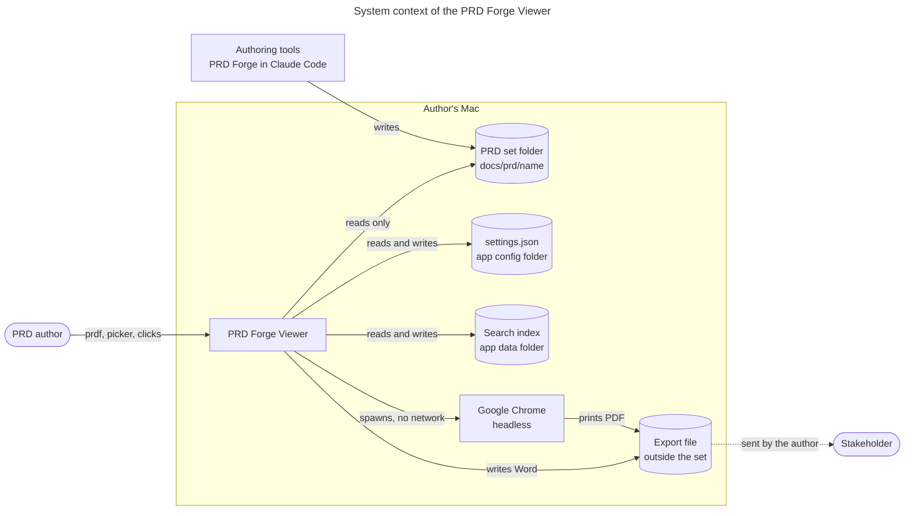

**How to read it.** Solid arrows are what happens on the Mac. The dotted arrow
is outside the system: the author sends the export by any means. The viewer has
no arrow into the set folder that writes.

**Trust boundaries.** The PRD set content is untrusted input. A body can hold
raw HTML, remote images, and links. The viewer treats it as data and sanitizes
it before display (section 22).

## 5. High-level architecture

### 5.1 Logical architecture

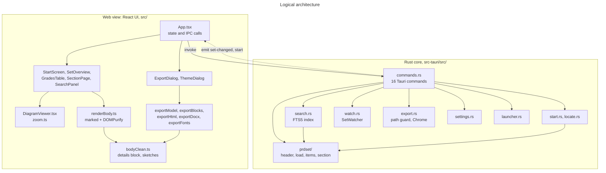

**How to read it.** Solid arrows are synchronous calls. The dotted arrow is an
asynchronous Tauri event. The UI never touches the file system. Every read and
write goes through a command in `commands.rs`.

The UI has two jobs that the Rust core does not do: Markdown rendering for the
screen, and building the export document (Markdown, then HTML or Word). Both
jobs start with the same body cleaner in `src/bodyClean.ts`, which has one
function for each job. `cleanForExport` drops each wireframe sketch whose
drawing the export has (`src/bodyClean.ts:11-12`). `cleanForView` keeps each
such sketch, hidden, so the screen can show it when the drawing fails to load
(`src/bodyClean.ts:18-19`). Both remove the details block. Rust
does the writes, because only Rust can check that a path is outside every known
set.

### 5.2 Runtime architecture

There is one process with one window (`main`). The single-instance plugin
sends a second launch to the open window as a `start` event
(`src-tauri/src/lib.rs:19-26`). Commands marked `#[tauri::command(async)]` run
on a worker thread, so a slow folder does not freeze the window
(`src-tauri/src/commands.rs:26-30`). `watch_set`, `themes`, `save_themes`, and
`print_page` are sync commands. They run on the main thread in call order. For
`watch_set`, the code depends on that order, so the last set opened is the one
watched (`src-tauri/src/commands.rs:149-164`).

Shared state lives in three Tauri managed values (`src-tauri/src/lib.rs:28-30`):

| State | Holds | Guard |
|-------|-------|-------|
| `StartArg` | The first launch path. `startup` takes it once. | `Mutex<Option<PathBuf>>` |
| `SearchState` | The open index and its set folder. | `Mutex<Option<(PathBuf, Index)>>` |
| `WatchState` | The watcher of the open set. | `Mutex<Option<SetWatcher>>` |

A headless Chrome child process runs only for the length of one PDF export.

### 5.3 Deployment architecture

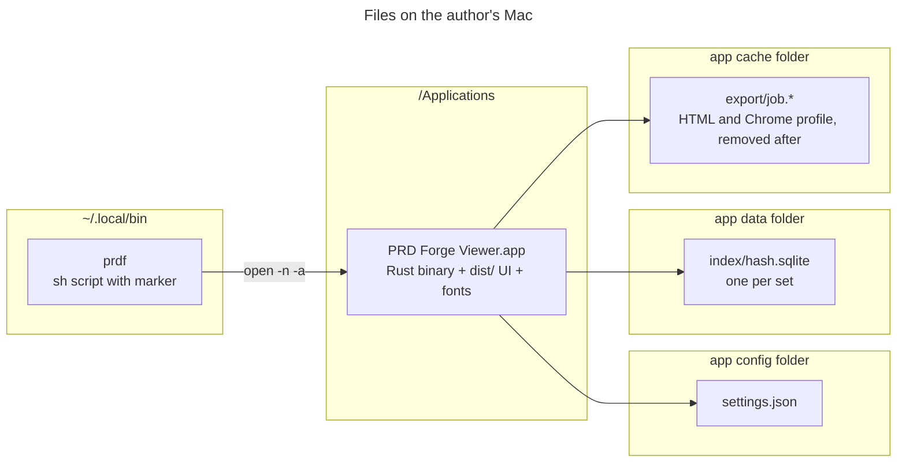

The bundle targets `app` and `dmg`, with a minimum macOS of 12.0
(`src-tauri/tauri.conf.json:25-37`). The app identifier is
`com.spillwave.prd-forge-viewer`, which sets the config, data, and cache
folder names (`src-tauri/tauri.conf.json:5`).

### 5.4 Data flow

1. Rust reads front matter and bodies from the set folder.
2. Rust sends typed values (`PrdSet`, `Section`, `ItemRef`, `Hit`) to the UI as
   JSON. `src/types.ts` mirrors them by hand.
3. The UI renders bodies to sanitized HTML.
4. For an export, the UI asks Rust for each section body, builds one Markdown
   document, and turns it into HTML or Word bytes.
5. The UI sends the HTML or base64 Word bytes back to Rust, which checks the
   path and writes the file.

## 6. Architectural decisions

The ADRs hold the full analysis. This section links them and records what the
build did.

| ADR | Decision | Status in the build |
|-----|----------|---------------------|
| ADR-001 | Tauri 2 desktop app with the Motion stack and plugins | **Confirmed.** Tauri 2.9, dialog and single-instance plugins, and an MCP bridge for tests only (`src-tauri/Cargo.toml:25-32`). |
| ADR-002 | Reuse Motion themes and Word writer. PDF from themed HTML. | **Confirmed.** `themes.ts`, `exportBlocks.ts`, `exportHtml.ts`, and `exportDocx.ts` are Motion copies. The print engine is headless Google Chrome, recorded in the ADR-002 implementation note of 2026-10-29. |
| ADR-003 | BM25 in a local SQLite FTS5 index, one cache file per set | **Confirmed.** `rusqlite` with the bundled SQLite (`src-tauri/Cargo.toml:21`), index at `index/<fnv>.sqlite` (`src-tauri/src/search.rs:36-38`). |
| ADR-004 | The app installs `prdf`. One settings file in the app config folder. | **Confirmed.** `src-tauri/src/launcher.rs:9-35`, `src-tauri/src/commands.rs:11-13`. |
| ADR-005 | OS file events with debounce and a polling fallback | **Confirmed, with a change.** The poll runs at all times, not only as a fallback (`src-tauri/src/watch.rs:80-88`). |

**Least privilege.** The window has only `core:default` and three dialog
permissions. There is no file system or network plugin
(`src-tauri/capabilities/default.json:1-7`). Every file access is a command
that the Rust core checks.

**Error handling strategy.** Commands return `Result<T, String>`. The string is
a sentence for the author, and the UI shows it in a `role="alert"` paragraph
(`src/App.tsx:196`). Derived data (the index) is rebuilt on any failure.
Settings fall back to empty on a broken file.

## 7. Component inventory

| Component | Type | Responsibility | Inputs | Outputs | Store | Failure impact |
|-----------|------|----------------|--------|---------|-------|----------------|
| `commands.rs` | Rust module | Tauri command surface | IPC args | JSON values | none | The UI action fails with a message. |
| `start.rs`, `locate.rs` | Rust module | Decide the start view | Launch path, settings | `StartView` | settings (read) | The author sees the welcome screen. |
| `prdset/` | Rust module | Parse front matter, items, bodies | Set folder | `PrdSet`, `Section`, `ItemRef` | set (read) | The document is marked unreadable. |
| `search.rs` | Rust module | Index and rank items | Set folder, term | `Hit` list | SQLite index | The index is rebuilt once, then the error shows. |
| `watch.rs` | Rust module | Report changed documents | Set folder | file names | none | "Live updates are off" shows. |
| `export.rs` | Rust module | Check export paths, write files, run Chrome | Path, bytes or HTML | File | export file, app cache | The export fails, an earlier file stays. |
| `settings.rs` | Rust module | Known locations, last set, themes | Changes | `settings.json` | settings | Empty settings. The viewer still starts. |
| `launcher.rs` | Rust module | Write `~/.local/bin/prdf` | Folder | Path | `prdf` | A foreign `prdf` is kept, with a message. |
| `App.tsx` | React component | App state, IPC, event listeners | Events, clicks | Views | none | Window-level. |
| `renderBody.ts` | TS module | Markdown to safe HTML | Body | HTML string | none | Fails closed to plain text. |
| `bodyClean.ts` | TS module | Remove the details block and each wireframe sketch that a drawing follows | Body Markdown | Body Markdown | none | A sketch or the details block shows. |
| `DiagramViewer.tsx`, `zoom.ts` | React component, TS module | Show one diagram with zoom and pan | Image `src` and alt text | Dialog | none | The diagram stays in the page at its fitted size. |
| Export pipeline | TS modules | Build and render the export | Set, sections, theme | HTML or Word bytes | none | The dialog shows "Not done". |

## 8. End-to-end workflows

### 8.1 Start and open a set

**Trigger.** App launch with or without a path, a second launch, or the
**Open PRD set** button.

**Main flow.**

1. `run()` stores the first launch argument in `StartArg`
   (`src-tauri/src/lib.rs:16`, `src-tauri/src/lib.rs:28`).
2. On mount, the UI calls `startup` (`src/App.tsx:116`).
3. `start_view` decides the view (section 9.1).
4. For `open`, the UI calls `open_set`. `open_and_remember` canonicalizes the
   folder, loads the set, and only on success records it in the settings
   (`src-tauri/src/commands.rs:16-24`).
5. A new `set.folder` triggers the effect that starts the watcher and loads the
   item index and the search categories (`src/App.tsx:43-54`).

**Failure flows.** A folder with no `prd.md` gives `No PRD set in <folder>`
(`src-tauri/src/prdset/load.rs:53`). A failed settings save prints to stderr
and the set still opens (`src-tauri/src/commands.rs:19-22`).

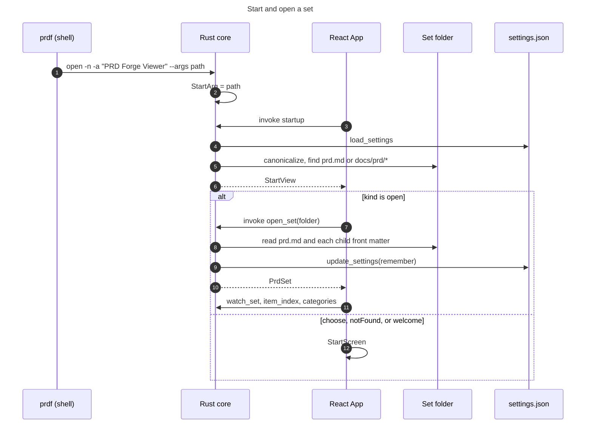

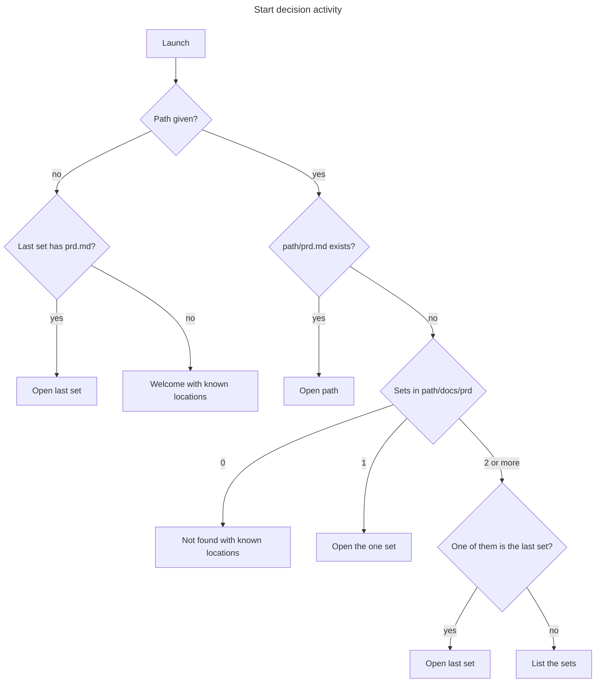

**Second launch.** `prdf` uses `open -n`, which starts a new process. The
single-instance plugin hands its argument to the first process, which computes
a new `StartView` and emits it as `start` (`src-tauri/src/lib.rs:19-26`). The
UI handles it with the same `showStart` function (`src/App.tsx:117`).

### 8.2 Read a section and follow a reference

1. The author clicks a document. `openDoc` calls `read_section`
   (`src/App.tsx:56-64`).
2. `read_section` refuses any file that the root does not list, then reads it
   through the `inside` path check (`src-tauri/src/prdset/section.rs:57-73`).
3. `SectionPage` renders the body once per section with `useMemo`, then loads
   each `img[data-asset]` through `read_asset` (`src/SectionPage.tsx:69-90`).
   Before Marked runs, `cleanForView` removes the details block and wraps each
   wireframe sketch that a drawing follows in a hidden `div[data-sketch]`
   (`src/renderBody.ts:52`). When a drawing fails to load, `SectionPage`
   removes `hidden` from the sketch just before it and shows
   `[image not found: ...]` in place of the image (`src/SectionPage.tsx:75-80`).
   Each local image renders as a `button.diagram` with its alt text as a
   caption (`src/renderBody.ts:13-17`).
4. An item button shows `ItemView`. Each known ID in a field is a button
   (`src/SectionPage.tsx:9-17`).
5. A click on an ID finds the file in the item index and opens it with that
   item selected (`src/App.tsx:65-68`).
6. A click on a diagram opens `DiagramViewer` with the image `src`, which is
   already a `data:` URL, and its alt text (`src/SectionPage.tsx:85-86`,
   `src/SectionPage.tsx:113`). Section 8.6 describes the window.

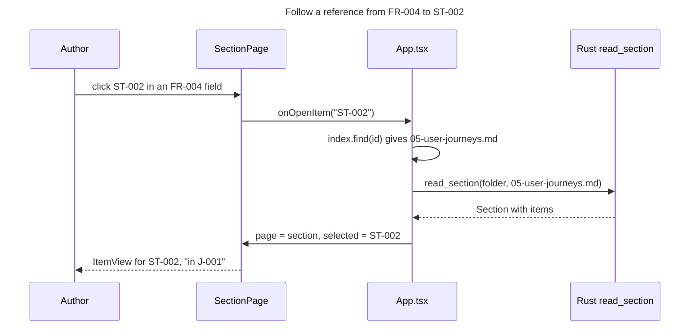

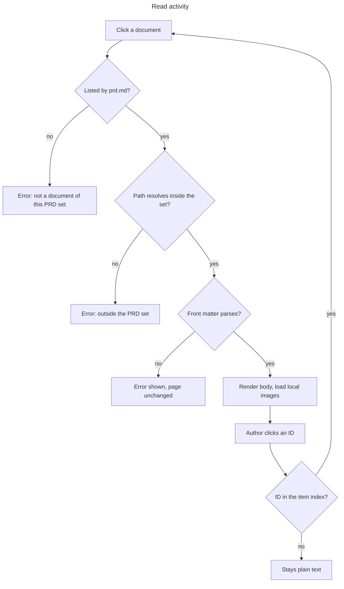

### 8.3 search

1. `SearchPanel` submits the term and category (`src/SearchPanel.tsx:37-47`).
2. `SearchState::with` opens the index for this set if needed, refreshes it,
   and runs the query. On any error it deletes the index, rebuilds it, and
   tries once more (`src-tauri/src/search.rs:179-197`).
3. `Index::search` ranks with `bm25(items, 50.0, 10.0, 1.0)` and scales scores
   so the best hit is 100 (`src-tauri/src/search.rs:138-160`).
4. A click on a hit opens its section with the item selected
   (`src/App.tsx:202`).

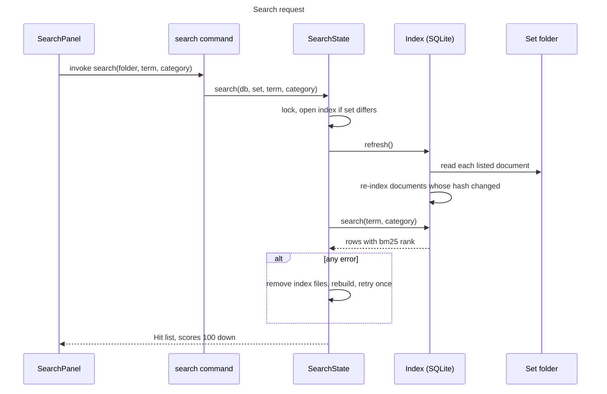

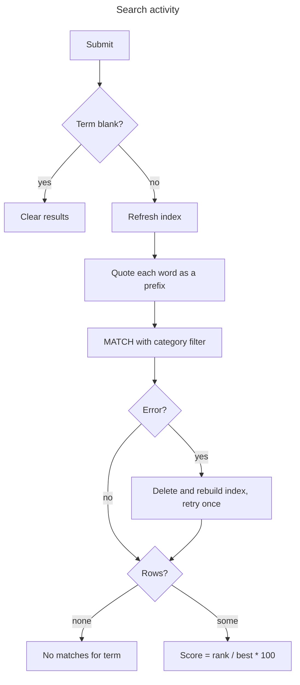

### 8.4 Live changes

1. `watch_set` drops the old watcher and starts a `SetWatcher` on the new
   folder (`src-tauri/src/commands.rs:152-164`).
2. The watcher passes on a top-level `.md` file only when its content hash
   differs from the last one passed on (`src-tauri/src/watch.rs:47-77`).
3. Rust emits `set-changed` with the folder and the file names
   (`src-tauri/src/commands.rs:159-161`).
4. The UI listener marks the files as changed, reloads the set and the item
   index, and reloads the open section if it changed
   (`src/App.tsx:90-112`). A sequence number drops stale replies
   (`src/App.tsx:95-97`).

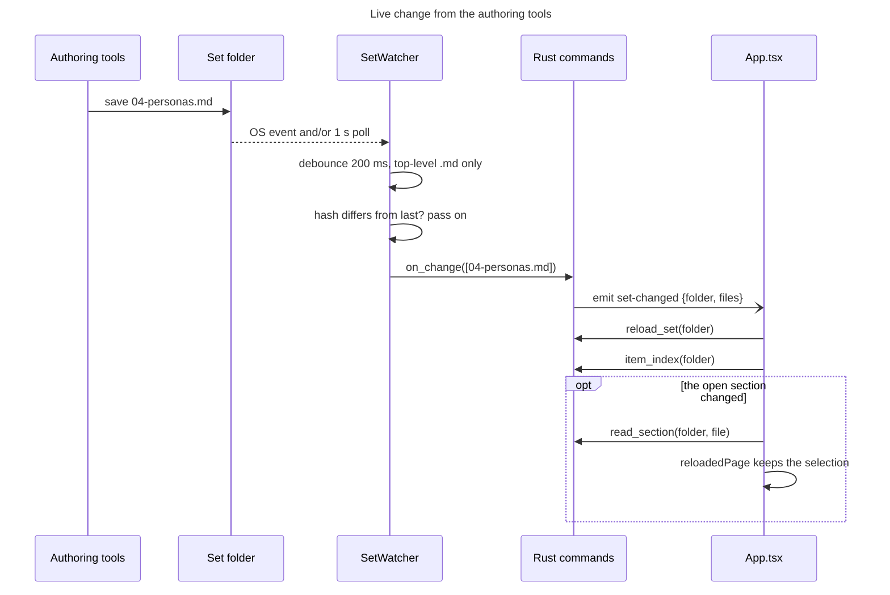

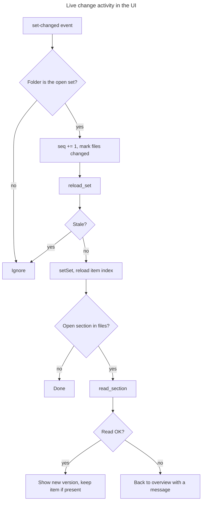

### 8.5 Export and print

1. `ExportDialog` collects the format, theme, sections, and the **Include
   grades** option, which is clear by default (`src/ExportDialog.tsx:9-94`,
   `src/ExportDialog.tsx:22`, `src/ExportDialog.tsx:84`). The dialog passes `{ grades }` as
   `ExportOptions`. `ExportOptions` also has `hasDrawing`, which the export
   run sets, not the dialog (`src/exportModel.ts:18`).
2. `runExport` asks for the save path first. Cancel returns `false`
   (`src/exportRun.ts:60-61`).
3. `collectBodies` reads every selected document that is not `pending`
   (`src/exportRun.ts:12-16`).
4. `loadImages` runs on the raw bodies, before `buildExport`, and finds each
   local image. For each one it calls the `export_image` command with the
   image path as written, usually an `.svg`. The result is a map from image
   path to `data:` URL. An image that cannot be read is not in the map
   (`src/exportRun.ts:36-40`, `src/exportRun.ts:51-57`). Section 9.7
   describes how `export_image` picks the PNG or the SVG.
5. `buildExport` writes one Markdown document: first page, contents table,
   then the sections in order (`src/exportModel.ts:20-43`). The contents
   table has Score and Blocking defects columns only when `options.grades` is
   true (`src/exportModel.ts:30-33`). Each section body goes through
   `cleanForExport` with `hasDrawing` set to "the image map has this path"
   (`src/exportModel.ts:40`, `src/exportRun.ts:55`). A wireframe sketch
   whose drawing is not in the map stays in the export, as `prd_export.py`
   does when the drawing file is missing.
6. For PDF, `renderThemedHtml` builds HTML with the fonts and images inlined, and Rust
   `export_pdf` prints it with headless Chrome
   (`src-tauri/src/export.rs:65-98`). For Word, `exportDocx` builds the bytes,
   and Rust `write_export` saves them (`src-tauri/src/export.rs:42-45`).
   Both writers draw an `image` block from the map, and use the alt text when
   the map has no entry (section 9.7).
7. Print puts the same HTML in a hidden `#print-root` and calls
   `window.print()` through `print_page` (`src/exportRun.ts:78-95`).

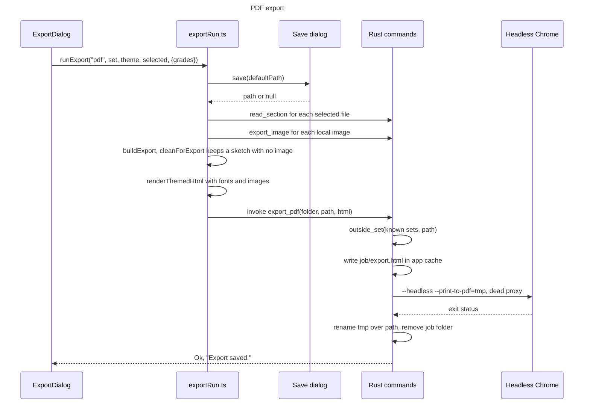

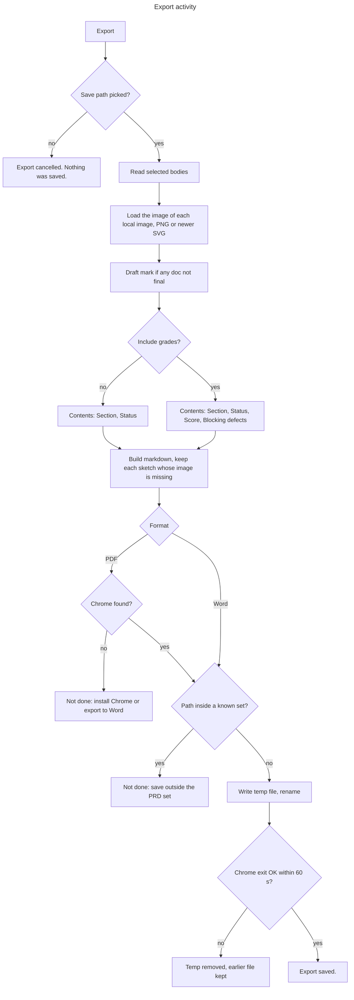

### 8.6 Open a diagram and zoom

1. `SectionPage` keeps the open diagram in state. A click inside a
   `[data-diagram]` button sets it to the image `src` and alt text
   (`src/SectionPage.tsx:67`, `src/SectionPage.tsx:85-86`).
2. `DiagramViewer` opens a native modal `<dialog>` and moves focus to the
   stage. On close, focus goes back to the element that had it
   (`src/DiagramViewer.tsx:15-20`).
3. When the image loads, `fit` computes the start view with `fitView`. An SVG
   with no natural size is treated as 1000 by 750 pixels
   (`src/DiagramViewer.tsx:23-27`).
4. The wheel, a pinch, the **+** and **-** buttons, and the `+`, `=`, `-`
   keys call `zoomAt`. A pinch arrives as a wheel event with `ctrlKey`, and
   it counts five times more per unit of `deltaY`
   (`src/DiagramViewer.tsx:28-38`).
5. A pointer drag and the arrow keys pan by changing `x` and `y`. The `0`
   key and **Fit** fit again (`src/DiagramViewer.tsx:39-56`).
6. Escape fires `cancel` on the dialog. The handler prevents the default
   close and calls `onClose`, so React owns the close
   (`src/DiagramViewer.tsx:59`).

The view is one CSS `transform` on the image: `translate(x, y)
scale(scale)` with the origin at the top left (`src/DiagramViewer.tsx:69-70`,
`src/styles.css:204`). No library is used.

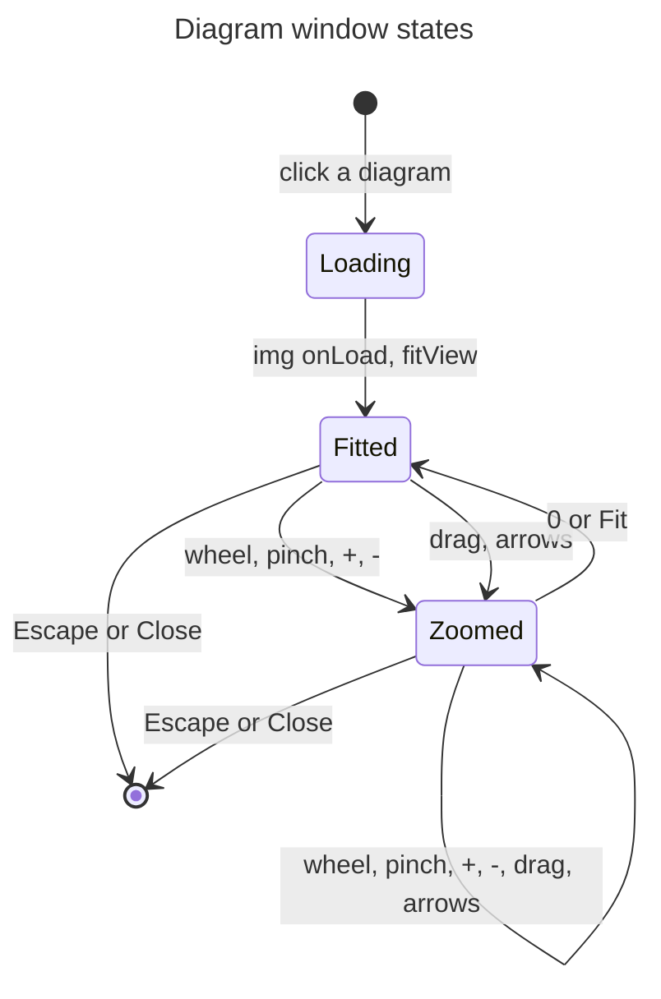

## 9. Complex business logic

### 9.1 Start view rules

`StartView` has four kinds: `Open`, `Choose`, `NotFound`, and `Welcome`
(`src-tauri/src/start.rs:10-15`). Paths are canonicalized before they are
compared, so `prdf .`, `../x`, and a symlinked folder match the saved last set
(`src-tauri/src/start.rs:23-26`).

| Path given | `path/prd.md` | Sets under `path/docs/prd` | Last set among them | View |
|------------|---------------|----------------------------|---------------------|------|
| no | n/a | n/a | last has `prd.md` | `Open` last |
| no | n/a | n/a | no last, or gone | `Welcome` |
| yes | yes | n/a | n/a | `Open` path |
| yes | no | 0 | n/a | `NotFound` |
| yes | no | 1 | n/a | `Open` that set |
| yes | no | 2 or more | yes | `Open` last |
| yes | no | 2 or more | no | `Choose` |

`find_sets` looks only at direct subfolders of `docs/prd` that hold a
`prd.md`, sorted by folder (`src-tauri/src/locate.rs:26-36`).

### 9.2 Item extraction

An item is any YAML mapping with an `id` of 1 to 4 uppercase letters, a dash,
and 3 digits. A mapping with `term` and `meaning` is a glossary item. A mapping
with `version` and `summary` is a change log item
(`src-tauri/src/prdset/items.rs:26-49`). The walk is recursive. A nested item
records the ID of the item that holds it as `parent`, so stage `ST-002` has
parent `J-001` (`src-tauri/src/prdset/items.rs:75-97`). The root `links` key
is skipped, because it names documents, not items
(`src-tauri/src/prdset/items.rs:100-113`).

The title comes from the first of 14 keys that exists, in a fixed order
(`src-tauri/src/prdset/items.rs:21-24`). A list of scalars reads as one line
joined with `, ` when no element has a space, and one element per line
otherwise (`src-tauri/src/prdset/items.rs:62-66`).

The UI uses the same ID shape to find references in text
(`src/SectionPage.tsx:6`).

### 9.3 Search ranking

| Rule | Code |
|------|------|
| Each word becomes a quoted prefix (`"word"*`), so FTS syntax in the term is plain text. | `src-tauri/src/search.rs:66-69` |
| Columns `id`, `title`, `text` weigh 50, 10, and 1. | `src-tauri/src/search.rs:143` |
| Field names are not indexed, and a field whose text equals the title is skipped. | `src-tauri/src/search.rs:109-110` |
| At most 200 hits, ordered by rank then row ID. | `src-tauri/src/search.rs:143-144` |
| Score = `|rank| / |best| * 100`, rounded and clamped to 0 to 100. | `src-tauri/src/search.rs:157-159` |

### 9.4 Draft mark

An export shows "Draft" when any document, the root included, is not `final`.
The reason names the count (`src/exportModel.ts:7-10`). A `pending` section
exports as "This section is not written yet." A section that cannot be read
exports as "This section cannot be read." (`src/exportModel.ts:35-41`). A
blocking defect never stops an export (TR-010). The export text never says
that the PRD is approved (TR-007).

### 9.5 Document status

The viewer does not change status. It shows the status from front matter, and
it adds one value of its own, `unreadable`, for a listed document whose front
matter fails to read (`src-tauri/src/prdset/load.rs:109-120`).

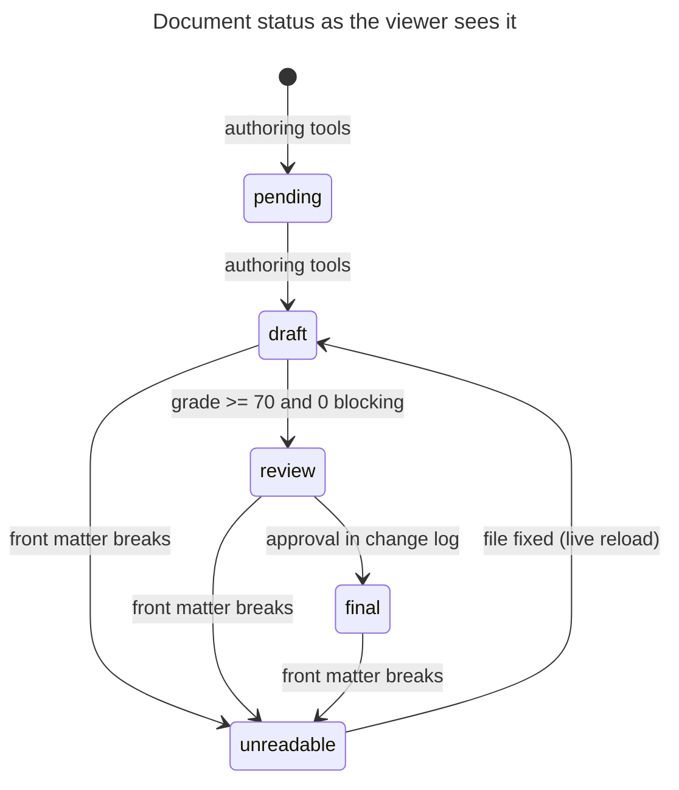

Only the authoring tools move a document between `pending`, `draft`, `review`,
and `final`. The viewer reads these values. The `unreadable` state exists only
in the viewer.

### 9.6 Body cleaning

`src/bodyClean.ts` follows the rules of the PRD Forge exporter
(`prd_export.py`), so the viewer and both exports hide the same parts of a
body (`src/bodyClean.ts:1-19`). It has two entry points:

- `cleanForExport(md, hasDrawing)` removes the details block, and removes each
  wireframe sketch whose drawing `hasDrawing` reports as present. The default
  `hasDrawing` returns `true` (`src/bodyClean.ts:11-12`).
- `cleanForView(md)` removes the details block, and wraps each such sketch in
  `<div class="sketch" data-sketch hidden>`. The blank lines inside the `div`
  keep the sketch a Markdown code block (`src/bodyClean.ts:18-19`).

| Part | Rule | Pattern |
|------|------|---------|
| Details block | Remove everything from `<!-- prd-forge:details -->` to `<!-- /prd-forge:details -->`. The block repeats the front matter. | `DETAILS` (`src/bodyClean.ts:6`) |
| Wireframe sketch | Match a fenced `wireframe` block only when the next non-blank line is an image line, and capture the image path. A sketch with no image line after it always stays. | `SKETCH` (`src/bodyClean.ts:8`) |

**Closed in 0.2.1.** In 0.2.0, the cleaner checked only the shape of the next
line, so a sketch followed by a link to a missing drawing was hidden. It now
matches `prd_export.py`, which keeps the sketch when the drawing file is
missing. The export passes `hasDrawing` from the image map
(`src/exportRun.ts:55`). The viewer cannot know in advance, so it renders the
sketch hidden and shows it when the image fails to load
(`src/SectionPage.tsx:75-80`). `src/interactive.test.tsx:61-73` covers the
viewer case.

### 9.7 Images in exports

| Rule | Code |
|------|------|
| A paragraph that holds only one image, with blank text around it, becomes an `image` block. An image inside other text is not a block, and exports as its alt text. | `src/exportBlocks.ts:57-62`, `src/exportBlocks.ts:149-151` |
| `loadImages` collects each image path with no URL scheme, passes it to the `asset` dependency unchanged (less a leading `./`), and drops any path that fails. In the app, `asset` calls `export_image`. | `src/exportRun.ts:36-40`, `src/App.tsx:135` |
| `export_image` reads the `.png` next to an `.svg`, as `prd_export.py` embeds. It reads the `.svg` itself when the PNG is missing or older than the SVG by more than 2 s. The slack covers a git checkout, which writes the pair in any order. Both reads go through `read_asset`, so the `inside` path check and the extension allow list apply. | `src-tauri/src/prdset/section.rs:103-116` |
| HTML draws a `figure.diagram` with a caption only when the map value starts with `data:image/`. Otherwise it writes the alt text, so nothing outside the set loads (NFR-010). | `src/exportHtml.ts:75-79` |
| A diagram in the HTML is at most the page width and 215 mm high, and does not break across pages. | `src/exportHtml.ts:50-52` |
| Word embeds a `data:image/png` or a `data:image/svg+xml` value. For a PNG, it reads the size from the `IHDR` chunk. For an SVG, `svgSize` reads the `viewBox`, or else `width` and `height`, or else 576 by 432. Either way it scales down, never up, to fit 6.0 by 8.0 inches at 96 pixels an inch. The alt text is the caption and the alt text of the image. | `src/exportDocx.ts:66-109` |
| An SVG is embedded with a 1 by 1 blank PNG as its fallback. Word 2016 and later draw the SVG; an older Word shows the blank PNG. | `src/exportDocx.ts:86-87`, `src/exportDocx.ts:96` |
| Without an image, Word writes the alt text in italics in the muted color. | `src/exportDocx.ts:91` |

## 10. Domain model

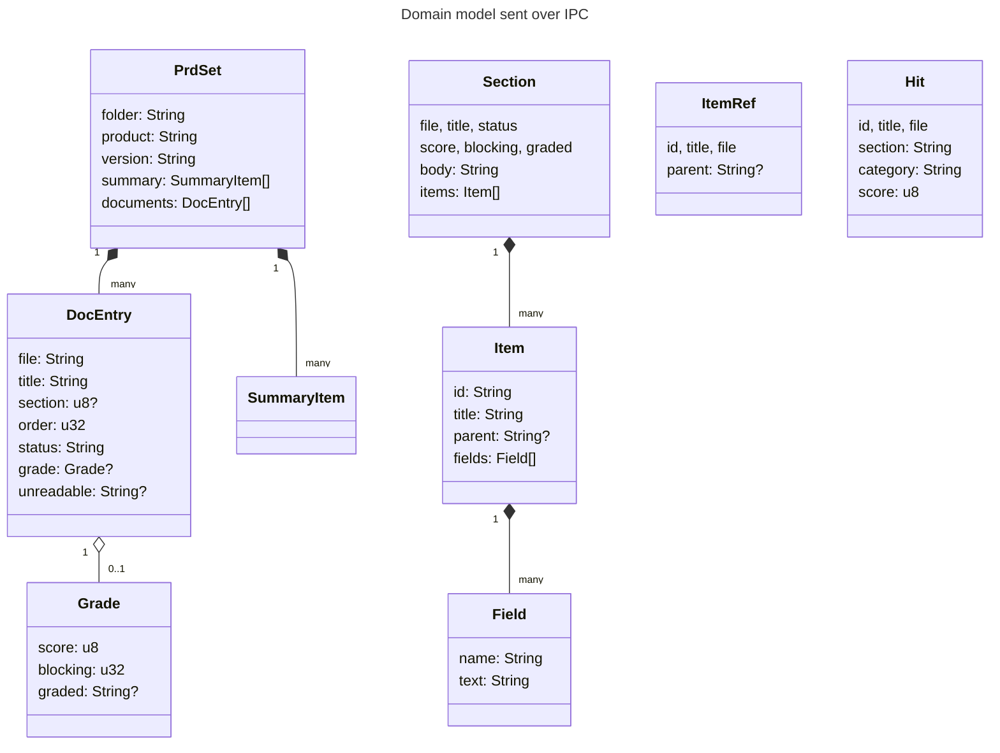

| Entity | Defined in | Notes |
|--------|------------|-------|
| `Header` | `src-tauri/src/prdset/header.rs:4-24` | Only the front matter fields the viewer shows. `graded` reads a YAML date as text. |
| `PrdSet`, `DocEntry`, `Grade` | `src-tauri/src/prdset/load.rs:7-42` | The root is always entry 0. Children sort by `order`. |
| `Section`, `ItemRef` | `src-tauri/src/prdset/section.rs:9-31` | Body is the Markdown after the front matter. |
| `Item`, `Field` | `src-tauri/src/prdset/items.rs:6-19` | Fields keep document order. |
| `Hit`, `Category` | `src-tauri/src/search.rs:11-27` | `Hit.section` holds the document title, not the section number. |
| `Settings` | `src-tauri/src/settings.rs:9-20` | Every field has `#[serde(default)]`. |
| `ExportTheme` | `src/themes.ts:9-29` | 13 colors and 2 fonts. |

**Invariant.** `src/types.ts` mirrors the Rust types by hand, with
`camelCase` names from `#[serde(rename_all = "camelCase")]`. No generator keeps
them in step. A Rust field rename breaks the UI with no compile error.

## 11. Module-by-module design

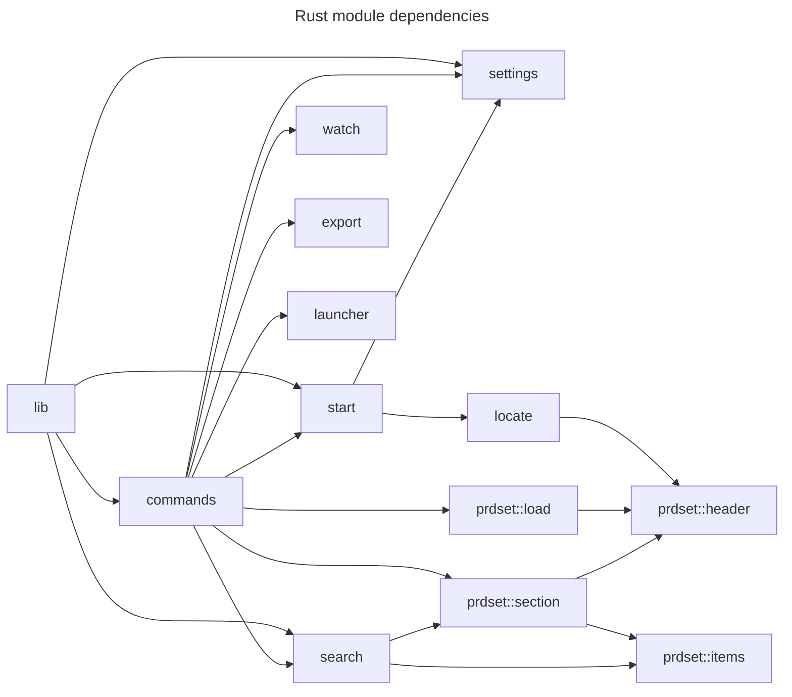

There are no circular dependencies. `export`, `watch`, and `launcher` depend
only on the standard library and their crates.

| Module | Public interface | Errors | Tests |
|--------|------------------|--------|-------|
| `prdset::header` | `split_front_matter`, `parse_header` | `None` or YAML error text | BOM, CRLF, bad YAML (`src-tauri/src/prdset/header.rs:66-115`) |
| `prdset::load` | `load_set` | `LoadError::NoRoot`, `UnreadableRoot` | `src-tauri/tests/load_set.rs` |
| `prdset::items` | `items_of` | none, bad YAML gives `[]` | Real PRD files (`src-tauri/src/prdset/items.rs:115-163`) |
| `prdset::section` | `read_section`, `item_index`, `read_asset`, `export_image`, crate-only `inside`, `read`, `listed` | Sentences for the author | Path escape tests (`src-tauri/src/prdset/section.rs:172-217`) |
| `search` | `Index`, `SearchState`, `index_path` | Rebuild once, then the error | 15 tests (`src-tauri/src/search.rs:208-373`) |
| `watch` | `SetWatcher::start`, `start_polling` | Start error text | 7 timing tests (`src-tauri/src/watch.rs:101-191`) |
| `export` | `outside_set`, `write_export`, `export_pdf`, `find_chrome`, `chrome_candidates` | Sentences for the author | 11 tests (`src-tauri/src/export.rs:110-209`) |
| `settings` | `load_settings`, `save_settings`, `update_settings`, `remember`, `set_themes` | `io::Result` | `src-tauri/src/settings.rs:70-162` |
| `launcher` | `launcher_script`, `install_launcher`, `MARKER` | Refuses a foreign `prdf` | `src-tauri/src/launcher.rs:37-113` |
| `start`, `locate` | `start_view`, `find_sets`, `set_ref` | none | `src-tauri/tests/start.rs` |

**Coupling notes.**

- The list of built-in theme IDs exists twice: `BUILTIN_THEMES` in
  `src-tauri/src/settings.rs:22` and in `src/themes.ts:72`. A new built-in
  theme needs both.
- The custom theme limit of 24 exists twice: `src/themes.ts:170` and
  `MAX_CUSTOM` in `src/ThemeDialog.tsx:20`.

## 12. Package-by-package design

| Package | Contents | May import | Must not import |
|---------|----------|------------|-----------------|
| `src-tauri/src/prdset/` | Front matter, set, item, section parsing | `serde`, `serde_yaml`, `base64` | `tauri`. The package is pure and testable without an app. |
| `src-tauri/src/` (other) | Commands, search, watch, export, settings, launcher | `prdset`, crates | The UI. |
| `src/` components | React views and dialogs | `types.ts`, helpers | `@tauri-apps/*`, except in `App.tsx`. |
| `src/` export modules | Model, blocks, HTML, Word, fonts, themes | `marked`, `docx`, `dompurify` | Tauri. `exportRun.ts` gets IPC through a `Deps` object (`src/exportRun.ts:42-49`). |
| `e2e/` | MCP-driven checks of the debug build | MCP SDK | Production code. |

**Confirmed.** Only `App.tsx` imports `@tauri-apps/api` and
`@tauri-apps/plugin-dialog` (`src/App.tsx:2-4`). Every other UI module takes
its effects as props or a `Deps` object, which is why the unit tests run in
Bun with no Tauri runtime.

## 13. Class-by-class design

### 13.1 `search::Index`

- **Responsibility.** The FTS5 index of one set (`src-tauri/src/search.rs:30-33`).
- **Schema.** `meta`, `docs(file, hash, kind, title)`, and the FTS5 table
  `items(id, title, text, file, kind, section)` with the `porter unicode61`
  tokenizer (`src-tauri/src/search.rs:45-52`).
- **`open(db, set)`.** Opens the file. When the `schema` row is not `"2"`, it
  deletes the file and its journals and creates a new one
  (`src-tauri/src/search.rs:73-87`).
- **`refresh()`.** In one transaction, re-indexes each listed document whose
  FNV-1a hash of front matter and body changed, and drops documents no longer
  listed. Returns the count re-indexed (`src-tauri/src/search.rs:90-135`).
- **`search(term, category)`.** See section 9.3.
- **`categories()`.** Document kinds that hold items, sorted in reading order
  (`src-tauri/src/search.rs:163-171`).
- **Concurrency.** `SearchState` holds the only `Index` behind a mutex.

### 13.2 `watch::SetWatcher`

- **Responsibility.** Report changed top-level documents of one set. Dropping
  it stops the watch (`src-tauri/src/watch.rs:11-15`).
- **`start(folder, on_change)`.** Starts an OS event watcher, if it can, and a
  1 s content-comparing poll watcher. Both feed one `only_new_content` filter
  (`src-tauri/src/watch.rs:82-88`).
- **Filter.** `changed_docs` keeps only files directly in the folder that end
  in `.md` and do not start with `.` (`src-tauri/src/watch.rs:19-28`).
  `only_new_content` keeps a hash of each file's last content, seeded from
  disk, so a second watcher that sees the same save passes nothing
  (`src-tauri/src/watch.rs:47-77`).

### 13.3 `export` functions

- **`outside_set(sets, path)`.** Requires a file name with `.pdf` or `.docx`.
  Canonicalizes the parent folder and refuses it when it is inside any known
  set (`src-tauri/src/export.rs:10-21`).
- **`replace(out, write)`.** Writes a unique hidden temp file next to `out` and
  renames it over `out`. A rename replaces a link at `out` and never writes
  through it (`src-tauri/src/export.rs:32-39`).
- **`export_pdf`.** Runs Chrome with a per-job profile, a dead proxy
  (`127.0.0.1:9`), and a 60 s limit, polled every 50 ms
  (`src-tauri/src/export.rs:65-98`).
- **`file_url`.** Percent-encodes every byte that is not a plain path
  character (`src-tauri/src/export.rs:102-108`).

### 13.4 `settings` functions

- **`update_settings(path, change)`.** Load, change, and save under one static
  mutex, so a theme save and a set open never lose each other's change
  (`src-tauri/src/settings.rs:50-56`).
- **`save_settings`.** Writes `settings.json.<pid>.<n>.tmp`, then renames
  (`src-tauri/src/settings.rs:38-46`).
- **`remember(s, folder)`.** Trims a trailing slash, moves the folder to the
  front of `known`, and sets `last` (`src-tauri/src/settings.rs:59-68`).
- **`set_themes`.** Drops any theme with a built-in ID and any selection that
  names no theme (`src-tauri/src/settings.rs:26-30`).

### 13.5 `App` (react)

- **State.** The open set, the page, the item index, categories, changed
  files, themes, dialogs, and messages (`src/App.tsx:26-37`).
- **Refs.** `current` gives the window-lifetime `set-changed` listener the
  latest set and page (`src/App.tsx:39-40`).
- **Effects.** Per set: watch, index, categories (`src/App.tsx:43-54`). Once:
  live listener (`src/App.tsx:90-112`), and themes, startup, and `start`
  listener (`src/App.tsx:114-121`).

### 13.6 `renderBody`

- Marked renderer rewrites: a local image becomes `img[data-asset]`, a remote
  image becomes its alt text, a `.md` link becomes a `data-doc` button, and any
  other link becomes text (`src/renderBody.ts:11-25`).
- DOMPurify with the HTML profile and extra forbidden tags and attributes, plus
  a hook that strips `src` and `href` from raw HTML
  (`src/renderBody.ts:27-56`).
- Without a working sanitizer, the body shows as plain text in `<pre>`
  (`src/renderBody.ts:38-42`).
- A local image renders as `button.diagram[data-diagram]` that holds the
  `img[data-asset]` and a caption span with the alt text. The button label is
  "Open diagram: " and the alt text (`src/renderBody.ts:13-17`).
- `cleanForView` runs on the Markdown before Marked parses it, so each
  wireframe sketch with a drawing after it renders as a hidden
  `div[data-sketch]` that holds a code block (`src/renderBody.ts:52`).

### 13.7 `DiagramViewer` and `zoom`

- **Responsibility.** Show one diagram in a modal dialog with zoom and pan
  (`src/DiagramViewer.tsx:7-8`).
- **State.** `view` is `{ scale, x, y }` or `null` before the image loads.
  While it is `null`, the image is hidden (`src/DiagramViewer.tsx:13`,
  `src/DiagramViewer.tsx:69-70`).
- **`fitView(image, box)`.** Scales the image to 95% of the stage, clamped to
  0.25 to 8, and centers it (`src/zoom.ts:10-13`).
- **`zoomAt(v, factor, px, py)`.** Clamps the scale to 0.25 to 8, and moves
  the offset so that the content point under `(px, py)` stays still
  (`src/zoom.ts:16-20`).
- **Constants.** `STEP` is 1.25 per button or key press. `PAN` is 40 pixels
  per arrow key (`src/DiagramViewer.tsx:4-5`).
- **Closed in 0.2.1.** `fitView` now applies `MIN_SCALE`, so a diagram more
  than about 3.8 times the stage size opens at 0.25 and the first zoom no
  longer jumps (`src/zoom.ts:11`, `src/zoom.test.ts:22-24`).

### 13.8 Visual design (`styles.css`)

- Color tokens on `:root`, with a dark set under `prefers-color-scheme: dark`
  (`src/styles.css:9-34`, `src/styles.css:35`).
- The bundled Source Sans 3, Source Serif 4, and Source Code Pro fonts load
  with `@font-face` from `public/fonts` (`src/styles.css:2-6`).
- The document list shows status as a colored left border, from the
  `data-status` attribute that `App.tsx` sets on each link
  (`src/styles.css:149-151`, `src/App.tsx:217`).
- A diagram in a body is at most 60% of the window height, with
  `object-fit: contain` (`src/styles.css:189`).

## 14. API design

The API is the set of Tauri commands registered in
`src-tauri/src/lib.rs:42-47`. All take named JSON arguments and return JSON or
an error string.

| Command | Args | Returns | Async | Writes |
|---------|------|---------|-------|--------|
| `open_set` | `path` | `PrdSet` | yes | settings |
| `startup` | none | `StartView` | yes | none |
| `start_for` | `path` | `StartView` | yes | none |
| `read_section` | `folder`, `file` | `Section` | yes | none |
| `item_index` | `folder` | `ItemRef[]` | yes | none |
| `read_asset` | `folder`, `rel` | data URL | yes | none |
| `export_image` | `folder`, `rel` | data URL of the PNG, or of the SVG when the PNG is older | yes | none |
| `search` | `folder`, `term`, `category` | `Hit[]` | yes | index |
| `categories` | `folder` | `Category[]` | yes | index |
| `watch_set` | `folder` or null | none | no | none |
| `reload_set` | `folder` | `PrdSet` | yes | none |
| `install_prdf` | none | message | yes | `~/.local/bin/prdf` |
| `themes` | none | `{themes, selected}` | no | none |
| `save_themes` | `themes`, `selected` | none | no | settings |
| `write_export` | `folder`, `path`, `data` (base64) | none | yes | export file |
| `export_pdf` | `folder`, `path`, `html` | none | yes | export file, app cache |
| `print_page` | none | none | no | none |

**Events from Rust.**

| Event | Payload | Emitted by |
|-------|---------|------------|
| `start` | `StartView` | Second launch (`src-tauri/src/lib.rs:22`) |
| `set-changed` | `{folder, files}` | Watcher (`src-tauri/src/commands.rs:160`) |

**Note.** `read_section`, `item_index`, `read_asset`, `export_image`, `search`, and
`reload_set` take the folder from the UI and do not check it against the known
sets. The path checks keep every read inside that folder, but the folder can
be any folder that the web view names. **Assumption.** This is acceptable
because only the app's own bundled UI can call commands.

## 15. Database design

There is one database: the SQLite search index. It is derived data.

| Property | Value |
|----------|-------|
| Engine | SQLite, bundled with `rusqlite` 0.32 |
| Location | `<app data>/index/<fnv-1a of folder>.sqlite` (`src-tauri/src/search.rs:36-38`) |
| Owner | `search.rs` only |
| Schema version | `meta.schema = "2"` (`src-tauri/src/search.rs:8`) |
| Migration | None. A different version deletes and rebuilds the file. |
| Transactions | One per `refresh()` (`src-tauri/src/search.rs:91`, `src-tauri/src/search.rs:133`) |
| Backup | None needed. |

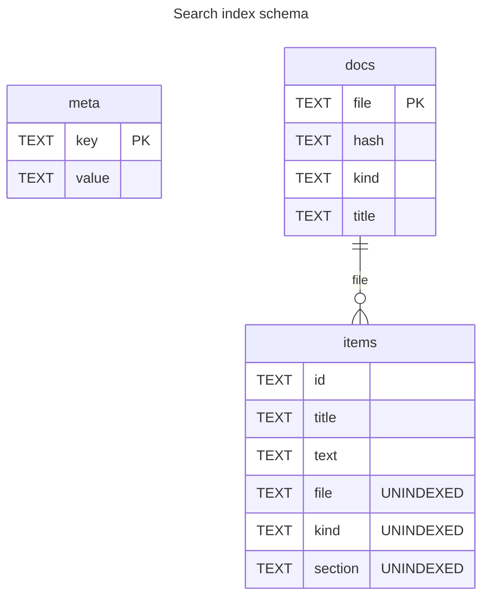

**Duplicate prevention.** `refresh()` deletes a document's items before it
inserts them again. `docs` uses `INSERT OR REPLACE`.

**Recovery.** Any error in a refresh or a query leads to delete, rebuild, and
one retry (`src-tauri/src/search.rs:189-196`). A damaged file and a dropped
table are both tested (`src-tauri/src/search.rs:288-296`,
`src-tauri/src/search.rs:341-353`).

**Settings file.** The other persistent store is `settings.json`, a single
JSON object (`src-tauri/src/settings.rs:9-20`). Example:

```json
{
  "known": ["/Users/me/project/docs/prd/prd-forge-viewer"],
  "last": "/Users/me/project/docs/prd/prd-forge-viewer",
  "themes": [{ "id": "acme", "name": "Acme", "accent": "#123456" }],
  "export_theme": "acme"
}
```

## 16. Cache design

There is no cache service. Two in-memory caches exist:

| Cache | Holds | Invalidation | Code |
|-------|-------|--------------|------|
| `SearchState` | The open `Index` | A search on another set replaces it. An error drops it. | `src-tauri/src/search.rs:176-197` |
| Export fonts | The five font files, about 1.6 MB | Once per window. A failed load is tried again next time. | `src/exportRun.ts:18-20` |

## 21. Event-driven and asynchronous processing

The only events are the Tauri `start` and `set-changed` events (section 14).
Delivery is in-process and best effort. The UI handles ordering with a
sequence number and a stale check (`src/App.tsx:91-97`). There is no queue,
retry, or dead-letter path. A missed event is covered by the next save or by
the 1 s poll.

## 22. Security design

The PRD set is untrusted input. The design goal is NFR-010: no script runs and
nothing remote loads.

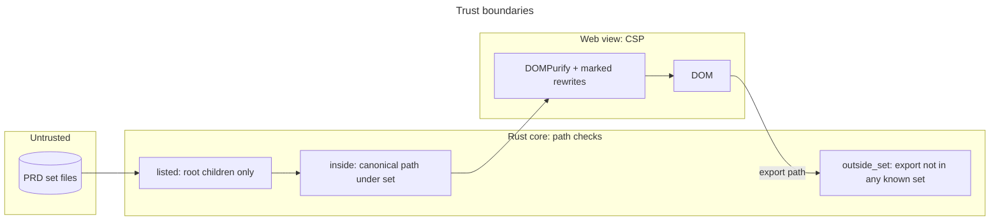

| Threat | Component | Mitigation | Residual risk |
|--------|-----------|------------|---------------|
| Script in a body | `renderBody` | DOMPurify, plus CSP `script-src 'self'` (`src-tauri/tauri.conf.json:21`) | Low |
| Remote image or link | `renderBody` | Rewritten to text. `img-src 'self' data:`. | Low |
| Remote image in an export | `loadImages`, `renderBlock` | Paths with a URL scheme are not loaded. HTML draws only a `data:image/` value (`src/exportRun.ts:37`, `src/exportHtml.ts:75-79`) | Low |
| `../` or symlink in a child path | `section::inside` | Canonical path must start with the set root (`src-tauri/src/prdset/section.rs:35-39`) | Low |
| Image read of a non-image file | `read_asset` | Extension allow list: svg, png, jpg, gif (`src-tauri/src/prdset/section.rs:89-95`) | An SVG is loaded as a data URL in an `img`, where scripts do not run. |
| Export overwrites a set file | `outside_set` | Refuses the open set, every known set, and the last set (`src-tauri/src/commands.rs:126-129`) | A set never opened is not known. |
| Export through a symlink or hard link | `replace` | Temp file and rename (`src-tauri/src/export.rs:32-39`) | Low |
| Chrome fetches remote content | `export_pdf` | Dead proxy, no background networking (`src-tauri/src/export.rs:74-75`) | Low |
| `prdf` replaces another tool | `install_launcher` | Marker line required. A symlink, binary, or foreign script is kept (`src-tauri/src/launcher.rs:24-30`) | Low |
| Test bridge in a release | `lib.rs` | MCP bridge only with `--features mcp-bridge`, bound to 127.0.0.1 (`src-tauri/src/lib.rs:35-39`) | Low |

There is no authentication, no secret, and no network service.

## 23. Error handling and resilience

| Class | Example | Behavior |
|-------|---------|----------|
| Validation | Export path inside a set | Error sentence. Nothing written. |
| Input data | Bad front matter in a section | Document marked `unreadable` with the reason. The set still opens. |
| Input data | Bad root `prd.md` | `The root document prd.md cannot be read: ...` |
| Derived data | Broken index | Delete, rebuild, retry once. |
| Local config | Broken `settings.json` | Empty settings. The viewer starts. |
| External tool | Chrome missing or slow | Clear message. 60 s limit. Earlier file kept. |
| Event source | OS events stop | The 1 s poll still runs. |

Each user-facing error is a full sentence that says what to do. No error is
retried except the index rebuild.

## 24. Performance and scalability

A PRD set is about 18 files. The main costs and their controls:

- **Open.** Only front matter is parsed for the overview. Bodies load per
  section.
- **Search.** The index refreshes on every search, but only changed documents
  are re-indexed, by content hash. The unit test runs 20 searches, each under
  500 ms (`src-tauri/src/search.rs:311-322`).
- **Live.** 200 ms debounce (`src-tauri/src/watch.rs:9`) and a 1 s poll.
- **Export.** Fonts load once. Each section body is read in parallel with
  `Promise.all` (`src/exportRun.ts:14`).

**Likely bottleneck.** `categories()` runs one query per category and listed
file while sorting (`src-tauri/src/search.rs:167-169`). With 18 files this is
not measurable. **Recommendation.** Leave it until a set is much larger.

## 25. observability

The app has no logging framework, metrics, or tracing. The only diagnostic
output is one `eprintln!` when the settings save fails
(`src-tauri/src/commands.rs:20-21`). Errors reach the author as UI messages.
The e2e checks save a screenshot per check to `e2e/shots/`
(`e2e/harness.mjs:77`).

## 26. Configuration and secrets

| Item | Where | Default |
|------|-------|---------|
| Window size, CSP, bundle | `src-tauri/tauri.conf.json` | 1200 x 800, minimum 720 x 480 |
| Test build overrides | `src-tauri/tauri.mcp.conf.json` | Adds `withGlobalTauri`, loosens `script-src` for the bridge |
| E2E hooks | `__PFV_E2E__` define in `scripts/build.ts:17` | `false` in a release build |
| User settings | `settings.json` in the app config folder | Empty |

There are no secrets.

## 27. Deployment architecture

- **Build.** `bun run build` bundles `src/main.tsx` into `dist/` and copies
  `public/` (the fonts) (`scripts/build.ts:8-46`). `tauri build` makes the
  `.app` and `.dmg`.
- **App icon.** The source is `src-tauri/icons/source/icon.svg`: a PRD page on
  a slate tile with the four status marks in its margin. `tauri icon` makes
  every size in `src-tauri/icons/` from it, and `src-tauri/tauri.conf.json:28-34`
  lists the sizes that the bundle uses. Edit the SVG, not the PNG files.
- **Install.** The author copies the app to `/Applications` and selects
  **Install prdf command**, which writes `~/.local/bin/prdf` after a confirm
  dialog (`src/App.tsx:142-145`).
- **Rollback.** Install the earlier `.app`. The settings file format is
  backward compatible: a plan 2 file with no themes loads
  (`src-tauri/src/settings.rs:120-129`).

There is no CI pipeline in the repository at this tag. **Open question.**
Should the unit tests and the e2e checks run in CI?

## 28. Testing strategy

| Layer | Runner | Location | What it covers |
|-------|--------|----------|----------------|
| Rust unit | `cargo test` | `#[cfg(test)]` in each module | Parsing, path checks, search ranking, watcher timing, export guards, settings |
| Rust integration | `cargo test` | `src-tauri/tests/` | `load_set`, start rules, config |
| UI unit | `bun test src` | `src/*.test.ts(x)` | Components with `renderToStaticMarkup`, sanitizer with JSDOM, export model and writers, body cleaning (`src/bodyClean.test.ts`), export images (`src/exportImages.test.ts`), zoom math (`src/zoom.test.ts`) |
| UI interactive | `bun test src` | `src/interactive.test.tsx` | React renders into a JSDOM document and the tests send real DOM events: the diagram window fits, zooms, pans, and closes, and a hidden sketch shows when its drawing fails to load (`src/interactive.test.tsx:28-59`, `src/interactive.test.tsx:61-73`) |
| End to end | `bun run test:e2e` | `e2e/checks/*.mjs` | The debug build driven through the Tauri MCP bridge |

Many Rust tests read the real PRD set in `docs/prd/prd-forge-viewer/`, so a
change to the PRD can break a test. Example:
`reads_functional_requirements` expects 25 `FR-` items
(`src-tauri/src/prdset/section.rs:127-133`).

The e2e `waitText` helper polls `document.body.innerText` every 150 ms with
short scripts, in place of one long `webview_wait_for` call, which can time
out while the web view is busy (`e2e/harness.mjs:39-45`).

The e2e harness moves the author's real settings file aside and restores it
after the run (`e2e/harness.mjs:84-95`). It needs macOS, the debug build with
`--features mcp-bridge`, and System Events access for real key presses
(`e2e/harness.mjs:48-51`).

## 29. Local development

1. Install Rust 1.77.2 or later, Bun, and Google Chrome.
2. Run `bun install`.
3. Run `bun run tauri dev` for the app, or `bun run tauri:mcp` for the app with
   the MCP bridge.
4. Run `bun test src` and `cargo test --manifest-path src-tauri/Cargo.toml`.
5. Run `bun run test:e2e` for the e2e checks. A viewer that is already open is
   quit first (`e2e/harness.mjs:80-83`).

## 30. Operations and support

| Symptom | Likely cause | Fix |
|---------|--------------|-----|
| Search results look wrong | Stale or damaged index | Delete `<app data>/index/`. The next search rebuilds it. |
| "PDF export needs Google Chrome" | Chrome not in `/Applications` or `~/Applications` | Install Chrome, or export to Word. |
| "Live updates are off" | Watcher failed to start | Reopen the set. |
| Viewer forgets known locations | Settings save failed | Check the stderr line and folder permissions. |
| `prdf` not found | `~/.local/bin` not on `PATH` | The install message says so. Add it to `PATH`. |

## 31. Risks, tradeoffs, and technical debt

| Item | Area | Probability | Impact | Mitigation |
|------|------|-------------|--------|------------|
| PDF depends on an installed Chrome | Export | Medium | PDF unavailable | Word still works. Bundling Chromium is open (ADR-002). |
| `src/types.ts` mirrors Rust by hand | IPC | Medium | Silent UI break | **Recommendation.** Generate types, or add a contract test. |
| Index path hashes the folder string, not a canonical path | Search | Low | Two index files for one set | `open_set` canonicalizes first (`src-tauri/src/commands.rs:17`). |
| Built-in theme IDs and the limit of 24 are duplicated | Themes | Low | Drift | Keep both in step, or pass them from one side. |
| `frontmatter.ts` comments describe a Motion editor | Export | Low | Confusion | **Recommendation.** Edit the comment. |
| Many tests read the real PRD | Tests | Medium | Test breaks on PRD edits | Use fixtures for counts that the PRD can change. |
| NFR-009 screen reader count not measured | Export | Medium | Accessibility claim unproven | ADR-002 note records it. Run a PDF checker. |
| The body cleaner copies the `prd_export.py` rules by hand | Viewer, export | Medium | The viewer and the PRD Forge export differ after a PRD Forge change | Compare with `prd_export.py` at each PRD Forge release. |
| Exports embed the PNG of each SVG, the viewer shows the SVG | Export | Low | A stale PNG exports an old drawing | **Closed in 0.2.1.** `export_image` uses the SVG when the PNG is older (section 9.7). |
| An SVG in a Word file shows a blank fallback in a Word older than 2016 | Export | Low | The diagram is missing in an old Word | Only when the PNG is stale. Run `prd-diagrams.mjs` before an export. |
| `fitView` does not clamp to `MIN_SCALE` | Diagram window | None | None | **Closed in 0.2.1.** `fitView` clamps (`src/zoom.ts:11`). |

## 32. Implementation plan (extension roadmap)

1. **FR-025, grade findings (REL-002).** Read `grades/<file>` through the
   `inside` check, add a command, and open it from the grades table.
2. **FR-006, previous and next.** Use `set.documents` order in `SectionPage`.
3. **Contract test** between `src/types.ts` and the Rust types.
4. **CI** for `cargo test` and `bun test src`.
5. **Bundled Chromium** if Chrome as a prerequisite is a problem for authors.

## 33. Requirement-to-design traceability

| Requirement | Workflow | Module | Store | Command | Test |
|-------------|----------|--------|-------|---------|------|
| FR-001 | 8.1 | `prdset::load` | set | `open_set` | `e2e/checks/plans-1-2.mjs` |
| FR-002 | 8.1 | `start` | settings | `startup` | `src-tauri/tests/start.rs` |
| FR-003 | 8.1 | `prdset::load` | set | `open_set`, `reload_set` | `reload_reads_the_set_again` |
| FR-004 | 8.2 | `GradesTable` | set | `open_set` | `src/GradesTable.test.tsx` |
| FR-005, FR-023 | 8.2 | `prdset::section`, `SectionPage` | set | `read_section` | `e2e/checks/phase-1-reading.mjs` |
| FR-007 | 8.2 | `prdset::section`, `linkify` | set | `item_index` | `index_finds_requirement_and_nested_stage` |
| FR-008 | 8.3 | `search` | index | `search`, `categories` | `e2e/checks/phase-2-search.mjs` |
| FR-009 | 8.4 | `watch`, `App` | none | `watch_set`, `reload_set` | `e2e/checks/phase-3-live.mjs` |
| FR-010 to FR-014, FR-019 | 8.5 | export pipeline, `export` | export file | `export_pdf`, `write_export`, `print_page`, `export_image` | `e2e/checks/phase-5-export.mjs`, `src/exportImages.test.ts`, `export_image_uses_the_png_unless_it_is_older_than_the_svg` |
| FR-019 (grades optional) | 8.5 | `ExportDialog`, `buildExport` | none | none | `fr_019_grades_are_left_out_by_default` |
| FR-005 (diagrams) | 8.2, 8.6 | `bodyClean`, `renderBody`, `DiagramViewer`, `zoom` | set | `read_asset` | `e2e/checks/phase-1-reading.mjs`, `src/bodyClean.test.ts`, `src/zoom.test.ts`, `src/interactive.test.tsx` |
| FR-015 to FR-018, FR-020 | 8.5 | `themes`, `ThemeDialog`, `settings` | settings | `themes`, `save_themes` | `e2e/checks/phase-4-themes.mjs` |
| FR-021 | 8.1 | `launcher` | `prdf` | `install_prdf` | `relative_path_made_absolute` |
| FR-022, FR-024 | 8.1 | `start`, `locate` | settings | `start_for` | `e2e/checks/plans-1-2.mjs` |
| NFR-010 | 8.2 | `renderBody`, `section` | none | `read_asset` | `src/renderBody.test.ts` |
| OUT-001 | 8.5 | `export` | none | `write_export`, `export_pdf` | `a_path_in_the_set_is_refused` |

## 34. Open questions and decisions needed

| Question | Why it matters | Options | Owner |
|----------|----------------|---------|-------|
| Bundle Chromium for PDF? | Authors without Chrome cannot make a PDF. | Keep Chrome as a prerequisite, or bundle. | Engineering lead |
| Add CI? | Tests run only on a developer's Mac. | GitHub Actions macOS runner, or keep local. | Engineering lead |
| Check the `folder` argument against known sets? | Defense in depth for read commands. | Add a check, or rely on the bundled UI. | Engineering lead |

## 35. appendices

### Diagram index

| Section | Diagram |
|---------|---------|
| 4 | System context |
| 5.1 | Logical architecture |
| 5.3 | Files on the author's Mac |
| 8.1 | Start and open a set, start decision |
| 8.2 | Follow a reference, read activity |
| 8.3 | Search request, search activity |
| 8.4 | Live change sequence and activity |
| 8.5 | PDF export, export activity |
| 8.6 | Diagram window states |
| 9.5 | Document status |
| 10 | Domain model |
| 11 | Rust module dependencies |
| 15 | Search index schema |
| 22 | Trust boundaries |

### Omitted sections

- **17. MCP server integration.** The app uses no MCP server at run time. The
  MCP bridge is a test-only feature, covered in sections 22 and 28.
- **18. AI endpoint design.** The app calls no AI model.
- **19. Managed AI platform integration.** No managed AI platform exists.
- **20. External service integrations.** No network service exists. Chrome is
  a local process, covered in sections 8.5 and 13.3.

## Summary for decision makers

1. **Top architectural risks.** PDF export needs an installed Chrome. The IPC
   types are mirrored by hand. The body cleaner and the image rules copy the
   PRD Forge exporter by hand, so a PRD Forge change can make the two
   exports differ.
2. **Immediate decisions.** None block release 1. Section 34 lists the open
   ones.
3. **Recommended order.** FR-025, then FR-006, then a type contract test and
   CI.
4. **Information still needed.** The NFR-009 screen reader checker count.
