# User journeys

J-001 is the golden thread: the one journey that release 1 must deliver end to
end.

| ID | Persona | Goal | Stages | Golden thread |
| --- | --- | --- | --- | --- |
| J-001 | PER-001 PRD author | Stakeholders read the PRD and the author has their feedback | ST-001 to ST-007 | Yes |
| J-003 | PER-004 Product sponsor | The sponsor approves or rejects a version | ST-011 to ST-012 | No |
| J-002 | PER-002 Developer with the authoring tools | The developer has the items for the current work and shares them | ST-008 to ST-010 | No |

## J-001. The author sends a reviewed PRD to stakeholders

Trigger: the authoring tools finish or regrade sections, and the author wants to
send a version for review.

| Stage | Actor | Decision |
| --- | --- | --- |
| ST-001. Open the PRD | PRD author | Is this the correct PRD and version? |
| ST-002. Check the grades | PRD author | Which sections must be fixed first? |
| ST-003. Go to a weak section | PRD author | Fix it now, or send it as a draft? |
| ST-004. Fix the section | PRD author, in the authoring tools | Is the section good enough to send? |
| ST-005. Export the PRD | PRD author | Which format, theme, and sections? |
| ST-006. Send the export | PRD author | Who receives this version? |
| ST-007. Read and respond | Sponsor, engineering lead, developers | Approve or reject, and comment |

The author fixes sections in the authoring tools, not in the viewer. The viewer
shows the change without any action from the author. ST-006 and ST-007 happen outside the
viewer.

End state: each stakeholder has read the version, and the author has the comments
and the sponsor's decision.

## J-002. A developer finds and shares the items for the current work

Trigger: the developer starts work on a part of the product.

| Stage | Actor | Decision |
| --- | --- | --- |
| ST-008. Open the PRD | Developer with the authoring tools | Is this the correct PRD and version? |
| ST-009. Search for the work | Developer with the authoring tools | Which items apply to the current work? |
| ST-010. Share the items | Developer with the authoring tools | Which sections does the team need? |

End state: the developer has the items for the current work, and the team has a
file with those items.

## J-003. The sponsor approves or rejects a version

Trigger: the sponsor receives an export of a PRD version.

| Stage | Actor | Decision |
| --- | --- | --- |
| ST-011. Read the export | Product sponsor | Is there enough here to decide? |
| ST-012. Decide and reply | Product sponsor | Approve or reject this version |

End state: the author has the sponsor's decision and its reason. Both stages
happen outside the viewer. The export must carry what the sponsor needs
(FR-014, FR-019).

<!-- prd-forge:details -->

## Details

Every item in this document, with each of its fields.

### J-001

**Goal:** Stakeholders have a version of the PRD they can read without the tools, and the author has their feedback.

**Persona:** PER-001

**Trigger:** The authoring tools finish or regrade one or more sections, and the author wants to send a version for review.

**Golden thread:** yes

**Pain points:**

- The PRD is 18 files, so finding one section or item takes a search (P-001).
- The grades and gaps are in 17 separate files (P-003).
- Readers without the tools cannot read the files (P-002).
- While the authoring tools change a section, the author cannot be sure that the view is current.
- A reader of a draft cannot tell that it is a draft.

**Needs:**

- One view of the whole PRD, with direct access to each section and a search for items.
- One view of the grades, blocking defects, and gaps of all sections.
- An export in a format that a reader opens without the tools, in a theme the author selects.
- The view shows each change to a section without any action from the author.
- The export shows the version and the status of the PRD and of each section.

**End state:** Each stakeholder has read the version, and the author has the comments and the sponsor's decision.

**Stages**

#### ST-001

**Name:** Open the PRD

**Actor:** PRD author (PER-001)

**Steps:**

1. The author opens the PRD set.
2. The author sees the product name, the version, the executive summary, and the status of every section.

**Inputs:** The PRD set

**Outputs:** The whole PRD, with the status of every section

**Acceptance:**

1. Given a PRD set with 18 documents, when the author opens it, then the author sees the product name, the version, and the status of every document in order.

**Decision:** Is this the correct PRD and version?

#### ST-002

**Name:** Check the grades

**Actor:** PRD author (PER-001)

**Steps:**

1. The author sees the score, the count of blocking defects, and the grade date for each section.
2. The author sees which sections are pending, draft, review, or final.

**Inputs:** The grades that the authoring tools recorded

**Outputs:** A list of the sections that are weak or not started

**Acceptance:**

1. Given a set with graded and ungraded sections, when the author checks the grades, then the author sees the score, blocking count, and grade date of each graded section, and which sections are not graded.

**Decision:** Which sections must be fixed before anyone else reads the PRD?

#### ST-003

**Name:** Go to a weak section

**Actor:** PRD author (PER-001)

**Steps:**

1. The author goes directly to a section, or searches for an item such as a requirement or a scenario.
2. The author reads the section and sees its status, score, and count of blocking defects.

**Inputs:** A section name, or a search term and a category

**Outputs:** The section or the item, with its status and grade

**Acceptance:**

1. Given a weak section, when the author selects it or searches for one of its items, then the author reads it with its status, score, and blocking count.

**Decision:** Fix the section now, or send the PRD as a draft?

#### ST-004

**Name:** Fix the section

**Actor:** PRD author (PER-001)

**Steps:**

1. The author fixes the section in the authoring tools, outside the viewer.
2. The author sees the changed section and its new grade in the viewer, without any action in the viewer.

**Inputs:** The author's answers to the wizard

**Outputs:** The changed section, with its new grade

**Acceptance:**

1. Given the author reads a section in the viewer, when the authoring tools save a new version of it, then the author sees the new text and grade without any action.

**Decision:** Is the section good enough to send?

#### ST-005

**Name:** Export the PRD

**Actor:** PRD author (PER-001)

**Steps:**

1. The author selects a document format that the readers open without the authoring tools.
2. The author selects an export theme.
3. The author selects the whole PRD or some sections.
4. The author saves or prints the export.

**Inputs:** The format, the theme, and the sections

**Outputs:** One file that a reader can open without the tools, or a printed copy

**Acceptance:**

1. Given the author selects a format, a theme, and some sections, when the author exports, then the author has one file with only those sections, in that theme, that a reader opens without the authoring tools.

**Decision:** Which format, theme, and sections do these readers need?

#### ST-006

**Name:** Send the export

**Actor:** PRD author (PER-001)

**Steps:**

1. The author sends the file to the stakeholders, outside the viewer.

**Inputs:** The exported file

**Outputs:** The stakeholders have the file

**Acceptance:**

1. Given an exported file, when the author sends it, then each chosen stakeholder has the file.

**Decision:** Who receives this version?

**Handoff:** Product sponsor (PER-004), engineering lead (PER-003), and developers (PER-005)

#### ST-007

**Name:** Read and respond

**Actor:** Product sponsor (PER-004), engineering lead (PER-003), and developers (PER-005)

**Steps:**

1. Each reader opens the file and sees the version, and sees if it is a draft.
2. The engineering lead and the developers reply with comments.
3. The sponsor approves or rejects the version.

**Inputs:** The exported file

**Outputs:** Comments, and the sponsor's approval or rejection

**Acceptance:**

1. Given a stakeholder has the file, when the stakeholder opens it, then the stakeholder sees the version and if it is a draft, and can reply with comments or a decision.

**Decision:** The sponsor approves or rejects. The engineering lead decides if the team can build from it.

**Handoff:** PRD author (PER-001), who receives the feedback

### J-002

**Goal:** The developer has the sections and items for the current work, such as requirements, journeys, and scenarios, and can share those sections with the team.

**Persona:** PER-002

**Trigger:** The developer starts work on a part of the product.

**Pain points:**

- Finding one requirement or scenario in 18 files takes a search (P-001).
- The team needs only the sections for the current work, not the whole PRD.

**Needs:**

- A search by term and category, with the best matches first.
- An export of selected sections only.

**End state:** The developer has the items for the current work, and the team has a file with the sections that hold those items.

**Stages**

#### ST-008

**Name:** Open the PRD

**Actor:** Developer who uses the authoring tools (PER-002)

**Steps:**

1. The developer opens the PRD set and sees the list of sections.

**Inputs:** The PRD set

**Outputs:** The whole PRD

**Acceptance:**

1. Given a PRD set, when the developer opens it, then the developer sees the version and the list of sections.

**Decision:** Is this the correct PRD and version?

#### ST-009

**Name:** Search for the work

**Actor:** Developer who uses the authoring tools (PER-002)

**Steps:**

1. The developer enters a search term and selects a category, such as requirements, journeys, or scenarios, or all.
2. The developer sees the best matches first, each with its section and id.
3. The developer opens a match and follows its links to related items.

**Inputs:** A search term and a category

**Outputs:** The matching items, best match first

**Acceptance:**

1. Given a search term and a category, when the developer searches, then the developer sees the matching items best first, each with its id and section, and opens one in one action.

**Decision:** Which items apply to the current work?

#### ST-010

**Name:** Share the items

**Actor:** Developer who uses the authoring tools (PER-002)

**Steps:**

1. The developer exports the selected sections in a document format the team opens without the authoring tools, or prints them.
2. The developer sends the file to the team, outside the viewer.

**Inputs:** The selected sections, the format, and the theme

**Outputs:** One file with only those sections

**Acceptance:**

1. Given the developer selects two sections, when the developer exports them, then the team has one file with only those two sections.

**Decision:** Which sections does the team need?

**Handoff:** Developers on the team (PER-005)

### J-003

**Goal:** The sponsor approves or rejects a version of the PRD, with a reason.

**Persona:** PER-004

**Trigger:** The sponsor receives an export of a PRD version from the author.

**Pain points:** The sponsor will not read 18 files to make a decision (P-002).

**Needs:** One short file that starts with the version, the draft mark, the summary, and the status of every section.

**End state:** The author has the sponsor's decision and its reason for this version.

**Stages**

#### ST-011

**Name:** Read the export

**Actor:** Product sponsor (PER-004)

**Steps:**

1. The sponsor opens the file without the authoring tools.
2. The sponsor sees the version and if it is a draft on the first page.
3. The sponsor reads the executive summary and the contents list with the status and score of each section.

**Inputs:** The exported file

**Outputs:** The sponsor knows what the PRD proposes and how complete it is

**Acceptance:**

1. Given an export of a draft version, when the sponsor opens it, then the first page shows the version and the word Draft, then the summary and the status and score of every section.

**Decision:** Is there enough here to decide, or must the author answer questions first?

#### ST-012

**Name:** Decide and reply

**Actor:** Product sponsor (PER-004)

**Steps:**

1. The sponsor approves or rejects the version, outside the viewer.
2. The sponsor sends the decision and the reason to the author.

**Inputs:** The sponsor's reading of the export

**Outputs:** An approval or a rejection, with a reason

**Acceptance:**

1. Given the sponsor decided on a version, when the sponsor replies, then the author has the decision and its reason.

**Decision:** Approve or reject this version.

**Handoff:** PRD author (PER-001), who records the decision in the change log

<!-- /prd-forge:details -->
