# Scenarios














SC-001 is the happy path of the golden thread. It is the end-to-end acceptance
test for release 1.

SC-005, SC-007, and SC-008 are on J-002, and SC-010 to SC-012 are on J-003, so
their priority is should. SC-006 and SC-009 are should because their requirements
(FR-002 and FR-024) are should. A should scenario is still in release 1, but
release 1 can ship without it.

| ID | Journey | Stage | Variant | Summary |
| --- | --- | --- | --- | --- |
| SC-001 | J-001 | ST-001 | happy | The author fixes a weak section and sends a draft fixed-layout document to the sponsor |
| SC-002 | J-001 | ST-001 | exception | The PRD set has pending sections and one unreadable section |
| SC-003 | J-001 | ST-004 | exception | The authoring tools change a section while the author reads it |
| SC-004 | J-001 | ST-005 | alternate | The author exports a set that is not complete |
| SC-005 | J-002 | ST-009 | happy | A developer searches by category and exports two sections |
| SC-006 | J-001 | ST-001 | alternate | The author reopens the viewer the next day |
| SC-007 | J-002 | ST-009 | exception | A search finds no match |
| SC-008 | J-002 | ST-010 | alternate | A developer exports a section that is still pending |
| SC-009 | J-001 | ST-001 | alternate | The author runs the viewer for the first time, with two sets in docs/prd |
| SC-010 | J-003 | ST-011 | happy | The sponsor reads the export and decides |
| SC-011 | J-003 | ST-012 | exception | The sponsor rejects a version with a reason |
| SC-012 | J-003 | ST-012 | alternate | The sponsor is not available, and the approval waits |

## SC-001. The author sends a draft fixed-layout document to the sponsor

The author opens the set, sees that section 4 has the lowest score (61), fixes it
in the authoring tools, and sees the new score in the viewer. The author exports
the whole set as a fixed-layout document with the Clay theme. Expected outcome:
the sponsor's file
shows version 0.1.0, the word "Draft", every section in order, and the status
and score of each section.

## SC-002. The set has pending sections and one unreadable section

Expected outcome: the set opens, all 18 documents are listed, the unreadable
section is marked with its file name, and the other 17 can be read.

## SC-003. A section changes while the author reads it

Expected outcome: the viewer shows score 75 and the new text without any action
from the author. Section 8 sets the time limit.

## SC-004. The author exports a set that is not complete

Expected outcome: the editable document shows "Draft" and the version on the first page,
the status and score of every section in the contents list, and "not written
yet" for each pending section.

## SC-005. A developer searches by category and exports two sections

Expected outcome: the developer sees only the items that contain "export", best
match first, and the team receives one file with only the two selected sections.

## SC-006. The author reopens the viewer the next day

Expected outcome: the viewer opens the same PRD set as in the last session, and
every section shows its current version, including changes made while the viewer
was closed.

## SC-007. A search finds no match

Expected outcome: the developer sees that no item contains "invoice", and sees no
results (FR-008).

## SC-008. A developer exports a section that is still pending

The developer exports two sections, and one is still pending. Expected outcome:
the file has both sections, the pending one says that it is not written yet, and
the export shows "Draft" (FR-012, FR-019, TR-005). This answers Q-008.

## SC-009. The author runs the viewer for the first time

The author runs prdf for the first time where docs/prd holds two PRD sets.
Expected outcome: the viewer lists both sets and opens neither until the author
selects one (FR-024, WF-010).

## SC-010. The sponsor reads the export and decides

The sponsor opens version 0.5.0 without the authoring tools. Expected outcome:
the first two pages show the version, the draft mark, the summary, and every
grade, and the author receives the decision and its reason (FR-014, FR-019,
WF-009, TR-007).

## SC-011. The sponsor rejects a version with a reason

The sponsor rejects version 0.5.0 because section 5 scores 72. Expected outcome:
the author has the reason, and the change log records the rejection with a note
(TR-007).

## SC-012. The sponsor is not available

Nobody else approves. Expected outcome: the version waits for the sponsor, and
every export shows "Draft" (TR-007, Q-006).

## LC-001. The lifecycle of a section

A section moves from pending to draft when the author writes it, to review at a
score of 70 or more with 0 blocking defects, and to final when the sponsor
approves the version. A change to an approved section returns it to review. The
author makes each move in the authoring tools, and the sponsor (PER-004) makes
the move to final. The viewer only shows the state.
