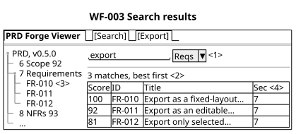
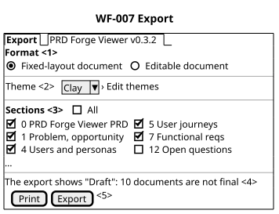
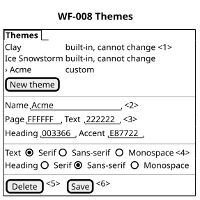

# Wireframes

Each sketch shows what a person sees and what they can do there, with the
set's own content. None of them decides how anything looks or how it is built.
Every screen has a tree of the PRD set on the left. The person expands the PRD,
then a section, then an item.

The PRD owner approved WF-001 to WF-009 on 2026-10-26. The sponsor approved
the WF-006 change for FR-024 in version 0.3.2. Version 0.3.4 changes the example
folder names in WF-006. Version 0.4.0 moves the list of PRD sets in docs/prd
from WF-006 to WF-010, a state of WF-006. The sponsor approved both versions
on 2026-10-27. Version 0.5.0 adds WF-011 for FR-025 (release 2), and the
sketches show version 0.5.0.

The numbered marks in each sketch are explained, in order, by its `shows` list.
Each sketch is also drawn in PlantUML Salt for the printed PRD.

## WF-001 The PRD set, with the scores

Illustration, not a design. Illustrates FR-001, FR-002, FR-003, FR-004, FR-005, and FR-009. PER-001 sees it at ST-001.

The author opens the set and sees every section and its grade in one place. Each section in the root page is a link.

```wireframe
┌─ PRD Forge Viewer ─────────────── [ Search ] [ Export ] ─┐
│ ▾ PRD, v0.5.0 <1>    │ PRD Forge Viewer PRD <2>          │
│   ▸ 1 Problem    75  │ v0.5.0 · Draft · 8 of 18 final    │
│   ▸ 2 Market     70  │ ───────────────────────────────── │
│   ▸ 3 Objectives 83  │ Section      Score Blk Graded <3> │
│   ▸ 4 Personas • 86  │ › 1 Problem     75   0  10-26     │
│   ▸ 5 Journeys   90  │ › 2 Market      70   0  10-26     │
│   …                  │ › 4 Personas •  86   0  10-26 <4> │
│   ▸ 12 Questions  –  │ › 12 Questions  draft   –  none   │
│   ▸ 15 Change log –  │ …                                 │
│                      │ ───────────────────────────────── │
│                      │ Executive summary <5>             │
│                      │ PRD authors cannot read an        │
│                      │ 18-file PRD Forge set as one      │
│                      │ document or see every grade at    │
│                      │ once. …                           │
└──────────────────────┴───────────────────────────────────┘
```


## WF-002 One item, selected in the tree

Illustration, not a design. Illustrates FR-005, FR-007, FR-009, and FR-023. PER-001 sees it at ST-003.

The author expands a section and reads one item. The authoring tools changed the section a moment ago.

```wireframe
┌─ PRD Forge Viewer ─────────────── [ Search ] [ Export ] ─┐
│ ▾ PRD, v0.5.0        │ PER-001 PRD author <1>            │
│   ▸ 3 Objectives 83  │ 4 Personas · final  · 86 · 0 blk  │
│   ▾ 4 Personas • 86  │ ───────────────────────────────── │
│     PER-001 <2>      │ • Changed 10:42, 61 to 86 <3>     │
│     PER-002          │ ───────────────────────────────── │
│     PER-003          │ "Show me what is weak, then let   │
│     PER-004          │ me send it today."                │
│     PER-005          │ Pains: › P-001 <4>, › P-002,      │
│   ▸ 5 Journeys   90  │ › P-003                           │
│   …                  │                                   │
└──────────────────────┴───────────────────────────────────┘
```


## WF-003 Search results

Illustration, not a design. Illustrates FR-008 and FR-023. PER-002 sees it at ST-009.

The developer searches the requirements for "export". The search computes the
relevance scores, so the numbers here only show the order: highest first.

```wireframe
┌─ PRD Forge Viewer ─────────────── [ Search ] [ Export ] ─┐
│ ▾ PRD, v0.5.0        │ [ export_______ ] [ Reqs ▾ ] <1>  │
│   ▸ 6 Scope      92  │ ───────────────────────────────── │
│   ▾ 7 Requirements   │ 3 matches, best first <2>         │
│      FR-010 <3>      │ Score ID     Title       Sec <4>  │
│      FR-011          │ ───────────────────────────────── │
│      FR-012          │   100 FR-010 Export as a… 7       │
│   ▸ 8 NFRs       93  │    92 FR-011 Export as a… 7       │
│   …                  │    81 FR-012 Export only… 7       │
└──────────────────────┴───────────────────────────────────┘
```



## WF-004 A search with no match

Illustration, not a design. Illustrates FR-008. PER-002 sees it at ST-009.

SC-007 names this state.

```wireframe
┌─ PRD Forge Viewer ─────────────── [ Search ] [ Export ] ─┐
│ ▾ PRD, v0.5.0        │ [ invoice______ ] [ All  ▾ ]      │
│   ▸ 1 Problem    75  │ ───────────────────────────────── │
│   …                  │ No item contains "invoice". <1>   │
└──────────────────────┴───────────────────────────────────┘
```


## WF-005 A document that cannot be read

Illustration, not a design. Illustrates FR-003. PER-001 sees it at ST-001.

SC-002 names this state.

```wireframe
┌─ PRD Forge Viewer ─────────────── [ Search ] [ Export ] ─┐
│ ▾ PRD, v0.5.0        │ 5 Scenarios <1>                   │
│   ▸ 5 Journeys   90  │ ───────────────────────────────── │
│   ▸ 5 Scenarios  !   │ This document cannot be read.     │
│   ▸ 6 Scope      92  │ File: 06-scenarios.md <2>         │
│   ▸ 11 Risks     96  │ The other 17 documents can be     │
│   …                  │ read.                             │
└──────────────────────┴───────────────────────────────────┘
```


## WF-006 No PRD set in this folder

Illustration, not a design. Illustrates FR-021 and FR-022. PER-001 sees it at ST-001.

The author runs prdf in a folder with no PRD set. The first three locations are
real PRD sets on the owner's computer. The fourth shows a location that no
longer exists. When docs/prd holds more than one PRD set, the screen changes to
WF-010.

```wireframe
┌─ PRD Forge Viewer ───────────────────────────────────────┐
│ No PRD set in ~/clients/work/src <1>                     │
├──────────────────────────────────────────────────────────┤
│ Known PRD sets <2>                                       │
│ Product             Location                             │
│ ──────────────────────────────────────────────────────── │
│ › PRD Forge Viewer  ~/…/work/src/prd-forge-viewer        │
│ › PRD Forge         ~/…/work/src/prd-forge               │
│ › PRD Forge         ~/…/work/src/prd-forge-fix-table     │
│   PRD Forge         ~/…/src/prd-forge-old, not found <3> │
└──────────────────────────────────────────────────────────┘
```


## WF-007 Export

Illustration, not a design. Illustrates FR-010, FR-011, FR-012, FR-013, and FR-015. PER-001 sees it at ST-005.

The author exports the whole set, or some sections, in a theme.

```wireframe
┌─ Export ─────────────────────── PRD Forge Viewer v0.5.0 ─┐
│ Format <1>                                               │
│ (•) Fixed-layout document   ( ) Editable document        │
├──────────────────────────────────────────────────────────┤
│ Theme <2>  [ Clay              ▾ ]   › Edit themes       │
├──────────────────────────────────────────────────────────┤
│ Sections <3>                 [ ] All                     │
│ [x] 0 PRD Forge Viewer PRD   [x] 5 User journeys         │
│ [x] 1 Problem, opportunity   [x] 7 Functional reqs       │
│ [x] 4 Users and personas     [ ] 12 Open questions       │
│ …                                                        │
├──────────────────────────────────────────────────────────┤
│ The export shows "Draft": 10 documents are not final <4> │
│                               [ Print ]  [ Export ] <5>  │
└──────────────────────────────────────────────────────────┘
```



## WF-008 Themes

Illustration, not a design. Illustrates FR-015, FR-016, FR-017, FR-018, and FR-020. PER-001 sees it at ST-005.

The author makes and changes the custom theme "Acme", the same theme that the
acceptance criteria of FR-016 to FR-018 use. Its colors are the values the
author types.

```wireframe
┌─ Themes ─────────────────────────────────────────────────┐
│ Clay            built-in, cannot change <1>              │
│ Ice Snowstorm   built-in, cannot change                  │
│ › Acme          custom                                   │
│                                  [ New theme ]           │
├──────────────────────────────────────────────────────────┤
│ Name     [ Acme____________ ] <2>                        │
│ Page     [ FFFFFF ]    Text     [ 222222 ] <3>           │
│ Heading  [ 003366 ]    Accent   [ E87722 ]               │
├──────────────────────────────────────────────────────────┤
│ Text     (•) Serif  ( ) Sans-serif  ( ) Monospace <4>    │
│ Heading  ( ) Serif  (•) Sans-serif  ( ) Monospace        │
├──────────────────────────────────────────────────────────┤
│                          [ Delete ] <5>  [ Save ] <6>    │
└──────────────────────────────────────────────────────────┘
```



## WF-009 First page of an export

Illustration, not a design. Illustrates FR-014, FR-019, and FR-010. PER-004 sees it at ST-011.

The sponsor opens the file without the authoring tools and reads the first page.
The contents rows are example values. No section of this set is pending today.
The Change log row shows how a pending section looks (SC-004, FR-019).

```wireframe
┌─ PRD Forge Viewer PRD ────────────────────────── page 1 ─┐
│ DRAFT <1>                              Version 0.5.0 <2> │
├──────────────────────────────────────────────────────────┤
│ Executive summary <3>                                    │
│ PRD authors cannot read a PRD Forge set as one           │
│ document or see every grade at once. …                   │
├──────────────────────────────────────────────────────────┤
│ Contents <4>                                             │
│ Section                          Status   Score  Blk     │
│ ──────────────────────────────────────────────────────── │
│ 1  Problem and opportunity      final      75     0      │
│ 4  Users and personas           final      86     0      │
│ 12 Open questions               draft       –     –      │
│ 15 Change log                   pending     –     –  <5> │
│ …                                                        │
└──────────────────────────────────────────────────────────┘
```


## WF-010 More than one PRD set in docs/prd

Illustration, not a design. Illustrates FR-024 and FR-022. PER-001 sees it at ST-001.
It is a state of WF-006.

The author runs prdf in a folder whose docs/prd holds two PRD sets, and neither
set was open in the last session. The viewer lists the two sets above the known
locations and opens neither until the author selects one. The product names
and folders are examples.

```wireframe
┌─ PRD Forge Viewer ───────────────────────────────────────┐
│ Select a PRD set in ~/clients/work/src/docs/prd <1>      │
├──────────────────────────────────────────────────────────┤
│ PRD sets in docs/prd <2>                                 │
│ Product             Location                             │
│ ──────────────────────────────────────────────────────── │
│ › Portal            docs/prd/portal                      │
│ › Portal Admin      docs/prd/portal-admin                │
├──────────────────────────────────────────────────────────┤
│ Known PRD sets                                           │
│ › PRD Forge Viewer  ~/…/work/src/prd-forge-viewer        │
│ › PRD Forge         ~/…/work/src/prd-forge               │
└──────────────────────────────────────────────────────────┘
```


## WF-011 The findings behind a grade

Illustration, not a design. Illustrates FR-025. PER-001 sees it at ST-002. FR-025 is in release 2.

The author reads the findings of section 5. The values come from the grade of
section 5 on 2026-10-27.

```wireframe
┌─ PRD Forge Viewer ─────────────── [ Search ] [ Export ] ─┐
│ ▾ PRD, v0.5.0        │ 5 Scenarios · review · 72 · 0 blk │
│   ▸ 4 Personas   86  │ Blocking defects: none <1>        │
│   ▾ 5 Scenarios  72  │ ───────────────────────────────── │
│     Findings         │ To raise the grade <2>            │
│   ▸ 6 Scope      88  │ • Lifecycle 1 to 4: add the       │
│   …                  │   section lifecycle               │
│                      │ • First use 3 to 4: add a         │
│                      │   first-use scenario at ST-001    │
└──────────────────────┴───────────────────────────────────┘
```


