# Decision rights

A person makes every decision in the journeys, with two exceptions. The viewer
proposes the PRD set from the last session (TR-001), and the viewer decides if
an export shows "Draft" by a fixed rule (TR-005).

"Software may decide: No" and "Always a person: No" together mean that a person
decides, but the viewer can offer a default, such as the last theme used.

- PER-004 approves a version. PER-001, PER-002, PER-003, and PER-005 may not.
- PER-001 decides what goes to whom. The viewer may not send anything.
- No person may remove the "Draft" mark in the viewer.

| ID | Decision | Approver | Software may decide | Always a person |
| --- | --- | --- | --- | --- |
| TR-001 | Is this the correct PRD set and version | PER-001, PER-002 | Yes, it proposes the last set | No |
| TR-002 | Which sections to fix first | PER-001 | No | Yes |
| TR-003 | If a section is good enough to send | PER-001 | No | Yes |
| TR-004 | Format, theme, and sections of an export | PER-001, PER-002 | No | No |
| TR-005 | If an export shows "Draft" | PER-001, through section status | Yes | No |
| TR-006 | Who receives a version | PER-001 | No | Yes |
| TR-007 | Approve or reject a version | PER-004 | No | Yes |
| TR-008 | If the team can build from the PRD | PER-003 | No | Yes |
| TR-009 | Which items apply to the current work | PER-002 | No | No |
| TR-010 | Fix a section now, or send as a draft | PER-001 | No | Yes |
| TR-011 | Enough to decide, or ask the author first | PER-004 | No | Yes |

## TR-005. The "Draft" rule

An export shows "Draft" when any document in the PRD set is not at final. The
author cannot remove the mark in the viewer. To remove it, the author takes every
section to final in the authoring tools. The PRD owner decided this rule on 2026-10-26.

## TR-007. approval

Only the sponsor approves a version. The export never says that a PRD is
approved. The author records the approval in section 15. The escalation when the
sponsor is not available: the approval waits, and nobody else approves (Q-006).
When the sponsor rejects a version, the author records the rejection and its
reason in section 15, fixes the PRD, and sends a new version.
