# Release plan

| ID | Release | Target date | Stages | Requirements |
| --- | --- | --- | --- | --- |
| REL-001 | Release 1, read and export | 2026-10-27 | ST-001 to ST-005, ST-008 to ST-010 | FR-001 to FR-024, except FR-006 |
| REL-002 | Release 2, grade findings | 2026-11-06 | ST-002, ST-003 | Added after D-002 |

## REL-001. Release 1, read and export

The author reads the whole PRD set, sees the grades, and sends a themed PDF or
Word export with a draft mark. A developer searches and exports selected
sections. ST-006 and ST-007 happen outside the viewer. The PRD owner moved the
target date from 2026-10-26 to 2026-10-27 on 2026-10-26. Release 1 runs on
macOS only (C-004).

## REL-002. Release 2, grade findings

The author sees the findings behind each grade. D-002 is delivered, so this release
can start when the PRD owner decides. Editing in the viewer (OUT-001) has no release yet.
