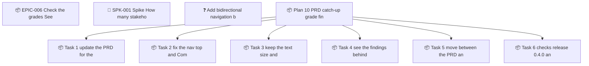

<!-- GENERATED by worklog roadmap-render. DO NOT EDIT. -->

> This file is generated from `.work/todo.jsonl`. Edits will be overwritten.
> To change the roadmap, change the work items: `worklog add|update|close`.

# Roadmap

_1 epic(s) in flight, 8 open item(s), 0 blocked, 1 unclassified._

## Now

### Plan 10: PRD catch-up, grade findings, backlog navigation, and release 0.4.0  ·  P1  ·  0 of 6 done

| # | Item | Type | Priority | Status | Blocked by |
|---|---|---|---|---|---|
| 01M67NH4 | Task 1: update the PRD for the new requirements | task | P0 | todo | — |
| 01M67NH4 | Task 4: see the findings behind a grade (FR-025, #35) | task | P0 | todo | — |
| 01M67NH4 | Task 5: move between the PRD and its backlog (FR-028, #199) | task | P0 | todo | — |
| 01M67NH4 | Task 6: checks, release 0.4.0, and install | task | P0 | todo | — |

## Next

### Plan 10: PRD catch-up, grade findings, backlog navigation, and release 0.4.0  ·  P1  ·  0 of 6 done

| # | Item | Type | Priority | Status | Blocked by |
|---|---|---|---|---|---|
| 01M67NH4 | Task 2: fix the nav top and Command-F with no set | task | P1 | todo | — |
| 01M67NH4 | Task 3: keep the text size and the search pin in settings.json | task | P1 | todo | — |

### (no epic)

| # | Item | Type | Priority | Status | Blocked by |
|---|---|---|---|---|---|
| [36](https://github.com/SpillwaveSolutions/prd-forge-viewer/issues/36) | SPK-001 Spike: How many stakeholders review a typical PRD, and how many of them have Claude Code and PRD Forge? | story | P2 | todo | — |
| [199](https://github.com/SpillwaveSolutions/prd-forge-viewer/issues/199) | Add bidirectional navigation between PRD and backlog | task | P2 | todo | — |

## Later

_Nothing here._

## Needs classification

- [199](https://github.com/SpillwaveSolutions/prd-forge-viewer/issues/199) Add bidirectional navigation between PRD and backlog (task)

## Milestones

### REL-001

| # | Item | Type | Priority | Status | Blocked by |
|---|---|---|---|---|---|
| [36](https://github.com/SpillwaveSolutions/prd-forge-viewer/issues/36) | SPK-001 Spike: How many stakeholders review a typical PRD, and how many of them have Claude Code and PRD Forge? | story | P2 | todo | — |

## Needs attention

- **[35](https://github.com/SpillwaveSolutions/prd-forge-viewer/issues/35)** EPIC-006 Check the grades: See the findings behind the grade of each section. — no open children left; close the epic.

## Visual roadmap

### Dependency graph

```mermaid
graph TD
    01M61XNM7GHPSJ1B96BCHA59ZE["📦 EPIC-006 Check the grades See"]
    01M61XNM9NY7F4D4V7400J56X9["🔧 SPK-001 Spike How many stakeho"]
    01M67NFZH5C1HWH4SBC22ZVXMS["❓ Add bidirectional navigation b"]
    01M67NH4X4JGDJB233B670SJFF["📦 Plan 10 PRD catch-up grade fin"]
    01M67NH4XPWE52APES54MYFEV2["📦 Task 1 update the PRD for the"]
    01M67NH4XPWE52APES54MYFEV4["📦 Task 2 fix the nav top and Com"]
    01M67NH4XPWE52APES54MYFEV6["📦 Task 3 keep the text size and"]
    01M67NH4XPWE52APES54MYFEV8["📦 Task 4 see the findings behind"]
    01M67NH4XPWE52APES54MYFEVA["📦 Task 5 move between the PRD an"]
    01M67NH4XPWE52APES54MYFEVC["📦 Task 6 checks release 0.4.0 an"]
    01M67NH4X4JGDJB233B670SJFF --> 01M67NH4XPWE52APES54MYFEV2
    01M67NH4X4JGDJB233B670SJFF --> 01M67NH4XPWE52APES54MYFEV4
    01M67NH4X4JGDJB233B670SJFF --> 01M67NH4XPWE52APES54MYFEV6
    01M67NH4X4JGDJB233B670SJFF --> 01M67NH4XPWE52APES54MYFEV8
    01M67NH4X4JGDJB233B670SJFF --> 01M67NH4XPWE52APES54MYFEVA
    01M67NH4X4JGDJB233B670SJFF --> 01M67NH4XPWE52APES54MYFEVC
    classDef todo fill:#f4f4f4,stroke:#999999
    class 01M61XNM7GHPSJ1B96BCHA59ZE,01M61XNM9NY7F4D4V7400J56X9,01M67NFZH5C1HWH4SBC22ZVXMS,01M67NH4X4JGDJB233B670SJFF,01M67NH4XPWE52APES54MYFEV2,01M67NH4XPWE52APES54MYFEV4,01M67NH4XPWE52APES54MYFEV6,01M67NH4XPWE52APES54MYFEV8,01M67NH4XPWE52APES54MYFEVA,01M67NH4XPWE52APES54MYFEVC todo
```

### Hierarchy

