<!-- GENERATED by worklog roadmap-render. DO NOT EDIT. -->

> This file is generated from `.work/todo.jsonl`. Edits will be overwritten.
> To change the roadmap, change the work items: `worklog add|update|close`.

# Roadmap

_1 epic(s) in flight, 5 open item(s), 0 blocked, 0 unclassified._

## Now

_Nothing here._

## Next

### Release 1 completion: build the 15 remaining requirements  ·  P0  ·  23 of 27 done
Build the 15 release 1 requirements that plans 1 and 2 did not cover: reading sections and items, search, live updates, export themes, and PDF and Word export. Six phases, each with its own TDD plan, checked through the tauri MCP server before it merges.

| # | Item | Type | Priority | Status | Blocked by |
|---|---|---|---|---|---|
| [129](https://github.com/SpillwaveSolutions/prd-forge-viewer/issues/129) | All e2e checks and unit tests pass on the release build | subtask | P2 | todo | — |
| [130](https://github.com/SpillwaveSolutions/prd-forge-viewer/issues/130) | The release build is installed in /Applications with no MCP bridge | subtask | P2 | todo | — |
| [131](https://github.com/SpillwaveSolutions/prd-forge-viewer/issues/131) | REQ and TRAC show each release 1 requirement as built and tested | subtask | P2 | todo | — |
| [132](https://github.com/SpillwaveSolutions/prd-forge-viewer/issues/132) | All release 1 stories closed, the roadmap rendered, and GitHub Issues synced | subtask | P2 | todo | — |

### (no epic)

| # | Item | Type | Priority | Status | Blocked by |
|---|---|---|---|---|---|
| [36](https://github.com/SpillwaveSolutions/prd-forge-viewer/issues/36) | SPK-001 Spike: How many stakeholders review a typical PRD, and how many of them have Claude Code and PRD Forge? | story | P2 | todo | — |

## Later

_Nothing here._

## Milestones

### REL-001

| # | Item | Type | Priority | Status | Blocked by |
|---|---|---|---|---|---|
| [36](https://github.com/SpillwaveSolutions/prd-forge-viewer/issues/36) | SPK-001 Spike: How many stakeholders review a typical PRD, and how many of them have Claude Code and PRD Forge? | story | P2 | todo | — |

## Needs attention

- **[14](https://github.com/SpillwaveSolutions/prd-forge-viewer/issues/14)** EPIC-003 Go to a weak section: Go directly to a weak section or item, or find it by search. — no open children left; close the epic.
- **[20](https://github.com/SpillwaveSolutions/prd-forge-viewer/issues/20)** EPIC-004 Fix the section: See each change from the authoring tools while the section is open. — no open children left; close the epic.
- **[22](https://github.com/SpillwaveSolutions/prd-forge-viewer/issues/22)** EPIC-005 Export the PRD: Export the selected sections, in a selected theme, as a file that a reader opens without the authoring tools. — no open children left; close the epic.
- **[35](https://github.com/SpillwaveSolutions/prd-forge-viewer/issues/35)** EPIC-006 Check the grades: See the findings behind the grade of each section. — no open children left; close the epic.

## Visual roadmap

### Dependency graph

```mermaid
graph TD
    01M61XNJQPA0F7H1BG56ERNJ3P["📦 EPIC-003 Go to a weak section"]
    01M61XNK50616FWM0WZ4FGWGEB["📦 EPIC-004 Fix the section See e"]
    01M61XNK9MPMV0RAEKPX0JC3K4["📦 EPIC-005 Export the PRD Export"]
    01M61XNM7GHPSJ1B96BCHA59ZE["📦 EPIC-006 Check the grades See"]
    01M61XNM9NY7F4D4V7400J56X9["🔧 SPK-001 Spike How many stakeho"]
    01M62C7REGCD2R415FMWFCZMV8["📦 All e2e checks and unit tests"]
    01M62C7REGCD2R415FMWFCZMVA["📦 The release build is installed"]
    01M62C7REHN9N2P8Z19K0EPA0F["📦 REQ and TRAC show each release"]
    01M62C7REHN9N2P8Z19K0EPA0H["📦 All release 1 stories closed t"]
    classDef todo fill:#f4f4f4,stroke:#999999
    class 01M61XNJQPA0F7H1BG56ERNJ3P,01M61XNK50616FWM0WZ4FGWGEB,01M61XNK9MPMV0RAEKPX0JC3K4,01M61XNM7GHPSJ1B96BCHA59ZE,01M61XNM9NY7F4D4V7400J56X9,01M62C7REGCD2R415FMWFCZMV8,01M62C7REGCD2R415FMWFCZMVA,01M62C7REHN9N2P8Z19K0EPA0F,01M62C7REHN9N2P8Z19K0EPA0H todo
```

### Hierarchy

```mermaid
graph TD
    01M61XNJQPA0F7H1BG56ERNJ3P["📦 EPIC-003 Go to a weak section"]
    01M61XNK50616FWM0WZ4FGWGEB["📦 EPIC-004 Fix the section See e"]
    01M61XNK9MPMV0RAEKPX0JC3K4["📦 EPIC-005 Export the PRD Export"]
    01M61XNM7GHPSJ1B96BCHA59ZE["📦 EPIC-006 Check the grades See"]
    01M61XNM9NY7F4D4V7400J56X9["🔧 SPK-001 Spike How many stakeho"]
    01M62C7REGCD2R415FMWFCZMV8["📦 All e2e checks and unit tests"]
    01M62C7REGCD2R415FMWFCZMVA["📦 The release build is installed"]
    01M62C7REHN9N2P8Z19K0EPA0F["📦 REQ and TRAC show each release"]
    01M62C7REHN9N2P8Z19K0EPA0H["📦 All release 1 stories closed t"]
```

