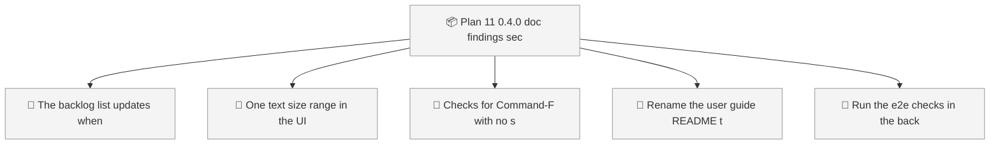
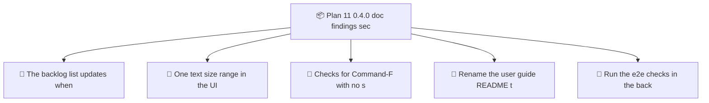

<!-- GENERATED by worklog roadmap-render. DO NOT EDIT. -->

> This file is generated from `.work/todo.jsonl`. Edits will be overwritten.
> To change the roadmap, change the work items: `worklog add|update|close`.

# Roadmap

_1 epic(s) in flight, 5 open item(s), 0 blocked, 0 unclassified._

## Now

_Nothing here._

## Next

### Plan 11: 0.4.0 doc findings, section 7 grade, and SPK-001 answer  ·  P1  ·  2 of 7 done  ·  feature 1 / bug 3 / ops 3
Fix the faults that the 0.4.0 doc agents found, grade section 7 again, and record the answer to Q-002.

| # | Item | Type | Priority | Status | Blocked by |
|---|---|---|---|---|---|
| 01M6CD2T | The backlog list updates when a backlog file changes | task | P1 | todo | — |
| 01M6CDER | Run the e2e checks in the background without focus or real keys | task | P1 | todo | — |
| 01M6CD2T | One text size range in the UI and in settings.json | task | P2 | todo | — |
| 01M6CD2T | Checks for Command-F with no set and the header at 200 percent text | task | P2 | todo | — |
| 01M6CD2T | Rename the user guide README to index so the wiki finds it | task | P2 | todo | — |

## Later

_Nothing here._

## Visual roadmap

### Dependency graph

### Hierarchy

