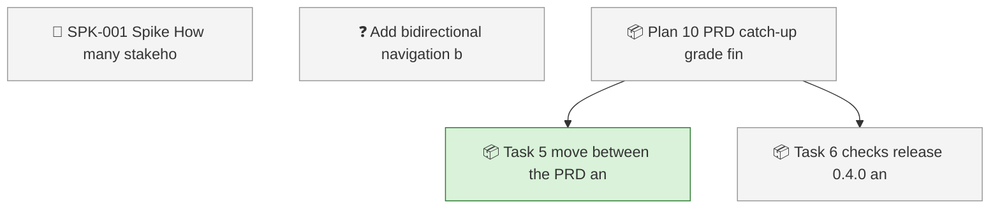
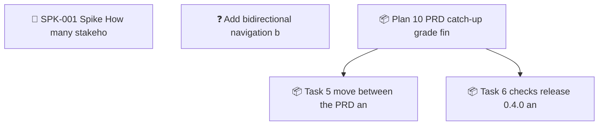

<!-- GENERATED by worklog roadmap-render. DO NOT EDIT. -->

> This file is generated from `.work/todo.jsonl`. Edits will be overwritten.
> To change the roadmap, change the work items: `worklog add|update|close`.

# Roadmap

_1 epic(s) in flight, 4 open item(s), 0 blocked, 1 unclassified._

## Now

### Plan 10: PRD catch-up, grade findings, backlog navigation, and release 0.4.0  ·  P1  ·  4 of 6 done

| # | Item | Type | Priority | Status | Blocked by |
|---|---|---|---|---|---|
| 01M67NH4 | Task 5: move between the PRD and its backlog (FR-028, #199) | task | P0 | in progress | — |
| 01M67NH4 | Task 6: checks, release 0.4.0, and install | task | P0 | todo | — |

## Next

### (no epic)

| # | Item | Type | Priority | Status | Blocked by |
|---|---|---|---|---|---|
| [36](https://github.com/SpillwaveSolutions/prd-forge-viewer/issues/36) | SPK-001 Spike: How many stakeholders review a typical PRD, and how many of them have Claude Code and PRD Forge? | story | P2 | todo | — |
| [199](https://github.com/SpillwaveSolutions/prd-forge-viewer/issues/199) | Add bidirectional navigation between PRD and backlog | task | P2 | todo | — |

## Later

_Nothing here._

## Needs classification

- [199](https://github.com/SpillwaveSolutions/prd-forge-viewer/issues/199) Add bidirectional navigation between PRD and backlog (task)

## Milestones

### REL-001

| # | Item | Type | Priority | Status | Blocked by |
|---|---|---|---|---|---|
| [36](https://github.com/SpillwaveSolutions/prd-forge-viewer/issues/36) | SPK-001 Spike: How many stakeholders review a typical PRD, and how many of them have Claude Code and PRD Forge? | story | P2 | todo | — |

## Visual roadmap

### Dependency graph

### Hierarchy

