<!-- GENERATED by worklog roadmap-render. DO NOT EDIT. -->

> This file is generated from `.work/todo.jsonl`. Edits will be overwritten.
> To change the roadmap, change the work items: `worklog add|update|close`.

# Roadmap

_3 epic(s) in flight, 19 open item(s), 0 blocked, 0 unclassified._

## Now

### EPIC-003 Go to a weak section: Go directly to a weak section or item, or find it by search.  ·  P0  ·  0 of 5 done  ·  → REL-001
Feature FEAT-003 (Go to a weak section), stage ST-003. Goal: Go directly to a weak section or item, or find it by search. Derived from PRD 0.6.1 backlog.

| # | Item | Type | Priority | Status | Blocked by |
|---|---|---|---|---|---|
| [15](https://github.com/SpillwaveSolutions/prd-forge-viewer/issues/15) | US-008 Go directly to any section | story | P0 | todo | — |
| [16](https://github.com/SpillwaveSolutions/prd-forge-viewer/issues/16) | US-009 Select one item of a section and read it without the whole section | story | P0 | todo | — |
| [18](https://github.com/SpillwaveSolutions/prd-forge-viewer/issues/18) | US-011 Search the PRD set by term, in one category or in all categories | story | P0 | todo | — |
| [19](https://github.com/SpillwaveSolutions/prd-forge-viewer/issues/19) | US-012 See the search results ranked by relevance, and open one result | story | P0 | todo | — |

### EPIC-004 Fix the section: See each change from the authoring tools while the section is open.  ·  P0  ·  0 of 1 done  ·  → REL-001
Feature FEAT-004 (Fix the section), stage ST-004. Goal: See each change from the authoring tools while the section is open. Derived from PRD 0.6.1 backlog.

| # | Item | Type | Priority | Status | Blocked by |
|---|---|---|---|---|---|
| [21](https://github.com/SpillwaveSolutions/prd-forge-viewer/issues/21) | US-013 See changes that the authoring tools make, without any action | story | P0 | todo | — |

### EPIC-005 Export the PRD: Export the selected sections, in a selected theme, as a file that a reader opens without the authoring tools.  ·  P0  ·  0 of 12 done  ·  → REL-001
Feature FEAT-005 (Export the PRD), stage ST-005. Goal: Export the selected sections, in a selected theme, as a file that a reader opens without the authoring tools. Derived from PRD 0.6.1 backlog.

| # | Item | Type | Priority | Status | Blocked by |
|---|---|---|---|---|---|
| [23](https://github.com/SpillwaveSolutions/prd-forge-viewer/issues/23) | US-014 Export the PRD set as a fixed-layout document (IN-006) | story | P0 | todo | — |
| [25](https://github.com/SpillwaveSolutions/prd-forge-viewer/issues/25) | US-016 Export only selected sections | story | P0 | todo | — |
| [27](https://github.com/SpillwaveSolutions/prd-forge-viewer/issues/27) | US-018 See the version of the PRD, and if it is a draft, in an export | story | P0 | todo | — |
| [28](https://github.com/SpillwaveSolutions/prd-forge-viewer/issues/28) | US-019 See "Draft" on every export until every document of the PRD set is final, and see no claim that the PRD is approved | story | P0 | todo | — |
| [30](https://github.com/SpillwaveSolutions/prd-forge-viewer/issues/30) | US-021 Select an export theme from the built-in themes | story | P0 | todo | — |

## Next

### EPIC-003 Go to a weak section: Go directly to a weak section or item, or find it by search.  ·  P0  ·  0 of 5 done  ·  → REL-001
Feature FEAT-003 (Go to a weak section), stage ST-003. Goal: Go directly to a weak section or item, or find it by search. Derived from PRD 0.6.1 backlog.

| # | Item | Type | Priority | Status | Blocked by |
|---|---|---|---|---|---|
| [17](https://github.com/SpillwaveSolutions/prd-forge-viewer/issues/17) | US-010 Follow a reference from one item to the item it names | story | P1 | todo | — |

### EPIC-005 Export the PRD: Export the selected sections, in a selected theme, as a file that a reader opens without the authoring tools.  ·  P0  ·  0 of 12 done  ·  → REL-001
Feature FEAT-005 (Export the PRD), stage ST-005. Goal: Export the selected sections, in a selected theme, as a file that a reader opens without the authoring tools. Derived from PRD 0.6.1 backlog.

| # | Item | Type | Priority | Status | Blocked by |
|---|---|---|---|---|---|
| [24](https://github.com/SpillwaveSolutions/prd-forge-viewer/issues/24) | US-015 Export the PRD set as an editable document (IN-006) | story | P1 | todo | — |
| [26](https://github.com/SpillwaveSolutions/prd-forge-viewer/issues/26) | US-017 Print the PRD set or selected sections | story | P1 | todo | — |
| [29](https://github.com/SpillwaveSolutions/prd-forge-viewer/issues/29) | US-020 See the status and score of every section in an export | story | P1 | todo | — |
| [31](https://github.com/SpillwaveSolutions/prd-forge-viewer/issues/31) | US-022 Make a custom export theme | story | P1 | todo | — |
| [32](https://github.com/SpillwaveSolutions/prd-forge-viewer/issues/32) | US-023 Change a custom export theme | story | P1 | todo | — |
| [33](https://github.com/SpillwaveSolutions/prd-forge-viewer/issues/33) | US-024 Delete a custom export theme | story | P1 | todo | — |
| [34](https://github.com/SpillwaveSolutions/prd-forge-viewer/issues/34) | US-025 Keep custom export themes from one session to the next | story | P1 | todo | — |

### (no epic)

| # | Item | Type | Priority | Status | Blocked by |
|---|---|---|---|---|---|
| [36](https://github.com/SpillwaveSolutions/prd-forge-viewer/issues/36) | SPK-001 Spike: How many stakeholders review a typical PRD, and how many of them have Claude Code and PRD Forge? | story | P2 | todo | — |

## Later

_Nothing here._

## Milestones

### REL-001

| # | Item | Type | Priority | Status | Blocked by |
|---|---|---|---|---|---|
| [15](https://github.com/SpillwaveSolutions/prd-forge-viewer/issues/15) | US-008 Go directly to any section | story | P0 | todo | — |
| [16](https://github.com/SpillwaveSolutions/prd-forge-viewer/issues/16) | US-009 Select one item of a section and read it without the whole section | story | P0 | todo | — |
| [18](https://github.com/SpillwaveSolutions/prd-forge-viewer/issues/18) | US-011 Search the PRD set by term, in one category or in all categories | story | P0 | todo | — |
| [19](https://github.com/SpillwaveSolutions/prd-forge-viewer/issues/19) | US-012 See the search results ranked by relevance, and open one result | story | P0 | todo | — |
| [21](https://github.com/SpillwaveSolutions/prd-forge-viewer/issues/21) | US-013 See changes that the authoring tools make, without any action | story | P0 | todo | — |
| [23](https://github.com/SpillwaveSolutions/prd-forge-viewer/issues/23) | US-014 Export the PRD set as a fixed-layout document (IN-006) | story | P0 | todo | — |
| [25](https://github.com/SpillwaveSolutions/prd-forge-viewer/issues/25) | US-016 Export only selected sections | story | P0 | todo | — |
| [27](https://github.com/SpillwaveSolutions/prd-forge-viewer/issues/27) | US-018 See the version of the PRD, and if it is a draft, in an export | story | P0 | todo | — |
| [28](https://github.com/SpillwaveSolutions/prd-forge-viewer/issues/28) | US-019 See "Draft" on every export until every document of the PRD set is final, and see no claim that the PRD is approved | story | P0 | todo | — |
| [30](https://github.com/SpillwaveSolutions/prd-forge-viewer/issues/30) | US-021 Select an export theme from the built-in themes | story | P0 | todo | — |
| [17](https://github.com/SpillwaveSolutions/prd-forge-viewer/issues/17) | US-010 Follow a reference from one item to the item it names | story | P1 | todo | — |
| [24](https://github.com/SpillwaveSolutions/prd-forge-viewer/issues/24) | US-015 Export the PRD set as an editable document (IN-006) | story | P1 | todo | — |
| [26](https://github.com/SpillwaveSolutions/prd-forge-viewer/issues/26) | US-017 Print the PRD set or selected sections | story | P1 | todo | — |
| [29](https://github.com/SpillwaveSolutions/prd-forge-viewer/issues/29) | US-020 See the status and score of every section in an export | story | P1 | todo | — |
| [31](https://github.com/SpillwaveSolutions/prd-forge-viewer/issues/31) | US-022 Make a custom export theme | story | P1 | todo | — |
| [32](https://github.com/SpillwaveSolutions/prd-forge-viewer/issues/32) | US-023 Change a custom export theme | story | P1 | todo | — |
| [33](https://github.com/SpillwaveSolutions/prd-forge-viewer/issues/33) | US-024 Delete a custom export theme | story | P1 | todo | — |
| [34](https://github.com/SpillwaveSolutions/prd-forge-viewer/issues/34) | US-025 Keep custom export themes from one session to the next | story | P1 | todo | — |
| [36](https://github.com/SpillwaveSolutions/prd-forge-viewer/issues/36) | SPK-001 Spike: How many stakeholders review a typical PRD, and how many of them have Claude Code and PRD Forge? | story | P2 | todo | — |

## Needs attention

- **[35](https://github.com/SpillwaveSolutions/prd-forge-viewer/issues/35)** EPIC-006 Check the grades: See the findings behind the grade of each section. — no open children left; close the epic.

## Visual roadmap

### Dependency graph

```mermaid
graph TD
    01M61XNJQPA0F7H1BG56ERNJ3P["📦 EPIC-003 Go to a weak section"]
    01M61XNJSXCVG60KPJFNBC4GPT["📦 US-008 Go directly to any sect"]
    01M61XNJW2AZJVWS7GNVCDWE6J["📦 US-009 Select one item of a se"]
    01M61XNJY90VDMDZW16HAGY522["📦 US-010 Follow a reference from"]
    01M61XNK0EWMYWDZNRXHB78SZ7["📦 US-011 Search the PRD set by t"]
    01M61XNK2Q80TZ9MTV20FQGGZM["📦 US-012 See the search results"]
    01M61XNK50616FWM0WZ4FGWGEB["📦 EPIC-004 Fix the section See e"]
    01M61XNK7A3WE67AVJFXNDZT2P["📦 US-013 See changes that the au"]
    01M61XNK9MPMV0RAEKPX0JC3K4["📦 EPIC-005 Export the PRD Export"]
    01M61XNKBWWJM55QTR4QJJDQXS["📦 US-014 Export the PRD set as a"]
    01M61XNKE6PN209QVSMRS7ZMJB["📦 US-015 Export the PRD set as a"]
    01M61XNKGH9S4J40A909MN4KA2["📦 US-016 Export only selected se"]
    01M61XNKJS20P36A6GTVDDSJJC["📦 US-017 Print the PRD set or se"]
    01M61XNKN3MT565WYVQJX63YTE["📦 US-018 See the version of the"]
    01M61XNKQC1ZHJPMYK5FW5N17N["📦 US-019 See Draft on every expo"]
    01M61XNKSH8CJ2NKNBEG5CVC7J["📦 US-020 See the status and scor"]
    01M61XNKVTP7XDRC60FNYY6Z6Y["📦 US-021 Select an export theme"]
    01M61XNKY44E0TMA06D5YGBBCT["📦 US-022 Make a custom export th"]
    01M61XNM0DH5XMHFKF6XVTBXFD["📦 US-023 Change a custom export"]
    01M61XNM2XG682DJC9R566BJ3K["📦 US-024 Delete a custom export"]
    01M61XNM5721TS9RGHEHTY4PYT["📦 US-025 Keep custom export them"]
    01M61XNM7GHPSJ1B96BCHA59ZE["📦 EPIC-006 Check the grades See"]
    01M61XNM9NY7F4D4V7400J56X9["🔧 SPK-001 Spike How many stakeho"]
    01M61XNJQPA0F7H1BG56ERNJ3P --> 01M61XNJSXCVG60KPJFNBC4GPT
    01M61XNJQPA0F7H1BG56ERNJ3P --> 01M61XNJW2AZJVWS7GNVCDWE6J
    01M61XNJQPA0F7H1BG56ERNJ3P --> 01M61XNJY90VDMDZW16HAGY522
    01M61XNJQPA0F7H1BG56ERNJ3P --> 01M61XNK0EWMYWDZNRXHB78SZ7
    01M61XNJQPA0F7H1BG56ERNJ3P --> 01M61XNK2Q80TZ9MTV20FQGGZM
    01M61XNK50616FWM0WZ4FGWGEB --> 01M61XNK7A3WE67AVJFXNDZT2P
    01M61XNK9MPMV0RAEKPX0JC3K4 --> 01M61XNKBWWJM55QTR4QJJDQXS
    01M61XNK9MPMV0RAEKPX0JC3K4 --> 01M61XNKE6PN209QVSMRS7ZMJB
    01M61XNK9MPMV0RAEKPX0JC3K4 --> 01M61XNKGH9S4J40A909MN4KA2
    01M61XNK9MPMV0RAEKPX0JC3K4 --> 01M61XNKJS20P36A6GTVDDSJJC
    01M61XNK9MPMV0RAEKPX0JC3K4 --> 01M61XNKN3MT565WYVQJX63YTE
    01M61XNK9MPMV0RAEKPX0JC3K4 --> 01M61XNKQC1ZHJPMYK5FW5N17N
    01M61XNK9MPMV0RAEKPX0JC3K4 --> 01M61XNKSH8CJ2NKNBEG5CVC7J
    01M61XNK9MPMV0RAEKPX0JC3K4 --> 01M61XNKVTP7XDRC60FNYY6Z6Y
    01M61XNK9MPMV0RAEKPX0JC3K4 --> 01M61XNKY44E0TMA06D5YGBBCT
    01M61XNK9MPMV0RAEKPX0JC3K4 --> 01M61XNM0DH5XMHFKF6XVTBXFD
    01M61XNK9MPMV0RAEKPX0JC3K4 --> 01M61XNM2XG682DJC9R566BJ3K
    01M61XNK9MPMV0RAEKPX0JC3K4 --> 01M61XNM5721TS9RGHEHTY4PYT
    classDef todo fill:#f4f4f4,stroke:#999999
    class 01M61XNJQPA0F7H1BG56ERNJ3P,01M61XNJSXCVG60KPJFNBC4GPT,01M61XNJW2AZJVWS7GNVCDWE6J,01M61XNJY90VDMDZW16HAGY522,01M61XNK0EWMYWDZNRXHB78SZ7,01M61XNK2Q80TZ9MTV20FQGGZM,01M61XNK50616FWM0WZ4FGWGEB,01M61XNK7A3WE67AVJFXNDZT2P,01M61XNK9MPMV0RAEKPX0JC3K4,01M61XNKBWWJM55QTR4QJJDQXS,01M61XNKE6PN209QVSMRS7ZMJB,01M61XNKGH9S4J40A909MN4KA2,01M61XNKJS20P36A6GTVDDSJJC,01M61XNKN3MT565WYVQJX63YTE,01M61XNKQC1ZHJPMYK5FW5N17N,01M61XNKSH8CJ2NKNBEG5CVC7J,01M61XNKVTP7XDRC60FNYY6Z6Y,01M61XNKY44E0TMA06D5YGBBCT,01M61XNM0DH5XMHFKF6XVTBXFD,01M61XNM2XG682DJC9R566BJ3K,01M61XNM5721TS9RGHEHTY4PYT,01M61XNM7GHPSJ1B96BCHA59ZE,01M61XNM9NY7F4D4V7400J56X9 todo
```

### Hierarchy

```mermaid
graph TD
    01M61XNJQPA0F7H1BG56ERNJ3P["📦 EPIC-003 Go to a weak section"]
    01M61XNJSXCVG60KPJFNBC4GPT["📦 US-008 Go directly to any sect"]
    01M61XNJW2AZJVWS7GNVCDWE6J["📦 US-009 Select one item of a se"]
    01M61XNJY90VDMDZW16HAGY522["📦 US-010 Follow a reference from"]
    01M61XNK0EWMYWDZNRXHB78SZ7["📦 US-011 Search the PRD set by t"]
    01M61XNK2Q80TZ9MTV20FQGGZM["📦 US-012 See the search results"]
    01M61XNK50616FWM0WZ4FGWGEB["📦 EPIC-004 Fix the section See e"]
    01M61XNK7A3WE67AVJFXNDZT2P["📦 US-013 See changes that the au"]
    01M61XNK9MPMV0RAEKPX0JC3K4["📦 EPIC-005 Export the PRD Export"]
    01M61XNKBWWJM55QTR4QJJDQXS["📦 US-014 Export the PRD set as a"]
    01M61XNKE6PN209QVSMRS7ZMJB["📦 US-015 Export the PRD set as a"]
    01M61XNKGH9S4J40A909MN4KA2["📦 US-016 Export only selected se"]
    01M61XNKJS20P36A6GTVDDSJJC["📦 US-017 Print the PRD set or se"]
    01M61XNKN3MT565WYVQJX63YTE["📦 US-018 See the version of the"]
    01M61XNKQC1ZHJPMYK5FW5N17N["📦 US-019 See Draft on every expo"]
    01M61XNKSH8CJ2NKNBEG5CVC7J["📦 US-020 See the status and scor"]
    01M61XNKVTP7XDRC60FNYY6Z6Y["📦 US-021 Select an export theme"]
    01M61XNKY44E0TMA06D5YGBBCT["📦 US-022 Make a custom export th"]
    01M61XNM0DH5XMHFKF6XVTBXFD["📦 US-023 Change a custom export"]
    01M61XNM2XG682DJC9R566BJ3K["📦 US-024 Delete a custom export"]
    01M61XNM5721TS9RGHEHTY4PYT["📦 US-025 Keep custom export them"]
    01M61XNM7GHPSJ1B96BCHA59ZE["📦 EPIC-006 Check the grades See"]
    01M61XNM9NY7F4D4V7400J56X9["🔧 SPK-001 Spike How many stakeho"]
    01M61XNJQPA0F7H1BG56ERNJ3P --> 01M61XNJSXCVG60KPJFNBC4GPT
    01M61XNJQPA0F7H1BG56ERNJ3P --> 01M61XNJW2AZJVWS7GNVCDWE6J
    01M61XNJQPA0F7H1BG56ERNJ3P --> 01M61XNJY90VDMDZW16HAGY522
    01M61XNJQPA0F7H1BG56ERNJ3P --> 01M61XNK0EWMYWDZNRXHB78SZ7
    01M61XNJQPA0F7H1BG56ERNJ3P --> 01M61XNK2Q80TZ9MTV20FQGGZM
    01M61XNK50616FWM0WZ4FGWGEB --> 01M61XNK7A3WE67AVJFXNDZT2P
    01M61XNK9MPMV0RAEKPX0JC3K4 --> 01M61XNKBWWJM55QTR4QJJDQXS
    01M61XNK9MPMV0RAEKPX0JC3K4 --> 01M61XNKE6PN209QVSMRS7ZMJB
    01M61XNK9MPMV0RAEKPX0JC3K4 --> 01M61XNKGH9S4J40A909MN4KA2
    01M61XNK9MPMV0RAEKPX0JC3K4 --> 01M61XNKJS20P36A6GTVDDSJJC
    01M61XNK9MPMV0RAEKPX0JC3K4 --> 01M61XNKN3MT565WYVQJX63YTE
    01M61XNK9MPMV0RAEKPX0JC3K4 --> 01M61XNKQC1ZHJPMYK5FW5N17N
    01M61XNK9MPMV0RAEKPX0JC3K4 --> 01M61XNKSH8CJ2NKNBEG5CVC7J
    01M61XNK9MPMV0RAEKPX0JC3K4 --> 01M61XNKVTP7XDRC60FNYY6Z6Y
    01M61XNK9MPMV0RAEKPX0JC3K4 --> 01M61XNKY44E0TMA06D5YGBBCT
    01M61XNK9MPMV0RAEKPX0JC3K4 --> 01M61XNM0DH5XMHFKF6XVTBXFD
    01M61XNK9MPMV0RAEKPX0JC3K4 --> 01M61XNM2XG682DJC9R566BJ3K
    01M61XNK9MPMV0RAEKPX0JC3K4 --> 01M61XNM5721TS9RGHEHTY4PYT
```

