<!-- GENERATED by worklog roadmap-render. DO NOT EDIT. -->

> This file is generated from `.work/todo.jsonl`. Edits will be overwritten.
> To change the roadmap, change the work items: `worklog add|update|close`.

# Roadmap

_3 epic(s) in flight, 20 open item(s), 0 blocked, 0 unclassified._

## Now

### EPIC-005 Export the PRD: Export the selected sections, in a selected theme, as a file that a reader opens without the authoring tools.  ·  P0  ·  4 of 12 done  ·  → REL-001
Feature FEAT-005 (Export the PRD), stage ST-005. Goal: Export the selected sections, in a selected theme, as a file that a reader opens without the authoring tools. Derived from PRD 0.6.1 backlog.

| # | Item | Type | Priority | Status | Blocked by |
|---|---|---|---|---|---|
| [23](https://github.com/SpillwaveSolutions/prd-forge-viewer/issues/23) | US-014 Export the PRD set as a fixed-layout document (IN-006) | story | P0 | todo | — |
| [25](https://github.com/SpillwaveSolutions/prd-forge-viewer/issues/25) | US-016 Export only selected sections | story | P0 | todo | — |
| [27](https://github.com/SpillwaveSolutions/prd-forge-viewer/issues/27) | US-018 See the version of the PRD, and if it is a draft, in an export | story | P0 | todo | — |
| [28](https://github.com/SpillwaveSolutions/prd-forge-viewer/issues/28) | US-019 See "Draft" on every export until every document of the PRD set is final, and see no claim that the PRD is approved | story | P0 | todo | — |

### Release 1 completion: build the 15 remaining requirements  ·  P0  ·  18 of 27 done
Build the 15 release 1 requirements that plans 1 and 2 did not cover: reading sections and items, search, live updates, export themes, and PDF and Word export. Six phases, each with its own TDD plan, checked through the tauri MCP server before it merges.

| # | Item | Type | Priority | Status | Blocked by |
|---|---|---|---|---|---|
| [123](https://github.com/SpillwaveSolutions/prd-forge-viewer/issues/123) | Phase 5: PDF and Word export, print, and the Draft mark (US-014 to US-020) | task | P0 | in progress | — |

### Plan 7: PDF and Word export, print, and the Draft mark  ·  P0  ·  4 of 6 done
Phase 5 of the release 1 completion plan. Export the set or selected sections to PDF or Word with a theme, or print them, with a first page that shows the version, the Draft mark, and the status and score of each section (US-014 to US-020).

| # | Item | Type | Priority | Status | Blocked by |
|---|---|---|---|---|---|
| 01M64AFR | Task 5: the export dialog and print | task | P0 | todo | — |
| 01M64AFR | Task 6: MCP checks for phase 5 | task | P0 | todo | — |

## Next

### EPIC-005 Export the PRD: Export the selected sections, in a selected theme, as a file that a reader opens without the authoring tools.  ·  P0  ·  4 of 12 done  ·  → REL-001
Feature FEAT-005 (Export the PRD), stage ST-005. Goal: Export the selected sections, in a selected theme, as a file that a reader opens without the authoring tools. Derived from PRD 0.6.1 backlog.

| # | Item | Type | Priority | Status | Blocked by |
|---|---|---|---|---|---|
| [24](https://github.com/SpillwaveSolutions/prd-forge-viewer/issues/24) | US-015 Export the PRD set as an editable document (IN-006) | story | P1 | todo | — |
| [26](https://github.com/SpillwaveSolutions/prd-forge-viewer/issues/26) | US-017 Print the PRD set or selected sections | story | P1 | todo | — |
| [29](https://github.com/SpillwaveSolutions/prd-forge-viewer/issues/29) | US-020 See the status and score of every section in an export | story | P1 | todo | — |
| [31](https://github.com/SpillwaveSolutions/prd-forge-viewer/issues/31) | US-022 Make a custom export theme | story | P1 | todo | — |

### Release 1 completion: build the 15 remaining requirements  ·  P0  ·  18 of 27 done
Build the 15 release 1 requirements that plans 1 and 2 did not cover: reading sections and items, search, live updates, export themes, and PDF and Word export. Six phases, each with its own TDD plan, checked through the tauri MCP server before it merges.

| # | Item | Type | Priority | Status | Blocked by |
|---|---|---|---|---|---|
| [128](https://github.com/SpillwaveSolutions/prd-forge-viewer/issues/128) | Phase 6: close out release 1 | task | P1 | todo | — |
| [125](https://github.com/SpillwaveSolutions/prd-forge-viewer/issues/125) | Built with TDD, and the review findings fixed | subtask | P2 | todo | — |
| [126](https://github.com/SpillwaveSolutions/prd-forge-viewer/issues/126) | e2e/phase5.mjs passes: FR-010 to FR-014, FR-019, TR-005, TR-007, and TR-010, with file checks of each export | subtask | P2 | todo | — |
| [127](https://github.com/SpillwaveSolutions/prd-forge-viewer/issues/127) | NFR-004 within 10 s, and NFR-009 with zero checker errors | subtask | P2 | todo | — |
| [129](https://github.com/SpillwaveSolutions/prd-forge-viewer/issues/129) | All e2e checks and unit tests pass on the release build | subtask | P2 | todo | — |
| [130](https://github.com/SpillwaveSolutions/prd-forge-viewer/issues/130) | The release build is installed in /Applications with no MCP bridge | subtask | P2 | todo | — |
| [131](https://github.com/SpillwaveSolutions/prd-forge-viewer/issues/131) | REQ and TRAC show each release 1 requirement as built and tested | subtask | P2 | todo | — |
| [132](https://github.com/SpillwaveSolutions/prd-forge-viewer/issues/132) | All release 1 stories closed, the roadmap rendered, and GitHub Issues synced | subtask | P2 | todo | — |

### (no epic)

| # | Item | Type | Priority | Status | Blocked by |
|---|---|---|---|---|---|
| [36](https://github.com/SpillwaveSolutions/prd-forge-viewer/issues/36) | SPK-001 Spike: How many stakeholders review a typical PRD, and how many of them have Claude Code and PRD Forge? | story | P2 | todo | — |

## Later

_Nothing here._

## Milestones

### REL-001

| # | Item | Type | Priority | Status | Blocked by |
|---|---|---|---|---|---|
| [23](https://github.com/SpillwaveSolutions/prd-forge-viewer/issues/23) | US-014 Export the PRD set as a fixed-layout document (IN-006) | story | P0 | todo | — |
| [25](https://github.com/SpillwaveSolutions/prd-forge-viewer/issues/25) | US-016 Export only selected sections | story | P0 | todo | — |
| [27](https://github.com/SpillwaveSolutions/prd-forge-viewer/issues/27) | US-018 See the version of the PRD, and if it is a draft, in an export | story | P0 | todo | — |
| [28](https://github.com/SpillwaveSolutions/prd-forge-viewer/issues/28) | US-019 See "Draft" on every export until every document of the PRD set is final, and see no claim that the PRD is approved | story | P0 | todo | — |
| [24](https://github.com/SpillwaveSolutions/prd-forge-viewer/issues/24) | US-015 Export the PRD set as an editable document (IN-006) | story | P1 | todo | — |
| [26](https://github.com/SpillwaveSolutions/prd-forge-viewer/issues/26) | US-017 Print the PRD set or selected sections | story | P1 | todo | — |
| [29](https://github.com/SpillwaveSolutions/prd-forge-viewer/issues/29) | US-020 See the status and score of every section in an export | story | P1 | todo | — |
| [31](https://github.com/SpillwaveSolutions/prd-forge-viewer/issues/31) | US-022 Make a custom export theme | story | P1 | todo | — |
| [36](https://github.com/SpillwaveSolutions/prd-forge-viewer/issues/36) | SPK-001 Spike: How many stakeholders review a typical PRD, and how many of them have Claude Code and PRD Forge? | story | P2 | todo | — |

## Needs attention

- **[14](https://github.com/SpillwaveSolutions/prd-forge-viewer/issues/14)** EPIC-003 Go to a weak section: Go directly to a weak section or item, or find it by search. — no open children left; close the epic.
- **[20](https://github.com/SpillwaveSolutions/prd-forge-viewer/issues/20)** EPIC-004 Fix the section: See each change from the authoring tools while the section is open. — no open children left; close the epic.
- **[35](https://github.com/SpillwaveSolutions/prd-forge-viewer/issues/35)** EPIC-006 Check the grades: See the findings behind the grade of each section. — no open children left; close the epic.

## Visual roadmap

### Dependency graph

```mermaid
graph TD
    01M61XNJQPA0F7H1BG56ERNJ3P["📦 EPIC-003 Go to a weak section"]
    01M61XNK50616FWM0WZ4FGWGEB["📦 EPIC-004 Fix the section See e"]
    01M61XNK9MPMV0RAEKPX0JC3K4["📦 EPIC-005 Export the PRD Export"]
    01M61XNKBWWJM55QTR4QJJDQXS["📦 US-014 Export the PRD set as a"]
    01M61XNKE6PN209QVSMRS7ZMJB["📦 US-015 Export the PRD set as a"]
    01M61XNKGH9S4J40A909MN4KA2["📦 US-016 Export only selected se"]
    01M61XNKJS20P36A6GTVDDSJJC["📦 US-017 Print the PRD set or se"]
    01M61XNKN3MT565WYVQJX63YTE["📦 US-018 See the version of the"]
    01M61XNKQC1ZHJPMYK5FW5N17N["📦 US-019 See Draft on every expo"]
    01M61XNKSH8CJ2NKNBEG5CVC7J["📦 US-020 See the status and scor"]
    01M61XNKY44E0TMA06D5YGBBCT["📦 US-022 Make a custom export th"]
    01M61XNM7GHPSJ1B96BCHA59ZE["📦 EPIC-006 Check the grades See"]
    01M61XNM9NY7F4D4V7400J56X9["🔧 SPK-001 Spike How many stakeho"]
    01M62C7RE2CW1HN12H2T82VJ6C["📦 Release 1 completion build the"]
    01M62C7REGCD2R415FMWFCZMTW["📦 Phase 5 PDF and Word export pr"]
    01M62C7REGCD2R415FMWFCZMV0["📦 Built with TDD and the review"]
    01M62C7REGCD2R415FMWFCZMV2["📦 e2e/phase5.mjs passes FR-010 t"]
    01M62C7REGCD2R415FMWFCZMV4["📦 NFR-004 within 10 s and NFR-00"]
    01M62C7REGCD2R415FMWFCZMV6["📦 Phase 6 close out release 1"]
    01M62C7REGCD2R415FMWFCZMV8["📦 All e2e checks and unit tests"]
    01M62C7REGCD2R415FMWFCZMVA["📦 The release build is installed"]
    01M62C7REHN9N2P8Z19K0EPA0F["📦 REQ and TRAC show each release"]
    01M62C7REHN9N2P8Z19K0EPA0H["📦 All release 1 stories closed t"]
    01M64AFRXQ04J5X7RQ0PC24VNC["📦 Plan 7 PDF and Word export pri"]
    01M64AFRY2E3BX98SZ4RCG3PEP["📦 Task 5 the export dialog and p"]
    01M64AFRY2E3BX98SZ4RCG3PER["📦 Task 6 MCP checks for phase 5"]
    01M61XNK9MPMV0RAEKPX0JC3K4 --> 01M61XNKBWWJM55QTR4QJJDQXS
    01M61XNK9MPMV0RAEKPX0JC3K4 --> 01M61XNKE6PN209QVSMRS7ZMJB
    01M61XNK9MPMV0RAEKPX0JC3K4 --> 01M61XNKGH9S4J40A909MN4KA2
    01M61XNK9MPMV0RAEKPX0JC3K4 --> 01M61XNKJS20P36A6GTVDDSJJC
    01M61XNK9MPMV0RAEKPX0JC3K4 --> 01M61XNKN3MT565WYVQJX63YTE
    01M61XNK9MPMV0RAEKPX0JC3K4 --> 01M61XNKQC1ZHJPMYK5FW5N17N
    01M61XNK9MPMV0RAEKPX0JC3K4 --> 01M61XNKSH8CJ2NKNBEG5CVC7J
    01M61XNK9MPMV0RAEKPX0JC3K4 --> 01M61XNKY44E0TMA06D5YGBBCT
    01M62C7RE2CW1HN12H2T82VJ6C --> 01M62C7REGCD2R415FMWFCZMTW
    01M62C7REGCD2R415FMWFCZMTW --> 01M62C7REGCD2R415FMWFCZMV0
    01M62C7REGCD2R415FMWFCZMTW --> 01M62C7REGCD2R415FMWFCZMV2
    01M62C7REGCD2R415FMWFCZMTW --> 01M62C7REGCD2R415FMWFCZMV4
    01M62C7RE2CW1HN12H2T82VJ6C --> 01M62C7REGCD2R415FMWFCZMV6
    01M62C7REGCD2R415FMWFCZMV6 --> 01M62C7REGCD2R415FMWFCZMV8
    01M62C7REGCD2R415FMWFCZMV6 --> 01M62C7REGCD2R415FMWFCZMVA
    01M62C7REGCD2R415FMWFCZMV6 --> 01M62C7REHN9N2P8Z19K0EPA0F
    01M62C7REGCD2R415FMWFCZMV6 --> 01M62C7REHN9N2P8Z19K0EPA0H
    01M64AFRXQ04J5X7RQ0PC24VNC --> 01M64AFRY2E3BX98SZ4RCG3PEP
    01M64AFRXQ04J5X7RQ0PC24VNC --> 01M64AFRY2E3BX98SZ4RCG3PER
    classDef todo fill:#f4f4f4,stroke:#999999
    class 01M61XNJQPA0F7H1BG56ERNJ3P,01M61XNK50616FWM0WZ4FGWGEB,01M61XNK9MPMV0RAEKPX0JC3K4,01M61XNKBWWJM55QTR4QJJDQXS,01M61XNKE6PN209QVSMRS7ZMJB,01M61XNKGH9S4J40A909MN4KA2,01M61XNKJS20P36A6GTVDDSJJC,01M61XNKN3MT565WYVQJX63YTE,01M61XNKQC1ZHJPMYK5FW5N17N,01M61XNKSH8CJ2NKNBEG5CVC7J,01M61XNKY44E0TMA06D5YGBBCT,01M61XNM7GHPSJ1B96BCHA59ZE,01M61XNM9NY7F4D4V7400J56X9,01M62C7RE2CW1HN12H2T82VJ6C,01M62C7REGCD2R415FMWFCZMV0,01M62C7REGCD2R415FMWFCZMV2,01M62C7REGCD2R415FMWFCZMV4,01M62C7REGCD2R415FMWFCZMV6,01M62C7REGCD2R415FMWFCZMV8,01M62C7REGCD2R415FMWFCZMVA,01M62C7REHN9N2P8Z19K0EPA0F,01M62C7REHN9N2P8Z19K0EPA0H,01M64AFRXQ04J5X7RQ0PC24VNC,01M64AFRY2E3BX98SZ4RCG3PEP,01M64AFRY2E3BX98SZ4RCG3PER todo
    classDef in_progress fill:#d9f2d9,stroke:#2e7d32
    class 01M62C7REGCD2R415FMWFCZMTW in_progress
```

### Hierarchy

```mermaid
graph TD
    01M61XNJQPA0F7H1BG56ERNJ3P["📦 EPIC-003 Go to a weak section"]
    01M61XNK50616FWM0WZ4FGWGEB["📦 EPIC-004 Fix the section See e"]
    01M61XNK9MPMV0RAEKPX0JC3K4["📦 EPIC-005 Export the PRD Export"]
    01M61XNKBWWJM55QTR4QJJDQXS["📦 US-014 Export the PRD set as a"]
    01M61XNKE6PN209QVSMRS7ZMJB["📦 US-015 Export the PRD set as a"]
    01M61XNKGH9S4J40A909MN4KA2["📦 US-016 Export only selected se"]
    01M61XNKJS20P36A6GTVDDSJJC["📦 US-017 Print the PRD set or se"]
    01M61XNKN3MT565WYVQJX63YTE["📦 US-018 See the version of the"]
    01M61XNKQC1ZHJPMYK5FW5N17N["📦 US-019 See Draft on every expo"]
    01M61XNKSH8CJ2NKNBEG5CVC7J["📦 US-020 See the status and scor"]
    01M61XNKY44E0TMA06D5YGBBCT["📦 US-022 Make a custom export th"]
    01M61XNM7GHPSJ1B96BCHA59ZE["📦 EPIC-006 Check the grades See"]
    01M61XNM9NY7F4D4V7400J56X9["🔧 SPK-001 Spike How many stakeho"]
    01M62C7RE2CW1HN12H2T82VJ6C["📦 Release 1 completion build the"]
    01M62C7REGCD2R415FMWFCZMTW["📦 Phase 5 PDF and Word export pr"]
    01M62C7REGCD2R415FMWFCZMV0["📦 Built with TDD and the review"]
    01M62C7REGCD2R415FMWFCZMV2["📦 e2e/phase5.mjs passes FR-010 t"]
    01M62C7REGCD2R415FMWFCZMV4["📦 NFR-004 within 10 s and NFR-00"]
    01M62C7REGCD2R415FMWFCZMV6["📦 Phase 6 close out release 1"]
    01M62C7REGCD2R415FMWFCZMV8["📦 All e2e checks and unit tests"]
    01M62C7REGCD2R415FMWFCZMVA["📦 The release build is installed"]
    01M62C7REHN9N2P8Z19K0EPA0F["📦 REQ and TRAC show each release"]
    01M62C7REHN9N2P8Z19K0EPA0H["📦 All release 1 stories closed t"]
    01M64AFRXQ04J5X7RQ0PC24VNC["📦 Plan 7 PDF and Word export pri"]
    01M64AFRY2E3BX98SZ4RCG3PEP["📦 Task 5 the export dialog and p"]
    01M64AFRY2E3BX98SZ4RCG3PER["📦 Task 6 MCP checks for phase 5"]
    01M61XNK9MPMV0RAEKPX0JC3K4 --> 01M61XNKBWWJM55QTR4QJJDQXS
    01M61XNK9MPMV0RAEKPX0JC3K4 --> 01M61XNKE6PN209QVSMRS7ZMJB
    01M61XNK9MPMV0RAEKPX0JC3K4 --> 01M61XNKGH9S4J40A909MN4KA2
    01M61XNK9MPMV0RAEKPX0JC3K4 --> 01M61XNKJS20P36A6GTVDDSJJC
    01M61XNK9MPMV0RAEKPX0JC3K4 --> 01M61XNKN3MT565WYVQJX63YTE
    01M61XNK9MPMV0RAEKPX0JC3K4 --> 01M61XNKQC1ZHJPMYK5FW5N17N
    01M61XNK9MPMV0RAEKPX0JC3K4 --> 01M61XNKSH8CJ2NKNBEG5CVC7J
    01M61XNK9MPMV0RAEKPX0JC3K4 --> 01M61XNKY44E0TMA06D5YGBBCT
    01M62C7RE2CW1HN12H2T82VJ6C --> 01M62C7REGCD2R415FMWFCZMTW
    01M62C7REGCD2R415FMWFCZMTW --> 01M62C7REGCD2R415FMWFCZMV0
    01M62C7REGCD2R415FMWFCZMTW --> 01M62C7REGCD2R415FMWFCZMV2
    01M62C7REGCD2R415FMWFCZMTW --> 01M62C7REGCD2R415FMWFCZMV4
    01M62C7RE2CW1HN12H2T82VJ6C --> 01M62C7REGCD2R415FMWFCZMV6
    01M62C7REGCD2R415FMWFCZMV6 --> 01M62C7REGCD2R415FMWFCZMV8
    01M62C7REGCD2R415FMWFCZMV6 --> 01M62C7REGCD2R415FMWFCZMVA
    01M62C7REGCD2R415FMWFCZMV6 --> 01M62C7REHN9N2P8Z19K0EPA0F
    01M62C7REGCD2R415FMWFCZMV6 --> 01M62C7REHN9N2P8Z19K0EPA0H
    01M64AFRXQ04J5X7RQ0PC24VNC --> 01M64AFRY2E3BX98SZ4RCG3PEP
    01M64AFRXQ04J5X7RQ0PC24VNC --> 01M64AFRY2E3BX98SZ4RCG3PER
```

