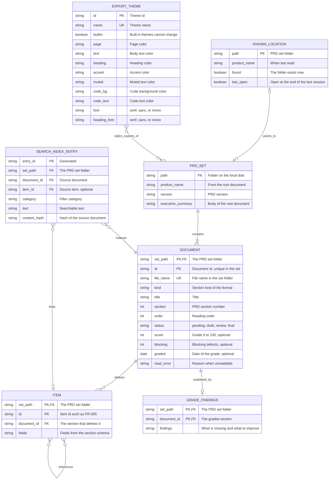

# Data model: PRD Forge Viewer

> **Template Origin**: Official | **ArcKit Version**: 6.18.3 | **Command**: `/arckit:data-model`

## Document control

| Field | Value |
|-------|-------|
| **Document ID** | ARC-001-DATA-v1.0 |
| **Document Type** | Data Model |
| **Project** | PRD Forge Viewer (Project 001) |
| **Classification** | PUBLIC |
| **Status** | DRAFT |
| **Version** | 1.0 |
| **Created Date** | 2026-10-26 |
| **Last Modified** | 2026-10-26 |
| **Review Cycle** | On-Demand |
| **Next Review Date** | 2026-11-25 |
| **Owner** | Richard Hightower, PRD owner |
| **Reviewed By** | [PENDING] |
| **Approved By** | [PENDING] |
| **Distribution** | Project Team, Architecture Team |

## Revision history

| Version | Date | Author | Changes | Approved By | Approval Date |
|---------|------|--------|---------|-------------|---------------|
| 1.0 | 2026-10-26 | ArcKit AI | Initial creation from `/arckit:data-model` command. Updated the same day for ADR-002 (theme fields), ADR-003 (index in memory), and ADR-004 (settings file) | [PENDING] | [PENDING] |
| 1.0 | 2026-10-26 | ArcKit AI | Updated for ADR-003 v1.1: E-006 is a table in a SQLite index file in the app data folder | [PENDING] | [PENDING] |

---

## Executive summary

### Overview

This data model covers the seven data requirements DR-001 to DR-007 in
`ARC-001-REQ-v1.0.md`. It has one entity for each requirement.

The entities are in two groups. Four entities (E-001 to E-004) are the PRD set
that the authoring tools write. The viewer only reads them (NFR-SEC-002). Three
entities (E-005 to E-007) belong to the viewer. The viewer stores them on the
author's computer, outside the PRD set folder.

The viewer is a local desktop app with no server and no accounts. No entity
holds personal data. No PRD content leaves the computer (NFR-SEC-001, PRD
NFR-005) [PFVP-C1].

### Model statistics

- **Total Entities**: 7 entities defined (E-001 through E-007)
- **Total Attributes**: 46 attributes across all entities
- **Total Relationships**: 8 relationships mapped
- **Data Classification**:
  - 🟢 Public: 0 entities
  - 🟡 Internal: 7 entities
  - 🟠 Confidential: 0 entities (0 contain PII)
  - 🔴 Restricted: 0 entities

"Internal" means that the data stays on the author's computer. A PRD set can hold
client material, so the author decides who receives an export (TR-006).

### Compliance summary

- **GDPR/DPA 2018 Status**: Not applicable. No personal data exists in the model.
- **PII Entities**: 0
- **Data Protection Impact Assessment (DPIA)**: NOT_REQUIRED
- **Data Retention**: Until the author deletes the data. The PRD sets no period.
- **Cross-Border Transfers**: NO. No data leaves the computer.

### Key data governance stakeholders

- **Data Owner (Business)**: PER-001 Author, for the PRD set content. The author owns the PRD (section 4 of the PRD).
- **Data Steward**: Richard Hightower, PRD owner, for this data model.
- **Data Custodian (Technical)**: The viewer, for E-005 to E-007. The authoring tools, for E-001 to E-004.
- **Data Protection Officer**: Not applicable. No personal data.

---

## Visual Entity-Relationship Diagram (ERD)

**Diagram Notes**:

- **Cardinality**: `||` = exactly one, `o{` = zero or more, `|{` = one or more, `o|` = zero or one.
- **Read-only entities**: PRD_SET, DOCUMENT, ITEM, and GRADE_FINDINGS come from the PRD set files. The viewer never writes them.
- **Viewer entities**: KNOWN_LOCATION, SEARCH_INDEX_ENTRY, and EXPORT_THEME are stored by the viewer, outside the PRD set folder.
- **Relevance**: The relevance score from 0 to 100 (WF-003) is computed for each query. The model does not store it.
- **EXPORT_THEME to PRD_SET**: A theme is not stored with a set. An export of any set can use any theme.

---

## Entity catalog

### Entity E-001: PRD set

**Description**: One folder with a root document and 17 section documents in the
PRD Forge format, version 1.

**Source Requirements**:

- DR-001: PRD set.
- NFR-I-001 (PRD C-003): the format version 1 layout.

**Business Context**: The author opens a PRD set to read it, search it, and export
it (J-001, J-002).

**Data Ownership**:

- **Business Owner**: PER-001 Author
- **Technical Owner**: The authoring tools write it. The viewer reads it.
- **Data Steward**: PER-001 Author

**Data Classification**: INTERNAL

**Volume Estimates**:

- **Initial Volume**: One set open at a time.
- **Growth Rate**: Not in the PRD.
- **Peak Volume**: Not in the PRD.
- **Average Record Size**: Not in the PRD. The NFR targets are for 18 documents.

**Data Retention**:

- **Active Period**: Owned by the authoring tools.
- **Archive Period**: Not applicable.
- **Total Retention**: The viewer keeps no copy.
- **Deletion Policy**: The viewer never deletes it (NFR-SEC-002).

#### Attributes

| Attribute | Type | Required | PII | Description | Validation Rules | Default | Source Req |
|-----------|------|----------|-----|-------------|------------------|---------|------------|
| path | Folder path | Yes | No | Location on the local disk | Folder exists and holds `prd.md` | None | DR-001 |
| product_name | Text | Yes | No | Product name | From the front matter of `prd.md` | None | DR-001, FR-001 |
| version | Text | Yes | No | PRD version | From the front matter of `prd.md` | None | DR-001, FR-014 |
| executive_summary | Text | Yes | No | Body of the root document | Markdown | None | DR-001, FR-001 |

**Attribute Notes**:

- **PII Attributes**: None.
- **Encrypted Attributes**: None. The files stay where the author keeps them.
- **Derived Attributes**: All attributes come from `prd.md`.
- **Audit Attributes**: None. The viewer does not change the set.

#### Relationships

**Outgoing Relationships**:

- contains: E-001 → E-002 (one-to-many)
  - Foreign Key: E-002.set_path references E-001.path
  - Description: The root and the 17 sections, from `links.children`.
  - Cascade Delete: Not applicable. The viewer never deletes.
  - Orphan Check: REQUIRED. A document belongs to one set.

**Incoming Relationships**:

- points_to: E-005 → E-001
  - Description: A known location names the folder of a set.
  - Usage: Start-up and the locations screen (FR-002, FR-021, FR-022).

#### Indexes

**Primary Key**:

- `pk_prd_set` on `path`

**Foreign Keys**: None.

**Unique Constraints**: None beyond the primary key.

**Performance Indexes**: Not applicable. The viewer holds one set in memory.

**Full-Text Indexes**: See E-006.

#### Privacy & Compliance

**GDPR/DPA 2018 Considerations**:

- **Contains PII**: NO
- **PII Attributes**: None
- **Legal Basis for Processing**: Not applicable
- **Data Subject Rights**: Not applicable
- **Data Breach Impact**: LOW for the viewer. The content stays on the computer (NFR-SEC-001).
- **Cross-Border Transfers**: None
- **Data Protection Impact Assessment (DPIA)**: NOT_REQUIRED

**Sector-Specific Compliance**: None applies.

**Audit Logging**:

- **Access Logging**: Not Required
- **Change Logging**: Not Required. The viewer makes no change.
- **Retention of Logs**: Not applicable

---

### Entity E-002: Document

**Description**: One markdown file of the set with YAML front matter. The front
matter is authoritative over the body text.

**Source Requirements**:

- DR-002: Document.
- FR-001, FR-003, FR-004: list, unreadable documents, and grades.

**Business Context**: The tree, the grade view, search, and export all read
documents (WF-001, WF-002, WF-009).

**Data Ownership**:

- **Business Owner**: PER-001 Author
- **Technical Owner**: The authoring tools
- **Data Steward**: PER-001 Author

**Data Classification**: INTERNAL

**Volume Estimates**:

- **Initial Volume**: 18 per set for the NFR targets.
- **Growth Rate**: Not in the PRD.
- **Peak Volume**: Not in the PRD.
- **Average Record Size**: Not in the PRD.

**Data Retention**:

- **Active Period**: Owned by the authoring tools.
- **Archive Period**: Not applicable.
- **Total Retention**: The viewer keeps no copy.
- **Deletion Policy**: The viewer never deletes it.

#### Attributes

| Attribute | Type | Required | PII | Description | Validation Rules | Default | Source Req |
|-----------|------|----------|-----|-------------|------------------|---------|------------|
| set_path | Folder path | Yes | No | The set | Matches E-001.path | None | DR-002 |
| id | Text | Yes | No | Document ID | Unique in the set | None | DR-002 |
| file_name | Text | Yes | No | File name | Shown when unreadable (FR-003) | None | DR-002, FR-003 |
| kind | Text | Yes | No | Section kind | One of the `prd-forge/*@1` kinds | None | DR-002, NFR-I-001 |
| title | Text | Yes | No | Title | Not empty | None | DR-002 |
| section | Integer | Yes | No | PRD section number | Positive | None | DR-002 |
| order | Integer | Yes | No | Reading order | Positive | None | DR-002, FR-001 |
| status | Enum | Yes | No | Document status | pending, draft, review, final | None | DR-002, FR-001, FR-014 |
| score | Integer | No | No | Grade | 0 to 100. Shown as missing when absent | None | DR-002, FR-004 |
| blocking | Integer | No | No | Blocking defects | 0 or more. Shown as missing when absent | None | DR-002, FR-004, FR-019 |
| graded | Date | No | No | Date of the grade | ISO 8601 date | None | DR-002 |
| read_error | Text | No | No | Reason the file cannot be read | Set by the viewer on a read failure | None | FR-003 |

**Attribute Notes**:

- **PII Attributes**: None.
- **Encrypted Attributes**: None.
- **Derived Attributes**: `read_error` is set by the viewer, not by the file. It lives in memory only.
- **Audit Attributes**: None.

#### Relationships

**Outgoing Relationships**:

- defines: E-002 → E-003 (one-to-many)
  - Foreign Key: E-003.document_id references E-002.id
  - Description: The items that the section defines.
  - Cascade Delete: Not applicable.
  - Orphan Check: REQUIRED.
- explained_by: E-002 → E-004 (one-to-zero-or-one)
  - Foreign Key: E-004.document_id references E-002.id
  - Description: The grade findings of the section (REL-002).

**Incoming Relationships**:

- contains: E-001 → E-002.
- indexes: E-006 → E-002.

#### Indexes

**Primary Key**:

- `pk_document` on `(set_path, id)`

**Foreign Keys**:

- `fk_document_prd_set` on `set_path`, references E-001.path

**Unique Constraints**:

- `uk_document_file` on `(set_path, file_name)`

**Performance Indexes**:

- `idx_document_order` on `(set_path, order)` for the tree.

**Full-Text Indexes**: See E-006.

#### Privacy & Compliance

**GDPR/DPA 2018 Considerations**: Same as E-001. No PII. DPIA NOT_REQUIRED.

**Sector-Specific Compliance**: None applies.

**Audit Logging**: Not Required.

---

### Entity E-003: Item

**Description**: One identified entry in a section, such as a persona, a stage, a
requirement, or a wireframe. IDs are stable and never renumbered.

**Source Requirements**:

- DR-003: Item.
- FR-007 (follow a reference), FR-008 (search), FR-023 (select an item in the tree).

**Business Context**: Developers work by item, not by section (SD-3).

**Data Ownership**:

- **Business Owner**: PER-001 Author
- **Technical Owner**: The authoring tools
- **Data Steward**: PER-001 Author

**Data Classification**: INTERNAL

**Volume Estimates**: Not in the PRD.

**Data Retention**: Owned by the authoring tools. The viewer keeps no copy.

#### Attributes

| Attribute | Type | Required | PII | Description | Validation Rules | Default | Source Req |
|-----------|------|----------|-----|-------------|------------------|---------|------------|
| set_path | Folder path | Yes | No | The set | Matches E-001.path | None | DR-003 |
| id | Text | Yes | No | Item ID | A PRD prefix (P-, PER-, O-, J-, ST-, SC-, IN-, OUT-, FR-, NFR-, C-, TR-, A-, R-, D-, Q-, REL-, WF-) and a number | None | DR-003 |
| document_id | Text | Yes | No | The defining section | Matches E-002.id | None | DR-003 |
| fields | Structured | Yes | No | The fields of the item | As the section schema defines | None | DR-003 |

**Attribute Notes**:

- **PII Attributes**: None. Persona items describe roles, not people.
- **Derived Attributes**: References to other items are found in `fields` by ID pattern (FR-007).

#### Relationships

**Outgoing Relationships**:

- references: E-003 → E-003 (many-to-many)
  - Description: An item names other items by ID, such as an FR that names its stage.
  - Orphan Check: OPTIONAL. A reference to a missing ID shows as text.

**Incoming Relationships**:

- defines: E-002 → E-003.
- finds: E-006 → E-003.

#### Indexes

**Primary Key**:

- `pk_item` on `(set_path, id)`

**Foreign Keys**:

- `fk_item_document` on `(set_path, document_id)`, references E-002

**Performance Indexes**:

- `idx_item_document` on `(set_path, document_id)` for the tree (FR-023).

#### Privacy & Compliance

Same as E-001. No PII. DPIA NOT_REQUIRED. No audit logging.

---

### Entity E-004: Grade findings

**Description**: The reasons behind a section's grade, in the `grades/` folder of
the set. PRD Forge 0.2.0 delivers them (D-002). Release 2 shows them (REL-002).

**Source Requirements**:

- DR-004: Grade findings.

**Business Context**: The author sees what is missing and what to improve
(REL-002 outcome).

**Data Ownership**:

- **Business Owner**: PER-001 Author
- **Technical Owner**: The authoring tools, which write it in a grading pass
- **Data Steward**: PER-001 Author

**Data Classification**: INTERNAL

**Volume Estimates**: At most one per section.

**Data Retention**: Owned by the authoring tools.

#### Attributes

| Attribute | Type | Required | PII | Description | Validation Rules | Default | Source Req |
|-----------|------|----------|-----|-------------|------------------|---------|------------|
| set_path | Folder path | Yes | No | The set | Matches E-001.path | None | DR-004 |
| document_id | Text | Yes | No | The graded section | Same file name as the section, in `grades/` | None | DR-004 |
| findings | Text | Yes | No | Findings | Markdown | None | DR-004 |

#### Relationships

- explained_by: E-002 → E-004 (one-to-zero-or-one).

#### Indexes

**Primary Key**:

- `pk_grade_findings` on `(set_path, document_id)`

#### Privacy & Compliance

Same as E-001. No PII. DPIA NOT_REQUIRED. No audit logging.

---

### Entity E-005: Known location

**Description**: A PRD set folder that the viewer remembers, and the set that was
open at the end of the last session.

**Source Requirements**:

- DR-005: Known location.
- FR-002 (return to the same set), FR-021 (`prdf`), FR-022 (remembered locations), WF-006.

**Business Context**: The author returns to the same set without selecting it
again, and chooses another set from a list.

**Data Ownership**:

- **Business Owner**: PER-001 Author
- **Technical Owner**: The viewer
- **Data Steward**: PER-001 Author

**Data Classification**: INTERNAL

**Volume Estimates**: Not in the PRD.

**Data Retention**:

- **Total Retention**: Until the author removes the location. The PRD sets no period.
- **Deletion Policy**: Hard delete when the author removes it.

#### Attributes

| Attribute | Type | Required | PII | Description | Validation Rules | Default | Source Req |
|-----------|------|----------|-----|-------------|------------------|---------|------------|
| path | Folder path | Yes | No | PRD set folder | Absolute path | None | DR-005, FR-022 |
| product_name | Text | No | No | Product name when last read | From `prd.md` | None | DR-005 |
| found | Boolean | Yes | No | The folder exists now | Checked on start | true | DR-005, WF-006 |
| last_open | Boolean | Yes | No | Open at the end of the last session | At most one location is true | false | DR-005, FR-002 |

**Attribute Notes**:

- **PII Attributes**: None. A folder path can contain a user name. The path never leaves the computer.
- **Derived Attributes**: `found` is checked on start, not stored as a fact.

#### Relationships

- points_to: E-005 → E-001 (zero-or-one to zero-or-one).

#### Indexes

**Primary Key**:

- `pk_known_location` on `path`

#### Privacy & Compliance

No PII is collected. A path stays on the computer (NFR-SEC-001). DPIA
NOT_REQUIRED. No audit logging.

---

### Entity E-006: Search index entry

**Description**: A derived entry for search by term and category. The viewer
keeps the index in a SQLite full-text table, one file for each set, in the app
data folder (ADR-003). The file is a derived cache. The viewer rebuilds it from
the set when it is missing or damaged (principle 6).

**Source Requirements**:

- DR-006: Search index entry.
- FR-008 (search), NFR-P-003 (0.5 seconds at p95), SC-007 (no match).

**Business Context**: A developer finds the items for one story (SD-3, G-3).

**Data Ownership**:

- **Business Owner**: PER-002 ToolsDeveloper
- **Technical Owner**: The viewer
- **Data Steward**: Richard Hightower, PRD owner

**Data Classification**: INTERNAL

**Volume Estimates**: Not in the PRD. One entry for each document and item.

**Data Retention**:

- **Total Retention**: Derived. Rebuilt when a source document changes.
- **Deletion Policy**: Hard delete. Safe at any time.

#### Attributes

| Attribute | Type | Required | PII | Description | Validation Rules | Default | Source Req |
|-----------|------|----------|-----|-------------|------------------|---------|------------|
| entry_id | Text | Yes | No | Generated ID | Unique | Generated | DR-006 |
| set_path | Folder path | Yes | No | The set | Matches E-001.path | None | DR-006 |
| document_id | Text | Yes | No | Source document | Matches E-002.id | None | DR-006 |
| item_id | Text | No | No | Source item | Matches E-003.id | None | DR-006, FR-008 |
| category | Text | Yes | No | Filter category | From the section kind | None | DR-006, FR-008 |
| text | Text | Yes | No | Searchable text | Plain text from the source | None | DR-006 |
| content_hash | Text | Yes | No | Hash of the source document when indexed | Matches the file on disk, else reindex | None | DR-006, FR-009 |

**Attribute Notes**:

- **Derived Attributes**: All. The relevance score (0 to 100) is computed per query and is not stored.

#### Relationships

- indexes: E-006 → E-002 (many-to-one).
- finds: E-006 → E-003 (many-to-zero-or-one).

#### Indexes

**Primary Key**:

- `pk_search_index_entry` on `entry_id`

**Performance Indexes**:

- `idx_search_category` on `(set_path, category)` for the category filter.
- `idx_search_document` on `(set_path, document_id)` to update one changed document (FR-009).

**Full-Text Indexes**:

- `ftx_search_text` on `text`: an FTS5 virtual table ranked with `bm25()` (ADR-003).

#### Privacy & Compliance

Same as E-001. No PII. DPIA NOT_REQUIRED. Stored in the app data folder, outside the PRD set (ADR-003).

---

### Entity E-007: Export theme

**Description**: A built-in or custom theme for exports. Custom themes survive a
restart.

**Source Requirements**:

- DR-007: Export theme.
- FR-015 to FR-018 (select, make, change, delete), FR-020 and NFR-A-002 (keep themes).

**Business Context**: The author sends exports that match the client (SD-2).

**Data Ownership**:

- **Business Owner**: PER-001 Author
- **Technical Owner**: The viewer
- **Data Steward**: PER-001 Author

**Data Classification**: INTERNAL

**Volume Estimates**: Not in the PRD.

**Data Retention**:

- **Total Retention**: Until the author deletes the theme (FR-018).
- **Deletion Policy**: Hard delete of custom themes. Built-in themes cannot be deleted.

#### Attributes

| Attribute | Type | Required | PII | Description | Validation Rules | Default | Source Req |
|-----------|------|----------|-----|-------------|------------------|---------|------------|
| id | Text | Yes | No | Theme ID | Unique | Generated | DR-007 |
| name | Text | Yes | No | Theme name | Unique, not empty | None | DR-007, FR-016 |
| builtin | Boolean | Yes | No | Built-in theme | Built-in themes cannot change or be deleted | false | DR-007, FR-015 |
| page, text, heading, accent, muted, codeBg, codeText | Color (7 fields) | Yes | No | Theme colors | Hex color, `#RRGGBB` | None | DR-007 |
| font | Enum | Yes | No | Body font | serif, sans, or mono | None | DR-007 |
| headingFont | Enum | Yes | No | Heading font | serif, sans, or mono | None | DR-007 |

The fields follow the Motion `ExportTheme` type (ADR-002). Built-in themes are
Ice Snowstorm and Clay.

**Attribute Notes**:

- **Durability**: Zero custom themes lost on a restart (NFR-A-002, PRD NFR-008).

#### Relationships

- styles_exports_of: E-007 → E-001 (many-to-many, not stored). Any theme can style an export of any set.

#### Indexes

**Primary Key**:

- `pk_export_theme` on `name`

#### Privacy & Compliance

Same as E-001. No PII. DPIA NOT_REQUIRED.

---

## Data governance matrix

| Entity | Business Owner | Data Steward | Technical Custodian | Sensitivity | Compliance | Quality SLA | Access Control |
|--------|----------------|--------------|---------------------|-------------|------------|-------------|----------------|
| E-001: PRD set | PER-001 Author | PER-001 Author | Authoring tools | INTERNAL | None | Every valid set opens (NFR-I-001) | Read-only in the viewer |
| E-002: Document | PER-001 Author | PER-001 Author | Authoring tools | INTERNAL | None | Status, score, and blocking shown exactly | Read-only in the viewer |
| E-003: Item | PER-001 Author | PER-001 Author | Authoring tools | INTERNAL | None | Every ID found by search | Read-only in the viewer |
| E-004: Grade findings | PER-001 Author | PER-001 Author | Authoring tools | INTERNAL | None | Shown for every graded section (REL-002) | Read-only in the viewer |
| E-005: Known location | PER-001 Author | PER-001 Author | The viewer | INTERNAL | None | Last set reopens (FR-002) | The local user |
| E-006: Search index entry | PER-002 ToolsDeveloper | PRD owner | The viewer | INTERNAL | None | Current within 2 seconds of a save (NFR-P-002) | The local user |
| E-007: Export theme | PER-001 Author | PER-001 Author | The viewer | INTERNAL | None | Zero themes lost (NFR-A-002) | The local user |

**Governance Notes**:

- The viewer has one user, the person who runs it. Access control is the operating system file permissions.
- No entity falls under a compliance framework.

---

## CRUD matrix

**Purpose**: Shows which components can Create, Read, Update, and Delete each
entity. The component names are logical. The ADRs and diagrams name the build
units.

| Entity | Authoring tools (external) | Set reader | Change watcher | Tree and grade view | Search | Export | Theme manager | `prdf` launcher |
|--------|---------------------------|------------|----------------|---------------------|--------|--------|---------------|-----------------|
| E-001: PRD set | CRUD | -R-- | -R-- | -R-- | ---- | -R-- | ---- | -R-- |
| E-002: Document | CRUD | -R-- | -R-- | -R-- | -R-- | -R-- | ---- | ---- |
| E-003: Item | CRUD | -R-- | -R-- | -R-- | -R-- | -R-- | ---- | ---- |
| E-004: Grade findings | CRUD | -R-- | -R-- | -R-- | ---- | -R-- | ---- | ---- |
| E-005: Known location | ---- | CRU- | ---- | -R-D | ---- | ---- | ---- | -R-- |
| E-006: Search index entry | ---- | C--- | CRUD | ---- | -R-- | ---- | ---- | ---- |
| E-007: Export theme | ---- | ---- | ---- | ---- | ---- | -R-- | CRUD | ---- |

**Legend**:

- **C** = Create, **R** = Read, **U** = Update, **D** = Delete, **-** = No access

**Access Control Implications**:

- No viewer component has C, U, or D on E-001 to E-004 (NFR-SEC-002).
- The viewer writes E-005 to E-007 only in its own data folder.

**Security Considerations**:

- **Least Privilege**: The viewer opens PRD set files for reading only.
- **Audit Trail**: Not required. One local user, no shared data.

---

## Data integration mapping

### Upstream systems (data sources)

#### Integration INT-001: PRD Forge authoring tools

**Source System**: The PRD Forge authoring tools (PRD Forge maintainers, D-001)

**Integration Type**: File-based, local

**Data Flow Direction**: Authoring tools → viewer

**Entity Mappings**:

| Source | Target Entity | Mapping |
|--------|---------------|---------|
| `prd.md` front matter and body | E-001, E-002 | Product name, version, summary, children |
| Section front matter | E-002, E-003 | Status, score, blocking, graded, items |
| `grades/*.md` | E-004 | Findings |

**Update Frequency**: On each save. Shown within 2 seconds at p95 (NFR-P-002).

**Data Quality SLA**: Every set that passes the PRD Forge validator opens (NFR-I-001).

**Error Handling**: An unreadable file sets `read_error` on E-002 and the other documents still show (FR-003).

#### Integration INT-002: Terminal (`prdf`)

**Source System**: The terminal

**Data Flow Direction**: Terminal → viewer

**Entity Mappings**: A folder path → E-005 and E-001.

**Update Frequency**: Each start.

---

### Downstream systems (data consumers)

#### Integration INT-003 and INT-004: PDF readers and word processors

**Target System**: Any standard PDF reader or word processor (IN-006)

**Data Flow Direction**: Viewer → export file

**Entity Mappings**: E-001, E-002, E-003, and E-004 content, styled by E-007, with the version and the draft mark.

**Sync Method**: A file that the author saves and sends. The viewer sends nothing (TR-006).

**Latency SLA**: Whole set within 10 seconds at p95 (NFR-P-004).

#### Integration INT-005: Operating system print service

**Entity Mappings**: Same as INT-003. FR-013 is a SHOULD.

---

### Master data management (MDM)

**Source of Truth**:

| Entity | System of Record | Rationale | Conflict Resolution |
|--------|------------------|-----------|---------------------|
| E-001 to E-004 | The PRD set files, written by the authoring tools | Principle 6 | The files always win. The viewer rereads them |
| E-005: Known location | The viewer | Only the viewer uses it | Not applicable |
| E-006: Search index entry | Derived from E-002 and E-003 | Principle 6 | Rebuild from the files |
| E-007: Export theme | The viewer | Only the viewer uses it | Not applicable |

**Data Lineage**:

- **E-002, E-003**: Written by the authoring tools → read by the set reader → indexed into E-006 → rendered by the tree and by exports.
- **E-007**: Made by the author in the theme manager → read by export.

---

## Privacy & Compliance

### GDPR / UK Data Protection Act 2018 Compliance

The viewer is not a government system and holds no personal data. This section
records that fact. It adds no compliance work.

#### PII inventory

None. No entity has a PII attribute.

#### Legal basis for processing

Not applicable.

#### Data subject rights implementation

Not applicable.

#### Data retention schedule

| Entity | Retention | Trigger |
|--------|-----------|---------|
| E-001 to E-004 | Owned by the authoring tools | Not applicable |
| E-005 | Until the author removes it | Author action |
| E-006 | Rebuilt on change | Source change |
| E-007 | Until the author deletes it | FR-018 |

#### Cross-Border data transfers

None. No data leaves the computer (NFR-SEC-001).

#### Data protection impact assessment (DPIA)

NOT_REQUIRED. No personal data.

#### ICO registration & notifications

Not applicable.

### Sector-Specific compliance

#### PCI-DSS (payment card industry data security standard)

Not applicable.

#### HIPAA (health insurance portability and accountability act)

Not applicable.

#### FCA regulations (financial conduct authority - UK)

Not applicable.

#### Government security classifications (UK public sector)

Not applicable.

---

## Data quality framework

The viewer does not create PRD content, so it cannot fix its quality. Its quality
duty is to show the files exactly and to fail visibly (principles 3 and 13).

### Quality dimensions

#### Accuracy

- Status, score, blocking, and graded show exactly as the front matter records them.
- Target: 100% match on the fixture sets.

#### Completeness

- A missing score or blocking count shows as missing, not as 0.
- A pending section shows as pending (FR-003).

#### Consistency

- E-006 matches the current files. Target: current within 2 seconds of a save at p95 (NFR-P-002).

#### Timeliness

- Same target as consistency.

#### Uniqueness

- Item IDs are unique in a set. A duplicate ID shows as a read error on the second document.

#### Validity

- `status` is one of pending, draft, review, final. `score` is 0 to 100. Any other value sets `read_error`.

### Data quality metrics

| Metric | Target | Source |
|--------|--------|--------|
| Fixture sets that open with every document shown | 100% | NFR-I-001 |
| Grades shown that match the front matter | 100% | Principle 13 |
| Search index current after a save, p95 | 2 seconds or less | NFR-P-002 |
| Custom themes lost on a restart | 0 | NFR-A-002 |

### Data quality issue resolution

1. The viewer shows the issue on the document by file name (FR-003).
2. The author fixes the file in the authoring tools.
3. The viewer rereads the file on save (FR-009).

---

## Requirements traceability

| Requirement ID | Requirement Description | Entity | Attributes | Status | Notes |
|----------------|------------------------|--------|------------|--------|-------|
| DR-001 | PRD set | E-001 | path, product_name, version, executive_summary | ✅ Implemented | |
| DR-002 | Document | E-002 | all 12 | ✅ Implemented | `read_error` added for FR-003 |
| DR-003 | Item | E-003 | set_path, id, document_id, fields | ✅ Implemented | |
| DR-004 | Grade findings | E-004 | set_path, document_id, findings | ✅ Implemented | Used in REL-002 |
| DR-005 | Known location | E-005 | path, product_name, found, last_open | ✅ Implemented | |
| DR-006 | Search index entry | E-006 | all 6 | ✅ Implemented | Relevance computed per query |
| DR-007 | Export theme | E-007 | name, built_in, font, colors | ✅ Implemented | |
| NFR-SEC-001 | No PRD content leaves the computer | All | All | ✅ Implemented | No entity syncs out |
| NFR-SEC-002 | The viewer does not change the PRD set | E-001 to E-004 | All | ✅ Implemented | CRUD matrix: read only |

**Coverage Summary**:

- **Total DR Requirements**: 7
- **Requirements Modeled**: 7 (✅)
- **Requirements Partially Modeled**: 0
- **Requirements Not Modeled**: 0
- **Coverage %**: 100%

**Gaps Identified**:

- The PRD gives no data volume except the 18-document set. Volumes stay "Not in the PRD" until the PRD owner adds a target.
- E-007 fonts: Motion uses `serif`, `sans`, and `mono`, and its PDF writer does not embed fonts. ADR-002 v1.1 writes the PDF from HTML with embedded fonts. Keep the Motion values and show the PRD words in the UI.

---

## Implementation guidance

### Database technology recommendation

The ADRs decide the technology. This model needs:

- **E-001 to E-004**: No database. The viewer reads the files and holds one set in memory.
- **E-006**: A SQLite file with an FTS5 table and `bm25()` ranking, in the app data folder (ADR-003).
- **E-005 and E-007**: One settings file in the operating system app config folder, written atomically (ADR-004). It must survive a restart (NFR-A-002).

All stores are on the author's computer, outside the PRD set folder (principles
1 and 2).

### Schema migration strategy

- E-001 to E-004 follow the PRD Forge format version 1. A new format version is a new ADR (principle 7).
- E-006 needs no migration. The viewer deletes and rebuilds it.
- E-005 and E-007 carry a schema version. The viewer upgrades them on start and keeps unknown fields.

### Backup and Recovery

- E-001 to E-004: owned by the authoring tools and the author's own backups.
- E-006: no backup. Rebuild it.
- E-005 and E-007: covered by the computer's own backup. A corrupt file must not lose the other themes (NFR-A-002).

### Data archival

Not applicable.

### Testing data strategy

- Use fixture PRD sets, not client PRDs (principle 15).
- Fixtures: the 18-document set, a set with 13 pending sections (FR-003), a set with one unreadable section, a set with an unknown front matter field, and a search with no match (SC-007).
- No anonymization is needed. Fixtures hold no personal data.

---

## Appendix

### Glossary

| Term | Meaning |
|------|---------|
| PRD set | One folder with a root document and 17 section documents (C-003) |
| Front matter | The YAML block at the top of each document. Authoritative for status, score, and links |
| Grade | The score and blocking count that a grading pass writes |
| Derived data | Data the viewer builds from the files and can rebuild at any time |

### References

- `ARC-001-REQ-v1.0.md`, requirements, DR-001 to DR-007
- `ARC-001-STKE-v1.0.md`, stakeholder analysis
- `projects/000-global/ARC-000-PRIN-v1.0.md`, architecture principles
- The PRD set, `docs/prd/prd-forge-viewer/`, version 0.3.1

---

## External references

> This section provides traceability from generated content back to source documents.

### Document register

| Doc ID | Filename | Type | Source Location | Description |
|--------|----------|------|-----------------|-------------|
| PFVP | prd-forge-viewer-prd.pdf | PRD | `projects/001-prd-forge-viewer/external/` | Export of the PRD Forge Viewer PRD, version 0.3.2, 18 documents |

### Citations

| Citation ID | Doc ID | Page/Section | Category | Quoted Passage |
|-------------|--------|--------------|----------|----------------|
| PFVP-C1 | PFVP | Section 8, NFR-005 | Privacy | No content of a PRD set leaves the author's computer. |

### Unreferenced documents

| Filename | Source Location | Reason |
|----------|-----------------|--------|
| README.md | `projects/001-prd-forge-viewer/external/` | Describes the PDF. No content to cite. |

---

**Generated by**: ArcKit `/arckit:data-model` command
**Generated on**: 2026-10-26
**ArcKit Version**: 6.18.3
**Project**: PRD Forge Viewer (Project 001)
**Model**: claude-opus-5-5

<!-- arckit-provenance:start -->

## Build provenance

*Stamped automatically by the ArcKit plugin's `provenance-stamp.mjs` PostToolUse hook. Complements (does not replace) the human-authored footer above. Carries only fields the model can't authoritatively self-report: build context from `.arckit/state.json` and effort levels derived from command frontmatter + the silent-downgrade matrix.*

| Field | Value |
|-------|-------|
| Requested Effort | `high` |
| Effective Effort | `high` |
| Stamped at | 2026-10-27T00:45:46.141Z |

<!-- arckit-provenance:end -->
