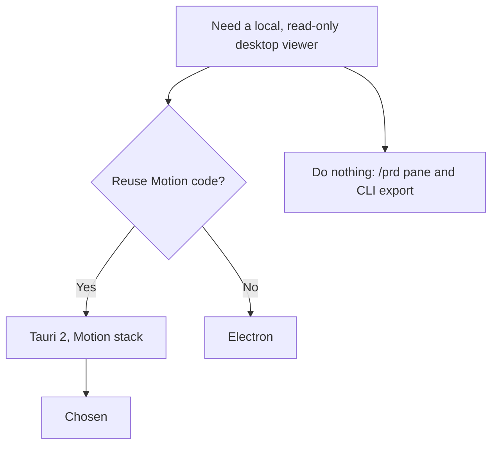

# Architecture decision record: Build the viewer as a Tauri desktop app

> **Template Origin**: Official | **ArcKit Version**: 6.18.3 | **Command**: `/arckit:adr`

## Document control

| Field | Value |
|-------|-------|
| **Document ID** | ARC-001-ADR-001-v1.1 |
| **Document Type** | Architecture Decision Record |
| **Project** | PRD Forge Viewer (Project 001) |
| **Classification** | PUBLIC |
| **Status** | APPROVED |
| **Version** | 1.1 |
| **Created Date** | 2026-10-26 |
| **Last Modified** | 2026-10-26 |
| **Review Cycle** | On-Demand |
| **Next Review Date** | 2026-11-25 |
| **Owner** | Richard Hightower, PRD owner |
| **Reviewed By** | [PENDING] |
| **Approved By** | Richard Hightower, PRD owner |
| **Distribution** | Project Team, Architecture Team |

## Revision history

| Version | Date | Author | Changes | Approved By | Approval Date |
|---------|------|--------|---------|-------------|---------------|
| 1.0 | 2026-10-26 | ArcKit AI | Initial creation from `/arckit:adr` command | [PENDING] | [PENDING] |
| 1.1 | 2026-10-26 | ArcKit AI | Release 1 is macOS only (C-004). Release date 2026-10-27. Accepted | Richard Hightower | 2026-10-26 |

## 1. decision title

**Build the PRD Forge Viewer as a Tauri 2 desktop app with the standard Spillwave plugins**

**ADR Status**: Accepted

---

## 2. stakeholders

### 2.1 deciders (RACI: accountable)

- Richard Hightower, PRD owner. Decides scope and ADRs (`ARC-001-STKE-v1.0.md`, RACI).

### 2.2 consulted (RACI: consulted)

- Engineering lead of the viewer (not yet named). Build and test effort.
- PER-001 Author. Daily use on the test computer.

### 2.3 informed (RACI: informed)

- PER-004 Sponsor.
- PRD Forge maintainers.

### 2.4 UK government escalation context

Not applicable. The viewer is not a government system.

**Decision Level**: Team (project). The PRD owner decides.

**Governance Forum**: PRD owner review of the ADR set.

**Approval Date**: 2026-10-26

---

## 3. context and problem statement

### 3.1 problem description

The PRD names no technology. The viewer must be a local desktop app that reads
files, works with no network, and writes PDF and Word exports. A desktop shell
and UI technology must be chosen before any build starts.

**Problem statement as a question**: Which desktop app technology does the viewer use?

### 3.2 why this decision is needed

- **Business context**: BR-003 needs release 1 by 2026-10-27. Reuse of existing Spillwave code shortens the build.
- **Technical context**: NFR-A-001 (works with no network), NFR-SEC-001 (no content leaves the computer), NFR-SEC-002 (read-only), NFR-P-001 to NFR-P-004 (performance), NFR-U-001 (keyboard-only use).
- **Regulatory context**: None applies.

### 3.3 supporting links

- **Requirements**: BR-003, FR-001 to FR-024, NFR-A-001, NFR-SEC-001 to NFR-SEC-003, NFR-U-001
- **Research findings**: No RSCH document. Evidence is the Motion repository [WEB-1-C1].
- **Related ADRs**: ADR-002, ADR-003, ADR-004, ADR-005

---

## 4. decision drivers (forces)

### 4.1 technical drivers

- **Local file access with least privilege**: The viewer reads one PRD set folder and its own data folder only.
  - Requirements: NFR-SEC-002, NFR-SEC-003
  - Architecture principles: 2 (read-only), 4 (security by design)
- **Offline and private**: No server, no account.
  - Requirements: NFR-A-001, NFR-SEC-001
  - Architecture principles: 1 (local first)
- **Performance on the test computer**: Apple silicon Mac with 16 GB.
  - Requirements: NFR-P-001 to NFR-P-004
  - Architecture principles: 11
- **Accessibility**: Keyboard-only use, zero WCAG 2.2 AA failures.
  - Requirements: NFR-U-001
  - Architecture principles: 12

### 4.2 business drivers

- **Reuse of Spillwave code**: Motion (`SpillwaveSolutions/motion`) is a Tauri 2 markdown app with themed PDF and Word export [WEB-1-C1].
  - Requirements: BR-003
  - Stakeholder goals: G-1, G-2
- **Free and open source**: Every dependency must allow it.
  - Architecture principles: 5

### 4.3 regulatory & compliance drivers

- **GDS Service Standard**: Not applicable.
- **Technology Code of Practice**: Not applicable.
- **NCSC Cyber Security**: Not applicable.
- **Data Protection**: Not applicable. No personal data (`ARC-001-DATA-v1.0.md`).
- **Accessibility**: WCAG 2.2 AA, from NFR-U-001 (PRD NFR-007).

### 4.4 alignment to architecture principles

| Principle | Alignment | Impact |
|-----------|-----------|--------|
| 1. Local first, no server | ✅ Supports | Tauri runs the UI and the core on the computer |
| 2. Read-only on the PRD set | ✅ Supports | The Tauri file system plugin limits access by scope |
| 4. Security by design | ✅ Supports | Capabilities and a content security policy block remote content |
| 5. Free and open source | ✅ Supports | Tauri is MIT or Apache-2.0 licensed |
| 11. Performance | ✅ Supports | Rust core for file reads and search |
| 12. Accessible | ⚠️ Partial | The system web view must be tested with a screen reader |
| 16. Reproducible builds | ✅ Supports | The Tauri CLI builds and signs packages |

---

## 5. considered options

### Option 1: Tauri 2 with a web UI and the standard Spillwave plugins

**Description**: A Rust core and a web UI in the system web view. Use the same
stack and plugins as Motion: Tauri 2.9, `tauri-plugin-fs`, `tauri-plugin-dialog`,
`tauri-plugin-log`, and the `mcp-bridge` feature for agent-driven tests only
[WEB-1-C2].

**Implementation approach**: Start from the Motion project layout. The Rust core
reads the PRD set, watches files (ADR-005), and holds the search index (ADR-003).
The web UI shows the tree, the grades, search, and export (ADR-002).

**Wardley Evolution Stage**: Product

#### Good (pros)

- ✅ **Reuse**: Motion already has Tauri 2 set-up, themes, and export code (ADR-002).
- ✅ **Least privilege**: Tauri capabilities limit file access to the opened folder and the app data folder (principle 2).
- ✅ **No remote content**: A content security policy blocks scripts and remote loads (NFR-SEC-003).
- ✅ **Small install**: The app uses the system web view and does not ship a browser.
- ✅ **Agent-driven tests**: The `mcp-bridge` feature lets an agent drive the UI in tests, and release builds leave it out [WEB-1-C2].

#### Bad (cons)

- ❌ **Web view differences**: WebKit on macOS, WebView2 on Windows, WebKitGTK on Linux. Release 1 runs on macOS only (OUT-003), so release 1 tests WebKit only.
- ❌ **Two languages**: Rust for the core, TypeScript for the UI.
- ❌ **Screen-reader support depends on the web view**: Needs a test against NFR-U-001.

#### Cost analysis

- **CAPEX**: No license cost. Build effort is not estimated in the PRD.
- **OPEX**: No hosting. A code-signing certificate for release packages (principle 4). The cost is not in the PRD.
- **TCO (3-year)**: Not estimated. The PRD gives no budget.

#### GDS service standard impact

Not applicable.

---

### Option 2: Electron with a web UI

**Description**: A Node.js core and a bundled Chromium UI.

**Implementation approach**: New project. Reuse the Motion TypeScript export and
theme code. Rewrite the Rust parts in TypeScript.

**Wardley Evolution Stage**: Product

#### Good (pros)

- ✅ **One web engine on every platform**: The same rendering on macOS, Windows, and Linux.
- ✅ **One language**: TypeScript for core and UI.

#### Bad (cons)

- ❌ **Large install**: Each package ships Chromium and Node.js.
- ❌ **Less reuse**: The Motion Tauri set-up and Rust file code do not carry over.
- ❌ **Wider default access**: The Node.js core has full file access unless the build restricts it (principle 2).

#### Cost analysis

- **CAPEX**: No license cost. More build effort than Option 1, because less code carries over.
- **OPEX**: Same as Option 1.
- **TCO (3-year)**: Not estimated.

#### GDS service standard impact

Not applicable.

---

### Option 3: do nothing (baseline)

**Description**: Build no viewer. Authors keep the `/prd` pane in Claude Code and
the command-line export of the authoring tools.

**Implementation approach**: No change.

**Wardley Evolution Stage**: Custom-Built

#### Good

- ✅ **No immediate cost**: No build.
- ✅ **No risk**: No new code.

#### Bad

- ❌ **P-002 stays**: Stakeholders without the authoring tools still read only the command-line export.
- ❌ **No live view outside Claude Code**: The `/prd` pane does not reread files on change. The author must click **Rescan**.
- ❌ **A-004 untested**: O-001 cannot show the effect of a viewer.

#### Cost analysis

- **CAPEX**: None.
- **OPEX**: None.
- **TCO (3-year)**: The cost is O-001 and O-002 not met.

#### GDS service standard impact

Not applicable.

---

## 6. decision outcome

### 6.1 chosen option

**"Option 1: Tauri 2 with a web UI and the standard Spillwave plugins"**

### 6.2 Y-Statement (structured justification)

> In the context of a local, read-only desktop viewer for PRD Forge sets,
> facing a release 1 date of 2026-10-26 and strict privacy and access limits,
> we decided for Tauri 2 with the Motion stack and plugins,
> to achieve reuse of the Motion export code, least-privilege file access, and a small install,
> accepting web view differences across platforms and a Rust and TypeScript code base.

### 6.3 justification (why this option?)

- Motion proves the stack for markdown reading and themed export [WEB-1-C1].
- Tauri capabilities give principle 2 and principle 4 at the platform level.
- Option 2 gives the same features with a larger install and less reuse.
- Option 3 leaves P-002 and O-001 unsolved.

**Dissent**: None recorded.

---

## 7. consequences

### 7.1 positive consequences

- ADR-002 can reuse Motion export code.
- File access is limited by configuration, not only by code review.
- Release builds exclude the test bridge.

### 7.2 negative consequences (accepted Trade-offs)

- Windows and Linux web views need their own test runs when the PRD owner adds those platforms. **Mitigation**: release 1 ships for macOS only (OUT-003).
- Screen-reader support depends on the web view. **Mitigation**: an accessibility audit for NFR-U-001 before release 1.

### 7.3 neutral consequences (changes needed)

- The team needs Rust and TypeScript skills.
- An Apple Developer ID certificate to sign and notarize the macOS package.

### 7.4 risks and mitigations

| Risk | Likelihood | Impact | Mitigation | Owner |
|------|-----------|--------|------------|-------|
| The web view fails a WCAG 2.2 AA check | MEDIUM | HIGH | Audit early with a screen reader. Fix in the UI | Engineering lead |
| A Tauri 2 plugin changes its API | LOW | MEDIUM | Pin plugin versions. Review on each upgrade | Engineering lead |
| R-001: a PRD Forge format change | MEDIUM | HIGH | Not affected by this ADR. See principle 7 | PRD owner |

---

## 8. validation & compliance

### 8.1 how will implementation be verified?

- The HLD shows the Rust core and the web UI as separate containers.
- The capability file allows only the opened PRD set folder (read) and the app data folder (read and write).
- The content security policy has no remote source.
- Acceptance tests for FR-001 to FR-024 run in the built app with the network off (NFR-A-001).

### 8.2 monitoring & observability

- No telemetry leaves the computer (NFR-SEC-001). Local logs only, through `tauri-plugin-log`.
- Performance tests for NFR-P-001 to NFR-P-004 on each release.

### 8.3 compliance verification

- **Accessibility**: Keyboard-only run of every acceptance criterion (NFR-U-001).
- **Security**: Dependency scan and license report in the pipeline (principles 4 and 5).
- **Government frameworks**: Not applicable.

---

## 9. links to supporting documents

### 9.1 requirements traceability

- **Business**: BR-003
- **Functional**: FR-001 to FR-024 (all run in this shell)
- **Non-functional**: NFR-A-001, NFR-SEC-001, NFR-SEC-002, NFR-SEC-003, NFR-P-001 to NFR-P-004, NFR-U-001

### 9.2 architecture artifacts

- **Architecture principles**: 1, 2, 4, 5, 11, 12, 16
- **Stakeholder drivers**: SD-1, SD-2 (goals G-1, G-2)
- **Risk register**: R-001 (not mitigated here)
- **Research findings**: None. No RSCH document exists.
- **Architecture diagrams**: C4 container diagram (to be created by `/arckit:diagram`)

### 9.3 design documents

- **Data model**: `ARC-001-DATA-v1.0.md`. E-005 to E-007 live in the app data folder.

### 9.4 external references

- Motion repository, `package.json` and `src-tauri/Cargo.toml` [WEB-1].

---

## 10. implementation plan

### 10.1 dependencies

- ADR-002 to ADR-005 build on this decision.
- A code-signing certificate for macOS.

### 10.2 implementation timeline

| Phase | Activity | Owner |
|-------|----------|-------|
| 1 | Copy the Motion Tauri layout. Remove the editor, AI, and publish features | Engineering lead |
| 2 | Set the capabilities and the content security policy | Engineering lead |
| 3 | Build the tree and grade view (FR-001 to FR-005, FR-023) | Engineering lead |

### 10.3 rollback plan

- **Trigger**: The web view fails NFR-U-001 and the UI cannot fix it.
- **Procedure**: Move the UI to Option 2. The TypeScript UI and export code carry over.
- **Owner**: PRD owner.

---

## 11. review and updates

### 11.1 review schedule

- After release 1 (2026-10-26) and after release 2 (2026-11-06).

### 11.2 trigger events for review

- A Tauri major version.
- An accessibility audit failure.
- A request to support a platform with no test computer.

---

## 12. related decisions

### 12.1 decisions this ADR depends on

- None.

### 12.2 decisions that depend on this ADR

- ADR-002 (export), ADR-003 (search), ADR-004 (`prdf` and known locations), ADR-005 (file-change detection).

### 12.3 conflicting decisions

- None.

---

## 13. appendices

### Appendix a: options analysis details

No proof of concept exists yet. Motion is the evidence for Option 1.

### Appendix B: stakeholder consultation log

| Date | Stakeholder | Feedback | Action |
|------|-------------|----------|--------|
| 2026-10-26 | Richard Hightower, PRD owner | Named Tauri and the standard Spillwave plugins as a candidate in the PRD interview | This ADR |

### Appendix C: alternative formats

---

## Document approval

| Role | Name | Signature | Date |
|------|------|-----------|------|
| PRD owner | Richard Hightower | Accepted through HLDR v1.1 sign-off | 2026-10-26 |

## External references

### Document register

| Doc ID | Filename | Type | Source Location | Description |
|--------|----------|------|-----------------|-------------|
| WEB-1 | SpillwaveSolutions/motion | Web URL | https://github.com/SpillwaveSolutions/motion | Spillwave Motion repository, read through the GitHub API on 2026-10-26 |

### Citations

| Citation ID | Doc ID | Page/Section | Category | Quoted Passage |
|-------------|--------|--------------|----------|----------------|
| WEB-1-C1 | WEB-1 | `package.json` | Stack | `"@tauri-apps/api": "^2.9.1"`, `"docx": "^9.13.0"`, `"jspdf": "^4.2.1"` |
| WEB-1-C2 | WEB-1 | `src-tauri/Cargo.toml` | Plugins | `tauri-plugin-fs`, `tauri-plugin-dialog`, `tauri-plugin-log`. "Opt-in through the `mcp-bridge` feature so release builds never compile it in." |

### Unreferenced documents

| Filename | Source Location | Reason |
|----------|-----------------|--------|
| prd-forge-viewer-prd.pdf | `projects/001-prd-forge-viewer/external/` | Read through `ARC-001-REQ-v1.0.md` |

---

**Generated by**: ArcKit `/arckit:adr` command
**Generated on**: 2026-10-26
**ArcKit Version**: 6.18.3
**Project**: PRD Forge Viewer (Project 001)
**Model**: claude-opus-5-5
**Generation Context**: ARC-000-PRIN-v1.0, ARC-001-REQ-v1.0, ARC-001-STKE-v1.0, ARC-001-DATA-v1.0, and the Motion repository.

<!-- arckit-provenance:start -->

## Build provenance

*Stamped automatically by the ArcKit plugin's `provenance-stamp.mjs` PostToolUse hook. Complements (does not replace) the human-authored footer above. Carries only fields the model can't authoritatively self-report: build context from `.arckit/state.json` and effort levels derived from command frontmatter + the silent-downgrade matrix.*

| Field | Value |
|-------|-------|
| Requested Effort | `high` |
| Effective Effort | `high` |
| Stamped at | 2026-10-27T00:47:51.419Z |

<!-- arckit-provenance:end -->
