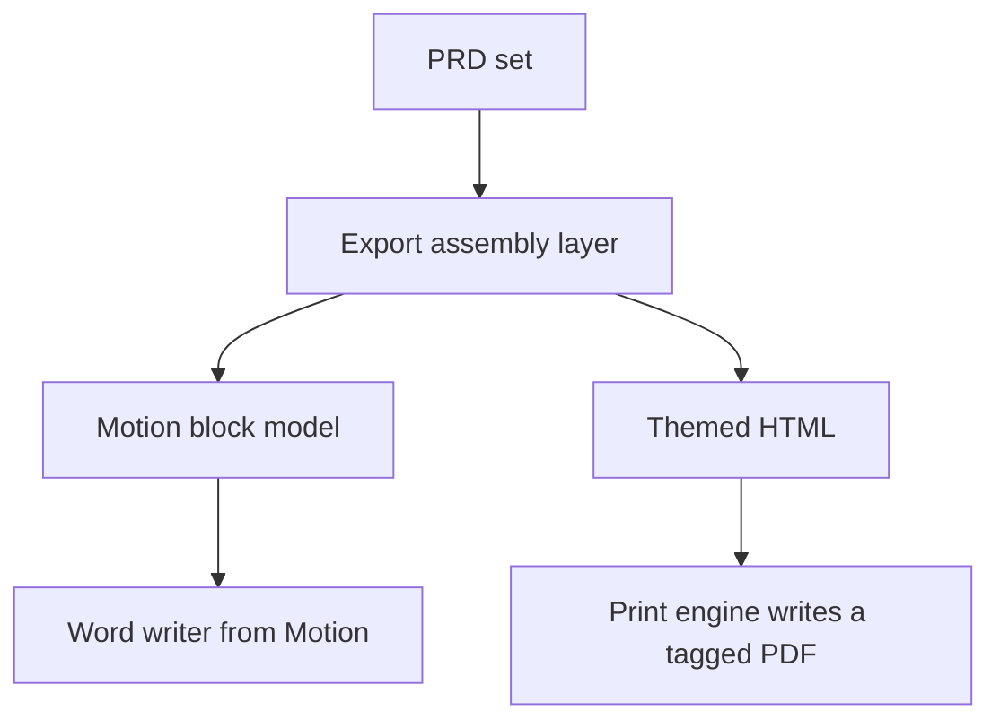

# Architecture decision record: Reuse the Motion export themes and export method

> **Template Origin**: Official | **ArcKit Version**: 6.18.3 | **Command**: `/arckit:adr`

## Document control

| Field | Value |
|-------|-------|
| **Document ID** | ARC-001-ADR-002-v1.1 |
| **Document Type** | Architecture Decision Record |
| **Project** | PRD Forge Viewer (Project 001) |
| **Classification** | PUBLIC |
| **Status** | APPROVED |
| **Version** | 1.1 |
| **Created Date** | 2026-10-26 |
| **Last Modified** | 2026-10-26 |
| **Review Cycle** | On-Demand |
| **Next Review Date** | 2026-11-25 |
| **Owner** | Richard Hightower, PRD owner |
| **Reviewed By** | [PENDING] |
| **Approved By** | Richard Hightower, PRD owner |
| **Distribution** | Project Team, Architecture Team |

## Revision history

| Version | Date | Author | Changes | Approved By | Approval Date |
|---------|------|--------|---------|-------------|---------------|
| 1.0 | 2026-10-26 | ArcKit AI | Initial creation from `/arckit:adr` command | [PENDING] | [PENDING] |
| 1.1 | 2026-10-26 | ArcKit AI | PDF decided: HTML to PDF (Option 2), no spike. Motion is MIT licensed. Accepted | Richard Hightower | 2026-10-26 |

## 1. decision title

**Reuse the Motion theme model and Word export, and write the PDF from themed HTML**

**ADR Status**: Accepted

---

## 2. stakeholders

### 2.1 deciders (RACI: accountable)

- Richard Hightower, PRD owner. Also the owner of the Motion repository.

### 2.2 consulted (RACI: consulted)

- Engineering lead of the viewer (not yet named).
- PER-003 EngineeringLead and PER-004 Sponsor, as readers of exports.

### 2.3 informed (RACI: informed)

- PER-001 Author, PER-002 ToolsDeveloper, PER-005 TeamDeveloper.

### 2.4 UK government escalation context

Not applicable.

**Decision Level**: Team (project). The PRD owner decides.

**Governance Forum**: PRD owner review of the ADR set.

**Approval Date**: 2026-10-26

---

## 3. context and problem statement

### 3.1 problem description

Stakeholders read the PRD only as an export (P-002). The viewer must write themed
PDF and Word files of the whole set or of selected sections, with the version,
the draft mark, and the grade of each section. Motion already writes themed PDF
and Word files from markdown [WEB-1-C1].

**Problem statement as a question**: Does the viewer reuse the Motion themes and
export code, and does that code meet the PRD export requirements?

### 3.2 why this decision is needed

- **Business context**: BR-001 (feedback within 2 days) depends on readable exports (G-2).
- **Technical context**: FR-010 to FR-020, NFR-P-004 (10 seconds at p95), NFR-U-002 (zero screen-reader errors), NFR-A-002 (themes survive a restart), NFR-I-002 (PDF and .docx).
- **Regulatory context**: None.

### 3.3 supporting links

- **Requirements**: BR-001, FR-010 to FR-020, NFR-P-004, NFR-U-002, NFR-A-002, NFR-I-002, BC-3 (TR-005)
- **Data model**: E-007 Export theme in `ARC-001-DATA-v1.0.md`
- **Related ADRs**: ADR-001

---

## 4. decision drivers (forces)

### 4.1 technical drivers

- **Accessible exports**: Each export has zero screen-reader errors.
  - Requirements: NFR-U-002 (PRD NFR-009)
  - Architecture principles: 10, 12
- **Fonts in the export**: The PRD change log for version 0.2.0 says custom themes use serif, sans-serif, or monospace fonts, embedded in exports [PFVP-C1].
  - Architecture principles: 10
- **Export speed**: The whole set within 10 seconds at p95.
  - Requirements: NFR-P-004
- **PRD-aware content**: The first page shows the draft mark, the version, the summary, and the contents with grades (FR-014, FR-019, WF-009).

### 4.2 business drivers

- **Reuse**: The Motion theme model, built-in themes, theme dialogs, and Word writer exist and have tests [WEB-1].
  - Requirements: BR-003
  - Stakeholder goals: G-2, G-5
- **Open source**: The Motion author, Richard Hightower, states that Motion is MIT licensed [WEB-1-C5]. The GitHub API shows no license file yet [WEB-1-C4].

### 4.3 regulatory & compliance drivers

- **GDS, TCoP, NCSC, Data Protection**: Not applicable.
- **Accessibility**: NFR-U-002 sets zero screen-reader errors for each format.

### 4.4 alignment to architecture principles

| Principle | Alignment | Impact |
|-----------|-----------|--------|
| 5. Free and open source | ✅ Supports | Motion is MIT licensed. LICENSE file in the repository |
| 10. Standard export formats | ✅ Supports | Motion writes PDF and .docx |
| 12. Accessible | ✅ Supports | HTML to PDF can write a tagged PDF with embedded fonts. NFR-U-002 test confirms |
| 13. Honest status | ✅ Supports | The new export assembly adds the draft mark and grades |
| 14. Recorded decisions | ✅ Supports | This ADR |

---

## 5. considered options

### Option 1: Reuse Motion themes, Word writer, and PDF writer as they are

**Description**: Copy `src/lib/themes.ts`, `exportBlocks.ts`, `exportDocx.ts`,
`exportPdf.ts`, and the theme dialogs from Motion. Add an export assembly layer
for the PRD set: title page, draft mark, version, contents with grades, and the
sections in `order`.

**Implementation approach**: The assembly layer turns the PRD set (E-001 to
E-004) into markdown blocks. The Motion writers turn the blocks into files.

**Wardley Evolution Stage**: Custom-Built

#### Good (pros)

- ✅ **Least new code**: Theme model, built-in themes (Ice Snowstorm, Clay), and both writers exist [WEB-1-C2].
- ✅ **Fonts match the PRD choices**: Motion themes use `serif`, `sans`, or `mono` for body and headings [WEB-1-C2].
- ✅ **Word export is native**: The `docx` library writes headings as Word heading styles, which screen readers use.

#### Bad (cons)

- ❌ **PDF fonts are not embedded**: Motion's PDF writer uses the standard PDF fonts (Helvetica, Times, Courier) "so the file opens everywhere without embedding" [WEB-1-C3]. The PRD change log says fonts are embedded.
- ❌ **PDF accessibility not proven**: This ADR found no tagged-structure support in the Motion PDF writer. NFR-U-002 can fail.
- ❌ **Images not proven**: The PRD set has diagram and wireframe images. This ADR found no image handling in the Motion PDF writer.

#### Cost analysis

- **CAPEX**: No license cost. Effort for the assembly layer only.
- **OPEX**: None.
- **TCO (3-year)**: Not estimated. The PRD gives no budget.

#### GDS service standard impact

Not applicable.

---

### Option 2: Reuse Motion themes and Word writer, and write the PDF from themed HTML

**Description**: Same as Option 1 for themes and Word. For PDF, render the
assembled set as themed HTML (Motion has `exportHtml.ts`) and print it to PDF.
The PRD Forge export uses the same method: python-docx for Word and Chromium for
the PDF [PRDF-C1].

**Implementation approach**: The assembly layer writes HTML with the theme as
CSS, the fonts as embedded web fonts, and the images inline. A print-to-PDF
step writes the file.

**Wardley Evolution Stage**: Product

#### Good (pros)

- ✅ **Fonts embedded**: Web fonts in the HTML are embedded in the PDF.
- ✅ **Images**: Diagrams and wireframes render as they do on screen.
- ✅ **Structure**: An HTML print path can write a tagged PDF from headings and tables. The NFR-U-002 test confirms this for the chosen engine.

#### Bad (cons)

- ❌ **Engine choice**: The system web view print path differs by platform. A bundled browser engine makes the install larger (ADR-001).
- ❌ **More new code than Option 1**: Print layout, page breaks, and page numbers in CSS.

#### Cost analysis

- **CAPEX**: No license cost. More effort than Option 1.
- **OPEX**: None.
- **TCO (3-year)**: Not estimated.

#### GDS service standard impact

Not applicable.

---

### Option 3: do nothing (baseline)

**Description**: The viewer has no export. Authors run the PRD Forge command-line
export.

**Implementation approach**: No change.

**Wardley Evolution Stage**: Custom-Built

#### Good

- ✅ **No immediate cost**.
- ✅ **No risk**.

#### Bad

- ❌ **FR-010 to FR-020 not met**: No themes, no selected sections, no print.
- ❌ **Needs the authoring tools, Python, and Chromium**: PER-002 cannot export from the viewer.

#### Cost analysis

- **CAPEX**: None.
- **OPEX**: None.
- **TCO (3-year)**: The cost is G-2 not met.

#### GDS service standard impact

Not applicable.

---

## 6. decision outcome

### 6.1 chosen option

**"Option 2: Motion themes and Word writer, and PDF from themed HTML"**

Reuse the Motion theme model, built-in themes, theme dialogs, block model, and
Word writer. Write the PDF from themed HTML. The Motion PDF writer is not used.
The PRD owner chose this on 2026-10-26 in place of a spike.

The engineering lead picks the print engine on macOS (C-004). Choose the engine
that writes a tagged PDF with embedded fonts: the system web view or a bundled
Chromium. PRD Forge uses Chromium. The NFR-U-002 test is the acceptance check.

### 6.2 Y-Statement (structured justification)

> In the context of themed PDF and Word exports of a PRD set,
> facing a release 1 date and a Motion PDF writer with no embedded fonts or tags,
> we decided for the Motion themes and Word writer, and PDF from themed HTML,
> to achieve embedded fonts and a tagged PDF for NFR-U-002,
> accepting new print layout code and the choice of a print engine.

### 6.3 justification (why this option?)

- The theme model and Word writer meet FR-015 to FR-018 and FR-011 with little change.
- The Motion PDF writer has two gaps (fonts and accessibility). HTML to PDF closes both.
- Option 3 meets no export requirement.

**Dissent**: None recorded.

---

## 7. consequences

### 7.1 positive consequences

- Built-in themes Ice Snowstorm and Clay ship on day one (FR-015).
- One block model feeds both formats, so both show the same content.

### 7.2 negative consequences (accepted Trade-offs)

- New print layout code: page breaks and page numbers in CSS. **Mitigation**: reuse the PRD Forge export layout.
- E-007 in the data model changes to match Motion: `page`, `text`, `heading`, `accent`, `muted`, `codeBg`, `codeText`, `font`, and `headingFont`. Font values are `serif`, `sans`, and `mono`.

### 7.3 neutral consequences (changes needed)

- Keep the MIT notice of Motion in the copied files (principle 5).
- Write the export assembly layer: title page, draft mark (TR-005), version, contents with status, score, and blocking (FR-019).

### 7.4 risks and mitigations

| Risk | Likelihood | Impact | Mitigation | Owner |
|------|-----------|--------|------------|-------|
| The print engine writes an untagged PDF | MEDIUM | HIGH | Test NFR-U-002 first. Use a bundled Chromium if the system web view fails | Engineering lead |
| Export of 18 documents exceeds 10 seconds | LOW | MEDIUM | Measure in the NFR-P-004 test | Engineering lead |

---

## 8. validation & compliance

### 8.1 how will implementation be verified?

- FR-010 to FR-020 acceptance tests.
- An export of a set with one draft document shows "Draft" (BC-3).
- A PDF accessibility checker and a screen reader on each format (NFR-U-002).
- Each export opens in a standard PDF reader and word processor on a computer without the authoring tools (NFR-I-002).

### 8.2 monitoring & observability

- Export time recorded in the performance test for each release (NFR-P-004).

### 8.3 compliance verification

- **License report**: every copied file has a license compatible with the viewer (principle 5).
- **Government frameworks**: Not applicable.

---

## 9. links to supporting documents

### 9.1 requirements traceability

- **Business**: BR-001, BR-002 (the export contents show the blocking defects of each section, FR-019), BR-003
- **Functional**: FR-010, FR-011, FR-012, FR-013, FR-014, FR-015, FR-016, FR-017, FR-018, FR-019, FR-020
- **Non-functional**: NFR-P-004, NFR-U-002, NFR-A-002, NFR-I-002

### 9.2 architecture artifacts

- **Architecture principles**: 5, 10, 12, 13, 14
- **Stakeholder drivers**: SD-2, SD-4, SD-5, SD-6 (goals G-2, G-5)
- **Risk register**: None in the PRD for exports. The risks are in section 7.4.

### 9.3 design documents

- **Data model**: E-007 Export theme.

### 9.4 external references

- Motion `src/lib/themes.ts`, `exportPdf.ts`, and `exportDocx.ts` [WEB-1].
- PRD Forge `scripts/prd_export.py` [PRDF].

---

## 10. implementation plan

### 10.1 dependencies

- ADR-001 (Tauri and the Motion stack).
- The MIT LICENSE file in the Motion repository (committed 2026-10-26).

### 10.2 implementation timeline

| Phase | Activity | Owner |
|-------|----------|-------|
| 1 | Pick the print engine with the NFR-U-002 test | Engineering lead |
| 2 | Copy themes, dialogs, block model, and Word writer | Engineering lead |
| 3 | Export assembly layer for the PRD set | Engineering lead |
| 4 | PDF from themed HTML | Engineering lead |

### 10.3 rollback plan

- **Trigger**: Option 2 PDF also fails NFR-U-002.
- **Procedure**: Ship Word export only and record a PRD change for PDF with the PRD owner.
- **Owner**: PRD owner.

---

## 11. review and updates

### 11.1 review schedule

- After the first NFR-U-002 test picks the print engine.
- After release 1.

### 11.2 trigger events for review

- The NFR-U-002 test result.
- A change to C-001.

---

## 12. related decisions

### 12.1 decisions this ADR depends on

- ADR-001.

### 12.2 decisions that depend on this ADR

- None.

### 12.3 conflicting decisions

- None.

---

## 13. appendices

### Appendix a: options analysis details

| Check | Motion PDF writer | HTML to PDF |
|-------|-------------------|-------------|
| Fonts embedded | No, standard PDF fonts [WEB-1-C3] | Yes, web fonts |
| Tagged structure | Not found in this review | Engine-dependent. Spike confirms |
| Images | Not found in this review | Yes |
| New code | Least | More |

### Appendix B: stakeholder consultation log

| Date | Stakeholder | Feedback | Action |
|------|-------------|----------|--------|
| 2026-10-26 | Richard Hightower, PRD owner | Named Motion themes and export method as a candidate in the PRD interview | This ADR |

### Appendix C: alternative formats

---

## Document approval

| Role | Name | Signature | Date |
|------|------|-----------|------|
| PRD owner | Richard Hightower | Accepted through HLDR v1.1 sign-off | 2026-10-26 |

## External references

### Document register

| Doc ID | Filename | Type | Source Location | Description |
|--------|----------|------|-----------------|-------------|
| WEB-1 | SpillwaveSolutions/motion | Web URL | https://github.com/SpillwaveSolutions/motion | Read through the GitHub API on 2026-10-26 |
| PRDF | prd_export.py | Document | PRD Forge plugin 0.5.1, `scripts/prd_export.py` | The PRD Forge export script |
| PFVP | prd-forge-viewer-prd.pdf | PRD | `projects/001-prd-forge-viewer/external/` | The PRD, version 0.3.2 |

### Citations

| Citation ID | Doc ID | Page/Section | Category | Quoted Passage |
|-------------|--------|--------------|----------|----------------|
| WEB-1-C1 | WEB-1 | `src/lib/exportDocx.ts` | Export | "Themed Word document. Heading and body fonts follow the theme" |
| WEB-1-C2 | WEB-1 | `src/lib/themes.ts` | Themes | `export type ThemeFont = "serif" \| "sans" \| "mono";` and `BUILTIN_THEMES = [ICE_SNOWSTORM, CLAY]` |
| WEB-1-C3 | WEB-1 | `src/lib/exportPdf.ts` | Export | "Standard PDF fonts only (Helvetica, Times, Courier) so the file opens everywhere without embedding." |
| WEB-1-C4 | WEB-1 | Repository metadata | License | The GitHub API returns no license for the repository |
| WEB-1-C5 | WEB-1 | Owner statement, 2026-10-26 | License | Motion is MIT licensed (Richard Hightower, author) |
| PRDF-C1 | PRDF | Module comment | Export | "Needs PyYAML and python-docx for the Word file, and Chromium for the PDF." |
| PFVP-C1 | PFVP | Section 15, version 0.2.0 | Decision | Custom themes use serif, sans-serif, or monospace fonts, embedded in exports. |

### Unreferenced documents

| Filename | Source Location | Reason |
|----------|-----------------|--------|
| README.md | `projects/001-prd-forge-viewer/external/` | Describes the PDF |

---

**Generated by**: ArcKit `/arckit:adr` command
**Generated on**: 2026-10-26
**ArcKit Version**: 6.18.3
**Project**: PRD Forge Viewer (Project 001)
**Model**: claude-opus-5-5
**Generation Context**: ARC-000-PRIN-v1.0, ARC-001-REQ-v1.0, ARC-001-DATA-v1.0, the Motion repository, and the PRD Forge export script.

<!-- arckit-provenance:start -->

## Build provenance

*Stamped automatically by the ArcKit plugin's `provenance-stamp.mjs` PostToolUse hook. Complements (does not replace) the human-authored footer above. Carries only fields the model can't authoritatively self-report: build context from `.arckit/state.json` and effort levels derived from command frontmatter + the silent-downgrade matrix.*

| Field | Value |
|-------|-------|
| Requested Effort | `high` |
| Effective Effort | `high` |
| Stamped at | 2026-10-27T00:49:04.357Z |

<!-- arckit-provenance:end -->
