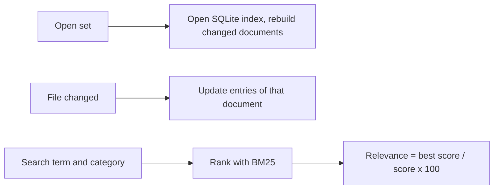

# Architecture decision record: Rank search results with BM25 in a local index

> **Template Origin**: Official | **ArcKit Version**: 6.18.3 | **Command**: `/arckit:adr`

## Document control

| Field | Value |
|-------|-------|
| **Document ID** | ARC-001-ADR-003-v1.1 |
| **Document Type** | Architecture Decision Record |
| **Project** | PRD Forge Viewer (Project 001) |
| **Classification** | PUBLIC |
| **Status** | APPROVED |
| **Version** | 1.1 |
| **Created Date** | 2026-10-26 |
| **Last Modified** | 2026-10-26 |
| **Review Cycle** | On-Demand |
| **Next Review Date** | 2026-11-25 |
| **Owner** | Richard Hightower, PRD owner |
| **Reviewed By** | [PENDING] |
| **Approved By** | Richard Hightower, PRD owner |
| **Distribution** | Project Team, Architecture Team |

## Revision history

| Version | Date | Author | Changes | Approved By | Approval Date |
|---------|------|--------|---------|-------------|---------------|
| 1.0 | 2026-10-26 | ArcKit AI | Initial creation from `/arckit:adr` command | [PENDING] | [PENDING] |
| 1.1 | 2026-10-26 | ArcKit AI | Chosen option changed to Option 1: BM25 in a local SQLite index. Accepted | Richard Hightower | 2026-10-26 |

## 1. decision title

**Rank search results with BM25 in a local SQLite full-text index**

**ADR Status**: Accepted

---

## 2. stakeholders

### 2.1 deciders (RACI: accountable)

- Richard Hightower, PRD owner.

### 2.2 consulted (RACI: consulted)

- Engineering lead of the viewer (not yet named).
- PER-002 ToolsDeveloper, the main user of search.

### 2.3 informed (RACI: informed)

- PER-001 Author.

### 2.4 UK government escalation context

Not applicable.

**Decision Level**: Team (project). The PRD owner decides.

**Governance Forum**: PRD owner review of the ADR set.

**Approval Date**: 2026-10-26

---

## 3. context and problem statement

### 3.1 problem description

A developer searches the PRD set by term and category and sees the matching
items best first, each with a relevance score from 0 to 100 (FR-008, WF-003).
Results must show within 0.5 seconds at p95 for 18 documents (NFR-P-003). The
PRD interview named BM25 ranking with a local SQL index as a candidate.

**Problem statement as a question**: Which ranking and which index does search use?

### 3.2 why this decision is needed

- **Business context**: G-3, developers find their items in under a second (SD-3).
- **Technical context**: FR-008, NFR-P-003, NFR-P-002 (index current within 2 seconds of a save), NFR-SEC-002 (nothing written to the PRD set folder), E-006 in the data model.
- **Regulatory context**: None.

### 3.3 supporting links

- **Requirements**: FR-007, FR-008, FR-012, NFR-P-002, NFR-P-003, NFR-SEC-002
- **Scenarios**: SC-007 (a search with no match)
- **Related ADRs**: ADR-001, ADR-005

---

## 4. decision drivers (forces)

### 4.1 technical drivers

- **Ranking quality**: Best match first. IDs such as `FR-005` must match exactly.
  - Requirements: FR-008
- **Speed**: 0.5 seconds at p95 for 18 documents.
  - Requirements: NFR-P-003
  - Architecture principles: 11
- **Freshness**: The index follows file changes within 2 seconds.
  - Requirements: NFR-P-002
  - Architecture principles: 6 (derived data is disposable)
- **No writes to the PRD set**: Requirements: NFR-SEC-002. Principle 2.

### 4.2 business drivers

- **Least code**: Release 1 is due 2026-10-27 (BR-003).
- **Interview candidate**: BM25 with a local SQL index.

### 4.3 regulatory & compliance drivers

- Not applicable.

### 4.4 alignment to architecture principles

| Principle | Alignment | Impact |
|-----------|-----------|--------|
| 1. Local first | ✅ Supports | The index is on the computer |
| 2. Read-only on the PRD set | ✅ Supports | The index file is in the app data folder, not the set folder |
| 6. Single source of truth | ✅ Supports | The index is a derived cache. Delete it and the viewer rebuilds it |
| 11. Performance | ✅ Supports | No rebuild on open when the files did not change |
| 14. Maintainable | ✅ Supports | One embedded library. A schema version in the file. Rebuild on mismatch |

---

## 5. considered options

### Option 1: BM25 in a local SQL full-text index on disk

**Description**: An embedded SQL database with a full-text index and a BM25 rank
function, stored in the app data folder. This is the interview candidate.

**Implementation approach**: Create one row for each document and item (E-006).
Update the rows of a changed document (ADR-005). Query with term match, category
filter, and BM25 order.

**Wardley Evolution Stage**: Commodity

#### Good (pros)

- ✅ **Proven ranking**: BM25 is the standard text ranking function.
- ✅ **Scales past 18 documents**: The index stays on disk for large sets.
- ✅ **SQL filters**: Category filter is one `WHERE` clause.

#### Bad (cons)

- ❌ **A file to manage**: Location, schema version, and corruption recovery for a cache that the viewer can rebuild in a moment.
- ❌ **More moving parts than the NFRs need**: Every NFR target is for 18 documents.

#### Cost analysis

- **CAPEX**: No license cost.
- **OPEX**: None.
- **TCO (3-year)**: Not estimated.

#### GDS service standard impact

Not applicable.

---

### Option 2: BM25 in an in-memory index, rebuilt on open

**Description**: The Rust core builds a BM25 index in memory when it opens a set,
and updates the entries of a changed document. Nothing is stored on disk.

**Implementation approach**: Tokenize document text and item fields. Keep IDs
such as `FR-005` as single tokens. Rank with BM25. Report relevance as the BM25
score divided by the top score of the query, times 100, rounded. The score shows
the order only (WF-003).

**Wardley Evolution Stage**: Commodity

#### Good (pros)

- ✅ **Same ranking as Option 1**: BM25.
- ✅ **No file**: Nothing to store, migrate, or repair. Principle 6 holds by design.
- ✅ **Fast for the target size**: An index of 18 documents is small and in memory.

#### Bad (cons)

- ❌ **Rebuild on every open**: The rebuild time counts toward NFR-P-001 (2 seconds to open). Measure it.
- ❌ **Memory grows with set size**: No PRD target exists for larger sets.

#### Cost analysis

- **CAPEX**: No license cost. Least effort.
- **OPEX**: None.
- **TCO (3-year)**: Not estimated.

#### GDS service standard impact

Not applicable.

---

### Option 3: do nothing (baseline)

**Description**: A plain substring scan of every document, in file order.

**Implementation approach**: No index.

**Wardley Evolution Stage**: Commodity

#### Good

- ✅ **No immediate cost**.
- ✅ **No risk**.

#### Bad

- ❌ **No ranking**: FR-008 needs best match first, with a relevance score.
- ❌ **No category filter without more code**.

#### Cost analysis

- **CAPEX**: None.
- **OPEX**: None.
- **TCO (3-year)**: The cost is FR-008 not met.

#### GDS service standard impact

Not applicable.

---

## 6. decision outcome

### 6.1 chosen option

**"Option 1: BM25 in a local SQL full-text index on disk"**

The PRD owner chose this option on 2026-10-26. The index is SQLite with its
full-text module (FTS5) and its `bm25()` rank function. The file is in the app
data folder, one file for each PRD set. The viewer keeps a content hash for each
document and updates only the rows of changed documents (ADR-005).

`bm25()` returns a lower value for a better match. Relevance for FR-008 is the
result's `bm25()` divided by the best result's `bm25()` (both are 0 or less), times
100, so the best result scores 100.

### 6.2 Y-Statement (structured justification)

> In the context of search over a local PRD set of 18 documents,
> facing a 0.5-second target and a rule that derived data is disposable,
> we decided for BM25 ranking in a local SQLite full-text index,
> to achieve the interview's choice with a category filter in SQL and no rebuild on each open,
> accepting an index file to version and rebuild when it is damaged.

### 6.3 justification (why this option?)

- Both BM25 options meet FR-008. The PRD owner chose the interview candidate.
- SQL gives the category filter in one clause and an upgrade path for larger sets.
- Option 3 does not meet FR-008.

**Dissent**: The HLD review first proposed Option 2. The PRD owner chose Option 1.

---

## 7. consequences

### 7.1 positive consequences

- No index rebuild when the files did not change.
- E-006 in the data model is a table in the index file.

### 7.2 negative consequences (accepted Trade-offs)

- An index file to manage. **Mitigation**: a schema version in the file. On a mismatch or a read error, delete the file and rebuild from the PRD set.

### 7.3 neutral consequences (changes needed)

- E-006 in `ARC-001-DATA-v1.1.md` is a table in the SQLite file.
- ADR-005 sends changed documents to the index.

### 7.4 risks and mitigations

| Risk | Likelihood | Impact | Mitigation | Owner |
|------|-----------|--------|------------|-------|
| Index build pushes open time past 2 seconds | LOW | MEDIUM | Build after the first view. Measure | Engineering lead |
| IDs split into tokens and miss exact matches | MEDIUM | MEDIUM | Tokenizer test for every PRD ID prefix | Engineering lead |
| The index file is damaged | LOW | LOW | Delete and rebuild from the files | Engineering lead |

---

## 8. validation & compliance

### 8.1 how will implementation be verified?

- FR-008 acceptance tests, including SC-007 ("invoice" with no match).
- A tokenizer test: a search for each ID prefix finds the exact item first.
- NFR-P-003 performance test: 0.5 seconds at p95 on the 18-document fixture set.

### 8.2 monitoring & observability

- Search time in the release performance test.

### 8.3 compliance verification

- Not applicable.

---

## 9. links to supporting documents

### 9.1 requirements traceability

- **Business**: BR-001, BR-003
- **Functional**: FR-007, FR-008, FR-012
- **Non-functional**: NFR-P-001, NFR-P-002, NFR-P-003, NFR-SEC-002

### 9.2 architecture artifacts

- **Architecture principles**: 1, 2, 6, 11, 14
- **Stakeholder drivers**: SD-3, SD-6 (goal G-3)

### 9.3 design documents

- **Data model**: E-006 Search index entry.

### 9.4 external references

- None.

---

## 10. implementation plan

### 10.1 dependencies

- ADR-001 (Rust core).
- ADR-005 (change events).

### 10.2 implementation timeline

| Phase | Activity | Owner |
|-------|----------|-------|
| 1 | Tokenizer with ID tokens, and its tests | Engineering lead |
| 2 | BM25 index, category filter, relevance score | Engineering lead |
| 3 | Update on change, and the NFR-P-003 test | Engineering lead |

### 10.3 rollback plan

- **Trigger**: NFR-P-003 or NFR-P-001 fails because of the index.
- **Procedure**: Move to Option 2 (in memory) behind the same query interface.
- **Owner**: Engineering lead.

---

## 11. review and updates

### 11.1 review schedule

- After release 1.

### 11.2 trigger events for review

- A PRD target for sets larger than 18 documents.

---

## 12. related decisions

### 12.1 decisions this ADR depends on

- ADR-001, ADR-005.

### 12.2 decisions that depend on this ADR

- None.

### 12.3 conflicting decisions

- None.

---

## 13. appendices

### Appendix a: options analysis details

No benchmark yet. The NFR-P-003 test is the benchmark.

### Appendix B: stakeholder consultation log

| Date | Stakeholder | Feedback | Action |
|------|-------------|----------|--------|
| 2026-10-26 | Richard Hightower, PRD owner | Named BM25 with a local SQL index as a candidate. Chose it in the HLD review | Option 1 chosen |

### Appendix C: alternative formats

---

## Document approval

| Role | Name | Signature | Date |
|------|------|-----------|------|
| PRD owner | Richard Hightower | Accepted through HLDR v1.1 sign-off | 2026-10-26 |

## External references

### Document register

| Doc ID | Filename | Type | Source Location | Description |
|--------|----------|------|-----------------|-------------|
| PFVP | prd-forge-viewer-prd.pdf | PRD | `projects/001-prd-forge-viewer/external/` | The PRD, version 0.3.2 |

### Citations

| Citation ID | Doc ID | Page/Section | Category | Quoted Passage |
|-------------|--------|--------------|----------|----------------|
| PFVP-C1 | PFVP | Section 8, NFR-003 | Performance | The developer sees search results within 0.5 seconds of searching. |

### Unreferenced documents

| Filename | Source Location | Reason |
|----------|-----------------|--------|
| README.md | `projects/001-prd-forge-viewer/external/` | Describes the PDF |

---

**Generated by**: ArcKit `/arckit:adr` command
**Generated on**: 2026-10-26
**ArcKit Version**: 6.18.3
**Project**: PRD Forge Viewer (Project 001)
**Model**: claude-opus-5-5
**Generation Context**: ARC-000-PRIN-v1.0, ARC-001-REQ-v1.0, ARC-001-DATA-v1.0.

<!-- arckit-provenance:start -->

## Build provenance

*Stamped automatically by the ArcKit plugin's `provenance-stamp.mjs` PostToolUse hook. Complements (does not replace) the human-authored footer above. Carries only fields the model can't authoritatively self-report: build context from `.arckit/state.json` and effort levels derived from command frontmatter + the silent-downgrade matrix.*

| Field | Value |
|-------|-------|
| Requested Effort | `high` |
| Effective Effort | `high` |
| Stamped at | 2026-10-27T00:49:49.769Z |

<!-- arckit-provenance:end -->
