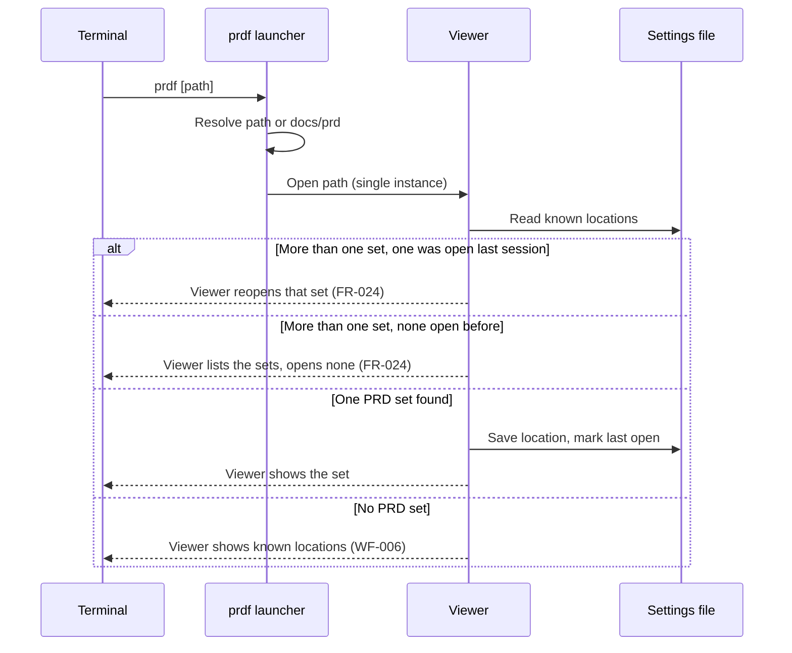

# Architecture decision record: Install `prdf` from the app, and store known locations in the app config folder

> **Template Origin**: Official | **ArcKit Version**: 6.18.3 | **Command**: `/arckit:adr`

## Document control

| Field | Value |
|-------|-------|
| **Document ID** | ARC-001-ADR-004-v1.1 |
| **Document Type** | Architecture Decision Record |
| **Project** | PRD Forge Viewer (Project 001) |
| **Classification** | PUBLIC |
| **Status** | APPROVED |
| **Version** | 1.1 |
| **Created Date** | 2026-10-26 |
| **Last Modified** | 2026-10-26 |
| **Review Cycle** | On-Demand |
| **Next Review Date** | 2026-11-25 |
| **Owner** | Richard Hightower, PRD owner |
| **Reviewed By** | [PENDING] |
| **Approved By** | Richard Hightower, PRD owner |
| **Distribution** | Project Team, Architecture Team |

## Revision history

| Version | Date | Author | Changes | Approved By | Approval Date |
|---------|------|--------|---------|-------------|---------------|
| 1.0 | 2026-10-26 | ArcKit AI | Initial creation from `/arckit:adr` command | [PENDING] | [PENDING] |
| 1.1 | 2026-10-26 | ArcKit AI | More than one set in docs/prd: the viewer shows a list (FR-024). Accepted | Richard Hightower | 2026-10-26 |

## 1. decision title

**Install `prdf` as a small launcher from inside the app, and store known locations and themes in the operating system app config folder**

**ADR Status**: Accepted

---

## 2. stakeholders

### 2.1 deciders (RACI: accountable)

- Richard Hightower, PRD owner.

### 2.2 consulted (RACI: consulted)

- Engineering lead of the viewer (not yet named).
- PER-001 Author, who works in a terminal with the authoring tools.

### 2.3 informed (RACI: informed)

- PER-002 ToolsDeveloper.

### 2.4 UK government escalation context

Not applicable.

**Decision Level**: Team (project). The PRD owner decides.

**Governance Forum**: PRD owner review of the ADR set.

**Approval Date**: 2026-10-26

---

## 3. context and problem statement

### 3.1 problem description

The author starts the viewer from a terminal with `prdf` (FR-021). The viewer
opens the set in `docs/prd` of the current directory, or the path given, or shows
the known locations when it finds none (FR-022, WF-006). When `docs/prd` holds
more than one set, the viewer reopens the set from the last session. If none of
them was open before, it lists the sets and the author selects one (FR-024, WF-010). The viewer reopens the
last set in the next session (FR-002).

**Problem statement as a question**: How does `prdf` get onto the author's
`PATH`, and where does the viewer store known locations?

### 3.2 why this decision is needed

- **Business context**: G-1. The author opens the set with no extra step.
- **Technical context**: FR-002, FR-021, FR-022, NFR-P-001, NFR-SEC-002 (no writes to the PRD set), E-005 and E-007 in the data model.
- **Regulatory context**: None.

### 3.3 supporting links

- **Requirements**: FR-002, FR-021, FR-022, NFR-P-001, NFR-SEC-002, NFR-A-002
- **Wireframes**: WF-006, WF-010
- **Related ADRs**: ADR-001

---

## 4. decision drivers (forces)

### 4.1 technical drivers

- **One step from the terminal**: `prdf` or `prdf <path>`.
  - Requirements: FR-021
- **One window**: A second `prdf` opens the set in the running viewer, not a second app.
  - Requirements: FR-021 (the viewer "opens and shows that PRD set")
- **Known locations survive a restart, outside the PRD set**:
  - Requirements: FR-002, FR-022, NFR-SEC-002
  - Architecture principles: 2

### 4.2 business drivers

- **No package manager required**: The author installs one app (principle 16).
- **Free and open source**: No paid distribution channel (principle 5).

### 4.3 regulatory & compliance drivers

- Not applicable.

### 4.4 alignment to architecture principles

| Principle | Alignment | Impact |
|-----------|-----------|--------|
| 1. Local first | ✅ Supports | Locations stay on the computer |
| 2. Read-only on the PRD set | ✅ Supports | Nothing is written in the set folder |
| 8. No personal data | ✅ Supports | Folder paths only. They never leave the computer |
| 9. Files are the only contract | ✅ Supports | `prdf` passes a path, nothing else |
| 16. Reproducible releases | ✅ Supports | The launcher ships in the app package |

---

## 5. considered options

### Option 1: The app installs a `prdf` launcher, and stores settings in the app config folder

**Description**: The app has a menu action **Install prdf command**. It writes a
small launcher into a folder on the `PATH`, after the author confirms. The
launcher passes the current directory or the given path to the app. A
single-instance check sends the path to a running viewer. Known locations
(E-005) and custom themes (E-007) live in one settings file in the operating
system app config folder.

**Implementation approach**: Tauri gives the app config folder path and a
single-instance plugin (ADR-001). The launcher resolves `docs/prd` under the
current directory before it starts the app.

**Wardley Evolution Stage**: Product

#### Good (pros)

- ✅ **No extra install step**: One app, one menu action.
- ✅ **One window**: The single-instance check meets FR-021 when the viewer is open.
- ✅ **Standard settings place**: The operating system backs it up with the rest of the user's settings.

#### Bad (cons)

- ❌ **`PATH` folders differ by platform and may need permission**: The action must show where it writes and why.
- ❌ **Uninstall must remove the launcher**: Or the author removes it by hand.

#### Cost analysis

- **CAPEX**: No license cost. Small effort.
- **OPEX**: None.
- **TCO (3-year)**: Not estimated.

#### GDS service standard impact

Not applicable.

---

### Option 2: A package manager installs `prdf`, and settings live in a dot folder in the home folder

**Description**: Publish the app and the `prdf` command through platform package
managers. Store settings in `~/.prdf/`.

**Implementation approach**: One package for each platform package manager.

**Wardley Evolution Stage**: Commodity

#### Good (pros)

- ✅ **Familiar to developers**: PER-002 likely has a package manager.
- ✅ **Updates through the package manager**.

#### Bad (cons)

- ❌ **One package per platform to maintain**.
- ❌ **Not every author has a package manager**: PER-001 is often not a developer (section 4 of the PRD).
- ❌ **Dot folder is not the platform settings place**.

#### Cost analysis

- **CAPEX**: No license cost. More release work than Option 1.
- **OPEX**: Package upkeep for each platform.
- **TCO (3-year)**: Not estimated.

#### GDS service standard impact

Not applicable.

---

### Option 3: do nothing (baseline)

**Description**: No terminal command. The author starts the app from the
operating system and picks a folder.

**Implementation approach**: No change.

**Wardley Evolution Stage**: Commodity

#### Good

- ✅ **No immediate cost**.
- ✅ **No risk**.

#### Bad

- ❌ **FR-021 not met**.
- ❌ **Extra steps for the author** on every open from a project folder.

#### Cost analysis

- **CAPEX**: None.
- **OPEX**: None.
- **TCO (3-year)**: The cost is FR-021 not met.

#### GDS service standard impact

Not applicable.

---

## 6. decision outcome

### 6.1 chosen option

**"Option 1: The app installs a `prdf` launcher, and stores settings in the app config folder"**

A package manager release (Option 2) can come later and install the same
launcher. It does not change this decision.

### 6.2 Y-Statement (structured justification)

> In the context of starting the viewer from a terminal on a project folder,
> facing authors who often are not developers,
> we decided for a launcher that the app installs, with settings in the app config folder,
> to achieve one install, one window, and settings outside the PRD set,
> accepting platform differences in where the launcher goes.

### 6.3 justification (why this option?)

- Option 1 meets FR-021 and FR-022 with one app install.
- Option 2 adds packages to maintain and assumes a package manager.
- Option 3 does not meet FR-021.

**Dissent**: None recorded.

---

## 7. consequences

### 7.1 positive consequences

- E-005 and E-007 share one settings file and one durability test (NFR-A-002).
- A running viewer receives new paths, so the author never has two windows on one set.

### 7.2 negative consequences (accepted Trade-offs)

- The install action may ask for permission. **Mitigation**: show the target folder first. Offer a folder in the user's home on the `PATH` when one exists.
- A corrupt settings file can lose locations and themes. **Mitigation**: write to a temporary file and rename it. Keep the last good copy (NFR-A-002).

### 7.3 neutral consequences (changes needed)

- Add an uninstall note for the launcher.
- Update `ARC-001-DATA-v1.0.md`: E-005 and E-007 storage is the app config folder.

### 7.4 risks and mitigations

| Risk | Likelihood | Impact | Mitigation | Owner |
|------|-----------|--------|------------|-------|
| `docs/prd` holds more than one PRD set | MEDIUM | LOW | The viewer lists the sets with name and folder (FR-024) | Engineering lead |
| The launcher name clashes with another `prdf` | LOW | LOW | The install action checks for an existing `prdf` and stops | Engineering lead |
| Settings file corrupt | LOW | MEDIUM | Atomic write and last good copy | Engineering lead |

---

## 8. validation & compliance

### 8.1 how will implementation be verified?

- FR-002, FR-021, and FR-022 acceptance tests, including a known location marked "not found".
- A test that runs `prdf` twice and finds one window.
- A restart test with custom themes and locations (NFR-A-002).
- A checksum test of the PRD set before and after (NFR-SEC-002).

### 8.2 monitoring & observability

- None. Local logs only.

### 8.3 compliance verification

- Not applicable.

---

## 9. links to supporting documents

### 9.1 requirements traceability

- **Business**: BR-001
- **Functional**: FR-002, FR-021, FR-022
- **Non-functional**: NFR-P-001, NFR-SEC-002, NFR-A-002
- **Integration**: INT-002

### 9.2 architecture artifacts

- **Architecture principles**: 1, 2, 8, 9, 16
- **Stakeholder drivers**: SD-1 (goal G-1)

### 9.3 design documents

- **Data model**: E-005 Known location, E-007 Export theme.

### 9.4 external references

- None.

---

## 10. implementation plan

### 10.1 dependencies

- ADR-001 (Tauri app, single-instance plugin, app config folder).

### 10.2 implementation timeline

| Phase | Activity | Owner |
|-------|----------|-------|
| 1 | Settings file with atomic write | Engineering lead |
| 2 | Launcher and single-instance handling | Engineering lead |
| 3 | **Install prdf command** menu action | Engineering lead |

### 10.3 rollback plan

- **Trigger**: The install action fails on a release platform.
- **Procedure**: Document a manual install of the launcher for that platform.
- **Owner**: Engineering lead.

---

## 11. review and updates

### 11.1 review schedule

- After release 1.

### 11.2 trigger events for review

- A package manager release.

---

## 12. related decisions

### 12.1 decisions this ADR depends on

- ADR-001.

### 12.2 decisions that depend on this ADR

- None.

### 12.3 conflicting decisions

- None.

---

## 13. appendices

### Appendix a: options analysis details

No proof of concept yet.

### Appendix B: stakeholder consultation log

| Date | Stakeholder | Feedback | Action |
|------|-------------|----------|--------|
| 2026-10-26 | Richard Hightower, PRD owner | Named `prdf` install and known-location storage as a candidate ADR topic | This ADR |

### Appendix C: alternative formats

---

## Document approval

| Role | Name | Signature | Date |
|------|------|-----------|------|
| PRD owner | Richard Hightower | Accepted through HLDR v1.1 sign-off | 2026-10-26 |

## External references

### Document register

| Doc ID | Filename | Type | Source Location | Description |
|--------|----------|------|-----------------|-------------|
| PFVP | prd-forge-viewer-prd.pdf | PRD | `projects/001-prd-forge-viewer/external/` | The PRD, version 0.3.2 |

### Citations

| Citation ID | Doc ID | Page/Section | Category | Quoted Passage |
|-------------|--------|--------------|----------|----------------|
| PFVP-C1 | PFVP | Section 7, FR-021 | Requirement | Given the current directory contains docs/prd with one PRD set, when the author runs prdf, then the viewer opens and shows that PRD set. |

### Unreferenced documents

| Filename | Source Location | Reason |
|----------|-----------------|--------|
| README.md | `projects/001-prd-forge-viewer/external/` | Describes the PDF |

---

**Generated by**: ArcKit `/arckit:adr` command
**Generated on**: 2026-10-26
**ArcKit Version**: 6.18.3
**Project**: PRD Forge Viewer (Project 001)
**Model**: claude-opus-5-5
**Generation Context**: ARC-000-PRIN-v1.0, ARC-001-REQ-v1.0, ARC-001-DATA-v1.0.

<!-- arckit-provenance:start -->

## Build provenance

*Stamped automatically by the ArcKit plugin's `provenance-stamp.mjs` PostToolUse hook. Complements (does not replace) the human-authored footer above. Carries only fields the model can't authoritatively self-report: build context from `.arckit/state.json` and effort levels derived from command frontmatter + the silent-downgrade matrix.*

| Field | Value |
|-------|-------|
| Requested Effort | `high` |
| Effective Effort | `high` |
| Stamped at | 2026-10-27T00:51:15.343Z |

<!-- arckit-provenance:end -->
