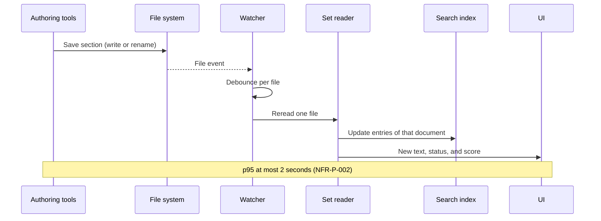

# Architecture decision record: Detect file changes with operating system events

> **Template Origin**: Official | **ArcKit Version**: 6.18.3 | **Command**: `/arckit:adr`

## Document control

| Field | Value |
|-------|-------|
| **Document ID** | ARC-001-ADR-005-v1.1 |
| **Document Type** | Architecture Decision Record |
| **Project** | PRD Forge Viewer (Project 001) |
| **Classification** | PUBLIC |
| **Status** | APPROVED |
| **Version** | 1.1 |
| **Created Date** | 2026-10-26 |
| **Last Modified** | 2026-10-26 |
| **Review Cycle** | On-Demand |
| **Next Review Date** | 2026-11-25 |
| **Owner** | Richard Hightower, PRD owner |
| **Reviewed By** | [PENDING] |
| **Approved By** | Richard Hightower, PRD owner |
| **Distribution** | Project Team, Architecture Team |

## Revision history

| Version | Date | Author | Changes | Approved By | Approval Date |
|---------|------|--------|---------|-------------|---------------|
| 1.0 | 2026-10-26 | ArcKit AI | Initial creation from `/arckit:adr` command | [PENDING] | [PENDING] |
| 1.1 | 2026-10-26 | ArcKit AI | Release 1 is macOS only (C-004). Accepted | Richard Hightower | 2026-10-26 |

## 1. decision title

**Detect PRD set changes with operating system file events, with a short debounce and a polling fallback**

**ADR Status**: Accepted

---

## 2. stakeholders

### 2.1 deciders (RACI: accountable)

- Richard Hightower, PRD owner.

### 2.2 consulted (RACI: consulted)

- Engineering lead of the viewer (not yet named).
- PRD Forge maintainers, for how the authoring tools save files.

### 2.3 informed (RACI: informed)

- PER-001 Author.

### 2.4 UK government escalation context

Not applicable.

**Decision Level**: Team (project). The PRD owner decides.

**Governance Forum**: PRD owner review of the ADR set.

**Approval Date**: 2026-10-26

---

## 3. context and problem statement

### 3.1 problem description

The author fixes a section in the authoring tools and watches the viewer. The
new text and score must show within 2 seconds of the save at p95, with no action
(FR-009, NFR-P-002) [PFVP-C1]. The `/prd` pane in Claude Code does not reread
files today. The author must click **Rescan**.

**Problem statement as a question**: How does the viewer learn that a file in the
PRD set changed?

### 3.2 why this decision is needed

- **Business context**: G-1 and SD-1. The author fixes and sends the same day.
- **Technical context**: FR-002 (changes while closed), FR-009, NFR-P-002, NFR-SEC-002, ADR-003 (index updates).
- **Regulatory context**: None.

### 3.3 supporting links

- **Requirements**: FR-002, FR-009, NFR-P-002, NFR-SEC-002
- **Scenarios**: SC-003, SC-006
- **Related ADRs**: ADR-001, ADR-003

---

## 4. decision drivers (forces)

### 4.1 technical drivers

- **2 seconds at p95 from save to screen**: Requirements: NFR-P-002. Principle 11.
- **Editors save in different ways**: Write in place, or write a temporary file and rename it. Both must count as a change.
- **Read-only**: No lock files or markers in the set folder (NFR-SEC-002, principle 2).
- **One changed file, one update**: Principle 11. The index updates one document (ADR-003).

### 4.2 business drivers

- **No extra action for the author**: FR-009 says "without any action".

### 4.3 regulatory & compliance drivers

- Not applicable.

### 4.4 alignment to architecture principles

| Principle | Alignment | Impact |
|-----------|-----------|--------|
| 2. Read-only on the PRD set | ✅ Supports | Watching reads only |
| 3. Fail visibly | ✅ Supports | A file that fails to parse after a save shows its error (FR-003) |
| 6. Single source of truth | ✅ Supports | The files win. The viewer rereads them |
| 11. Performance | ✅ Supports | Events arrive in far less than 2 seconds on a local disk |

---

## 5. considered options

### Option 1: Operating system file events, with debounce and a polling fallback

**Description**: The Rust core subscribes to file system events for the PRD set
folder, recursive. Events for one file within a short window collapse into one
reread. When the folder is on a file system without events, the core polls
modification times instead.

**Implementation approach**:

1. Watch the set folder, including `grades/` and `diagrams/`.
2. Debounce events per file. Start with 200 milliseconds and tune it in the NFR-P-002 test.
3. Treat create, modify, and rename-into-place as a change.
4. Reread the file, update E-002 and E-003, update the index (ADR-003), and redraw.
5. On open, compare each file with the last session to meet FR-002.

**Wardley Evolution Stage**: Commodity

#### Good (pros)

- ✅ **Fast**: Events on a local disk arrive well inside the 2-second budget.
- ✅ **No work when nothing changes**.
- ✅ **Handles rename saves**: The debounce waits for the final file.

#### Bad (cons)

- ❌ **Platform differences**: Each operating system reports events differently. The library hides most of it.
- ❌ **Network and synced folders can drop events**: The polling fallback covers them.

#### Cost analysis

- **CAPEX**: No license cost.
- **OPEX**: None.
- **TCO (3-year)**: Not estimated.

#### GDS service standard impact

Not applicable.

---

### Option 2: Poll modification times only

**Description**: Every second, read the modification time and size of each file
in the set.

**Implementation approach**: A timer in the Rust core. 18 documents plus grade
files is a small scan.

**Wardley Evolution Stage**: Commodity

#### Good (pros)

- ✅ **Simple and the same on every platform**.
- ✅ **Works on any file system**.

#### Bad (cons)

- ❌ **Latency adds up**: Up to 1 second of poll delay before the reread and the redraw. Less margin under NFR-P-002.
- ❌ **Constant work while the app is open**, even when nothing changes.

#### Cost analysis

- **CAPEX**: No license cost. Least effort.
- **OPEX**: None.
- **TCO (3-year)**: Not estimated.

#### GDS service standard impact

Not applicable.

---

### Option 3: do nothing (baseline)

**Description**: A **Rescan** button, the same as the `/prd` pane today.

**Implementation approach**: No watcher.

**Wardley Evolution Stage**: Commodity

#### Good

- ✅ **No immediate cost**.
- ✅ **No risk**.

#### Bad

- ❌ **FR-009 not met**: It needs no action from the author.

#### Cost analysis

- **CAPEX**: None.
- **OPEX**: None.
- **TCO (3-year)**: The cost is FR-009 not met.

#### GDS service standard impact

Not applicable.

---

## 6. decision outcome

### 6.1 chosen option

**"Option 1: Operating system file events, with debounce and a polling fallback"**

The polling fallback is Option 2, used only when events are not available.

Implementation note, 2026-10-28: file events can stop with no error, for
example inside a sandbox, so the viewer cannot always detect that events are
not available. The viewer runs the event watcher and a 1-second poll of the
set's top-level documents together, and passes a file on only when its
content differs from the content passed on last (2026-10-29: a time window
dropped a second save). The poll keeps NFR-002 when events stop, and its cost for 18 small
files is negligible.

### 6.2 Y-Statement (structured justification)

> In the context of an author who edits in the authoring tools and reads in the viewer,
> facing a 2-second limit from save to screen,
> we decided for operating system file events with a per-file debounce and a polling fallback,
> to achieve updates well inside the limit with no work when nothing changes,
> accepting platform differences in event delivery.

### 6.3 justification (why this option?)

- Events leave the most margin under NFR-P-002.
- The debounce handles editors that save through a temporary file.
- The fallback keeps FR-009 working on file systems without events.
- Option 3 does not meet FR-009.

**Dissent**: None recorded.

---

## 7. consequences

### 7.1 positive consequences

- The author sees each save with no action (FR-009).
- The search index stays current (ADR-003).

### 7.2 negative consequences (accepted Trade-offs)

- The 200-millisecond debounce is a design value, not a PRD number. **Mitigation**: tune it in the NFR-P-002 test.
- A save that leaves a file half written shows a read error for a moment. **Mitigation**: the debounce, and a reread on the next event.

### 7.3 neutral consequences (changes needed)

- The set reader exposes "reread one file".
- FR-002 needs the last-session state of each file. Store a file size and modification time per document in the settings file (ADR-004). It holds no content.

### 7.4 risks and mitigations

| Risk | Likelihood | Impact | Mitigation | Owner |
|------|-----------|--------|------------|-------|
| Events dropped on a synced or network folder | MEDIUM | MEDIUM | Polling fallback | Engineering lead |
| Many events during a save burst | MEDIUM | LOW | Per-file debounce | Engineering lead |
| p95 over 2 seconds | LOW | HIGH | NFR-P-002 test with a screen recording, as the PRD describes | Engineering lead |

---

## 8. validation & compliance

### 8.1 how will implementation be verified?

- FR-009 acceptance tests: score 61 to 75 on section 4, a change in a section the author is not reading.
- The NFR-P-002 measurement from the PRD: change and save one section 20 times, time each update from a screen recording, and take the 19th fastest time.
- A test with an editor that saves through a temporary file and a rename.
- FR-002 test: change a section while the viewer is closed.

### 8.2 monitoring & observability

- The NFR-P-002 result in each release performance report.

### 8.3 compliance verification

- Not applicable.

---

## 9. links to supporting documents

### 9.1 requirements traceability

- **Business**: BR-001
- **Functional**: FR-002, FR-003, FR-009
- **Non-functional**: NFR-P-002, NFR-SEC-002
- **Integration**: INT-001

### 9.2 architecture artifacts

- **Architecture principles**: 2, 3, 6, 11
- **Stakeholder drivers**: SD-1 (goal G-1)

### 9.3 design documents

- **Data model**: E-002 Document, E-003 Item, E-006 Search index entry.

### 9.4 external references

- None.

---

## 10. implementation plan

### 10.1 dependencies

- ADR-001 (Rust core).
- ADR-003 (index update per document).

### 10.2 implementation timeline

| Phase | Activity | Owner |
|-------|----------|-------|
| 1 | Watcher with per-file debounce | Engineering lead |
| 2 | Polling fallback | Engineering lead |
| 3 | Last-session check for FR-002 | Engineering lead |
| 4 | NFR-P-002 measurement | Engineering lead |

### 10.3 rollback plan

- **Trigger**: Events are not reliable on a release platform.
- **Procedure**: Use polling only (Option 2) on that platform, and measure NFR-P-002 again.
- **Owner**: Engineering lead.

---

## 11. review and updates

### 11.1 review schedule

- After release 1.

### 11.2 trigger events for review

- A change in how the authoring tools save files.
- An NFR-P-002 failure.

---

## 12. related decisions

### 12.1 decisions this ADR depends on

- ADR-001.

### 12.2 decisions that depend on this ADR

- ADR-003 receives change events.

### 12.3 conflicting decisions

- None.

---

## 13. appendices

### Appendix a: options analysis details

No benchmark yet. The NFR-P-002 measurement is the benchmark.

### Appendix B: stakeholder consultation log

| Date | Stakeholder | Feedback | Action |
|------|-------------|----------|--------|
| 2026-10-26 | Richard Hightower, PRD owner | Named file-change detection within the NFR-002 limit as a candidate ADR topic | This ADR |

### Appendix C: alternative formats

---

## Document approval

| Role | Name | Signature | Date |
|------|------|-----------|------|
| PRD owner | Richard Hightower | Accepted through HLDR v1.1 sign-off | 2026-10-26 |

## External references

### Document register

| Doc ID | Filename | Type | Source Location | Description |
|--------|----------|------|-----------------|-------------|
| PFVP | prd-forge-viewer-prd.pdf | PRD | `projects/001-prd-forge-viewer/external/` | The PRD, version 0.3.2 |

### Citations

| Citation ID | Doc ID | Page/Section | Category | Quoted Passage |
|-------------|--------|--------------|----------|----------------|
| PFVP-C1 | PFVP | Section 8, NFR-002 | Performance | The author sees a change from the authoring tools within 2 seconds of the save. |

### Unreferenced documents

| Filename | Source Location | Reason |
|----------|-----------------|--------|
| README.md | `projects/001-prd-forge-viewer/external/` | Describes the PDF |

---

**Generated by**: ArcKit `/arckit:adr` command
**Generated on**: 2026-10-26
**ArcKit Version**: 6.18.3
**Project**: PRD Forge Viewer (Project 001)
**Model**: claude-opus-5-5
**Generation Context**: ARC-000-PRIN-v1.0, ARC-001-REQ-v1.0, ARC-001-DATA-v1.0.

<!-- arckit-provenance:start -->

## Build provenance

*Stamped automatically by the ArcKit plugin's `provenance-stamp.mjs` PostToolUse hook. Complements (does not replace) the human-authored footer above. Carries only fields the model can't authoritatively self-report: build context from `.arckit/state.json` and effort levels derived from command frontmatter + the silent-downgrade matrix.*

| Field | Value |
|-------|-------|
| Requested Effort | `high` |
| Effective Effort | `high` |
| Stamped at | 2026-10-27T00:51:15.623Z |

<!-- arckit-provenance:end -->
