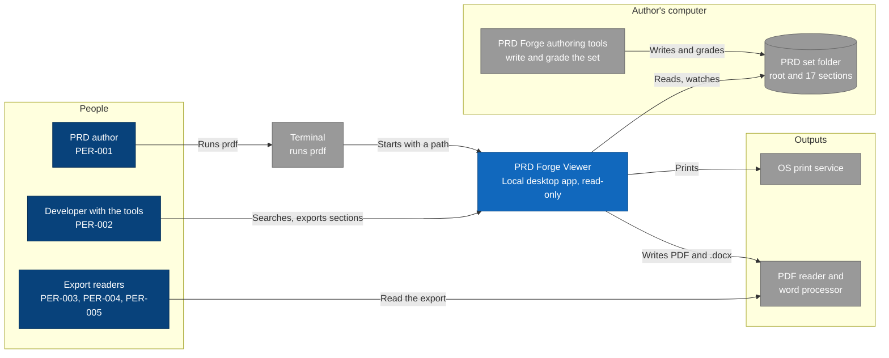

# Architecture diagram: PRD Forge Viewer system context

> **Template Origin**: Official | **ArcKit Version**: 6.18.3 | **Command**: `/arckit:diagram`

## Document Control

| Field | Value |
|-------|-------|
| **Document ID** | ARC-001-DIAG-001-v1.0 |
| **Document Type** | Architecture Diagram (C4 Context) |
| **Project** | PRD Forge Viewer (Project 001) |
| **Classification** | PUBLIC |
| **Status** | DRAFT |
| **Version** | 1.0 |
| **Created Date** | 2026-10-26 |
| **Last Modified** | 2026-10-26 |
| **Review Cycle** | On-Demand |
| **Next Review Date** | 2026-11-25 |
| **Owner** | Richard Hightower, PRD owner |
| **Reviewed By** | [PENDING] |
| **Approved By** | [PENDING] |
| **Distribution** | Project Team, Architecture Team |

## Revision History

| Version | Date | Author | Changes | Approved By | Approval Date |
|---------|------|--------|---------|-------------|---------------|
| 1.0 | 2026-10-26 | ArcKit AI | Initial creation from `/arckit:diagram` command | [PENDING] | [PENDING] |

## Diagram

**Type**: C4 Context. **Format**: Mermaid.

**Legend**: dark blue = person, blue = this system or its containers, light
blue = component, gray = external system or store. A cylinder is a store. The
diagram is a Mermaid flowchart with the C4 colors, because the Mermaid C4 layout
gave more than 5 line crossings.

## Component Inventory

| Element | Kind | Responsibility | Source |
|---------|------|----------------|--------|
| PRD author | Person | Writes the PRD, reads and exports it | PER-001 |
| Developer with the tools | Person | Searches and exports sections | PER-002 |
| Export readers | Person | Read exports only | PER-003, PER-004, PER-005 |
| Terminal | External | Runs `prdf` | INT-002 |
| PRD Forge Viewer | System | Reads, searches, and exports a PRD set. Read-only | FR-001 to FR-024 |
| PRD set folder | External store | Root and 17 section documents | INT-001, C-003 |
| PRD Forge authoring tools | External | Write and grade the set | INT-001 |
| PDF reader and word processor | External | Open exports | INT-003, INT-004 |
| OS print service | External | Prints | INT-005 |

## Architecture Decisions

### Key Design Decisions

- The viewer never writes to the PRD set (OUT-001, principle 2).
- The authoring tools and the viewer share only files (principle 9).
- Exports leave the viewer as files. The viewer sends nothing (TR-006).

### Technology Choices

None at this level. See DIAG-002.

## Requirements Traceability

| Requirement | Element |
|-------------|---------|
| INT-001 | PRD set folder, authoring tools |
| INT-002 | Terminal |
| INT-003, INT-004 | PDF reader and word processor |
| INT-005 | OS print service |
| NFR-SEC-001 | No element outside the computer |

## Integration Points

### External Systems

| System | Protocol | Direction |
|--------|----------|-----------|
| PRD set folder | Local files | Read |
| Terminal | Command line | In |
| PDF reader, word processor | PDF and .docx files | Out |
| OS print service | OS print dialog | Out |

### APIs and Endpoints

None. No network API.

## Data Flow

### Data Sources

- The PRD set folder (E-001 to E-004).

### Data Sinks

- Export files, the printer, and the settings file (E-005, E-007).

### PII Handling (UK GDPR / GDPR Compliance)

No personal data (`ARC-001-DATA-v1.0.md`).

## Security Architecture

### Security Zones

| Zone | Contents | Trust |
|------|----------|-------|
| PRD set folder | Documents from the authoring tools, any source | Untrusted input (principle 4) |
| Viewer | Web UI and Rust core | Trusted |
| App config folder | Settings file | Trusted, viewer only |

### Security Controls

- Tauri capabilities allow read on the opened set folder and read and write on the app config folder only (ADR-001).
- A content security policy with no remote source. Document content cannot run scripts or load remote content (NFR-SEC-003, PRD NFR-010).
- The export saver refuses a path inside the set (NFR-SEC-002).
- No network use for any feature (NFR-SEC-001, NFR-A-001).

### Authentication & Authorization

None. One local user. Operating system file permissions apply.

## Deployment Architecture

The viewer is a desktop app on the author's computer. No cloud, no server. The
test computer is an Apple silicon Mac with 16 GB. Release packages are signed
(principle 16).

## Non-Functional Requirements

### Performance

| ID | Target | How the design meets it |
|----|--------|-------------------------|
| NFR-P-001 | Open a set, p95 at most 2 seconds | Rust reader. Index built after the first view if needed (ADR-003) |
| NFR-P-002 | Change on screen, p95 at most 2 seconds | OS file events with per-file debounce (ADR-005) |
| NFR-P-003 | Search, p95 at most 0.5 seconds | SQLite FTS5 BM25 (ADR-003) |
| NFR-P-004 | Export, p95 at most 10 seconds | Word writer and HTML to PDF, measured in the NFR-P-004 test (ADR-002) |

### Scalability

Not in the PRD. All targets are for 18 documents.

### Availability & Resilience

- Works with no network (NFR-A-001).
- One unreadable file does not stop the others (NFR-A-003).
- Themes survive a restart with an atomic settings write (NFR-A-002, ADR-004).

### Security & Compliance

See Security Architecture. No compliance framework applies. No personal data.

## Diagram quality gate

| # | Criterion | Target | Result | Status |
|---|-----------|--------|--------|--------|
| 1 | Edge crossings | 0 for 9 elements | 0 | PASS |
| 2 | Visual hierarchy | The system is the most prominent element | The viewer is the only blue system | PASS |
| 3 | Grouping | Related elements together | People, author's computer, outputs | PASS |
| 4 | Flow direction | Consistent | Left to right | PASS |
| 5 | Relationship traceability | Each line clear | Yes | PASS |
| 6 | Abstraction level | One C4 level | Context | PASS |
| 7 | Edge label readability | No overlap | No overlap | PASS |
| 8 | Node placement | No long edges | One long edge, readers to documents | PASS |
| 9 | Element count | 10 or fewer | 9/10 | PASS |

## UK Government Compliance (if applicable)

Not applicable. The viewer is not a government system.

## Wardley Map Integration

No Wardley map exists for this project. The ADRs record the evolution stage of
each option: the Tauri shell, BM25, and OS file events are Commodity or Product.
The export assembly layer and the set reader are Custom-Built, because they are
specific to the PRD Forge format.

## Linked Artifacts

- `ARC-001-REQ-v1.0.md`, requirements
- `ARC-001-DATA-v1.0.md`, data model
- `decisions/ARC-001-ADR-001-v1.1.md` to `ARC-001-ADR-005-v1.1.md`
- `projects/000-global/ARC-000-PRIN-v1.0.md`, principles

## Change Log

| Version | Date | Change |
|---------|------|--------|
| 1.0 | 2026-10-26 | First version |

## External References

### Document Register

| Doc ID | Filename | Type | Source Location | Description |
|--------|----------|------|-----------------|-------------|
| PFVP | prd-forge-viewer-prd.pdf | PRD | `projects/001-prd-forge-viewer/external/` | The PRD, version 0.3.2 |

### Citations

| Citation ID | Doc ID | Page/Section | Category | Quoted Passage |
|-------------|--------|--------------|----------|----------------|
| PFVP-C1 | PFVP | Section 6, OUT-001 | Out of scope | Release 1 does not edit any document of a PRD set. |

### Unreferenced Documents

| Filename | Source Location | Reason |
|----------|-----------------|--------|
| README.md | `projects/001-prd-forge-viewer/external/` | Describes the PDF |

---

**Generated by**: ArcKit `/arckit:diagram` command
**Generated on**: 2026-10-26
**ArcKit Version**: 6.18.3
**Project**: PRD Forge Viewer (Project 001)
**Model**: claude-opus-5-5
**Generation Context**: ARC-001-REQ-v1.0, ARC-001-DATA-v1.0, ADR-001 to ADR-005.
