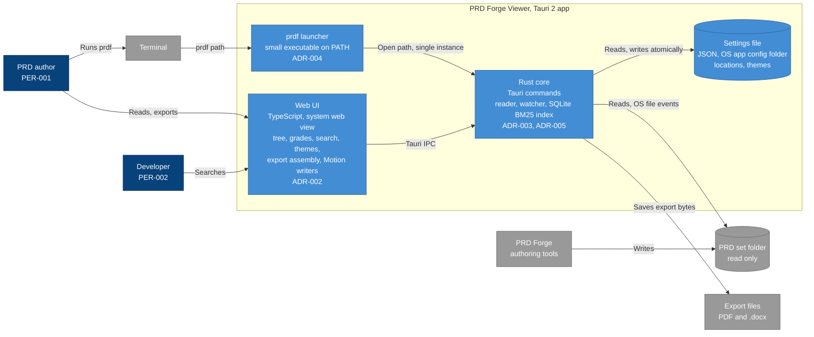

# Architecture diagram: PRD Forge Viewer containers

> **Template Origin**: Official | **ArcKit Version**: 6.18.3 | **Command**: `/arckit:diagram`

## Document Control

| Field | Value |
|-------|-------|
| **Document ID** | ARC-001-DIAG-002-v1.0 |
| **Document Type** | Architecture Diagram (C4 Container) |
| **Project** | PRD Forge Viewer (Project 001) |
| **Classification** | PUBLIC |
| **Status** | DRAFT |
| **Version** | 1.0 |
| **Created Date** | 2026-10-26 |
| **Last Modified** | 2026-10-26 |
| **Review Cycle** | On-Demand |
| **Next Review Date** | 2026-11-25 |
| **Owner** | Richard Hightower, PRD owner |
| **Reviewed By** | [PENDING] |
| **Approved By** | [PENDING] |
| **Distribution** | Project Team, Architecture Team |

## Revision History

| Version | Date | Author | Changes | Approved By | Approval Date |
|---------|------|--------|---------|-------------|---------------|
| 1.0 | 2026-10-26 | ArcKit AI | Initial creation from `/arckit:diagram` command | [PENDING] | [PENDING] |

## Diagram

**Type**: C4 Container. **Format**: Mermaid.

**Legend**: dark blue = person, blue = this system or its containers, light
blue = component, gray = external system or store. A cylinder is a store. The
diagram is a Mermaid flowchart with the C4 colors, because the Mermaid C4 layout
gave more than 5 line crossings.

## Component Inventory

| Container | Technology | Responsibility | Decision |
|-----------|-----------|----------------|----------|
| `prdf` launcher | Small executable on the `PATH` | Resolves `docs/prd` or a path. Starts or signals the app | ADR-004 |
| Web UI | TypeScript in the system web view | Tree, grades, search, themes, export assembly, Motion writers | ADR-001, ADR-002 |
| Rust core | Rust, Tauri commands | Set reader, change watcher, BM25 index, settings, export saver | ADR-001, ADR-003, ADR-005 |
| Settings file | JSON in the OS app config folder | Known locations, custom themes, last-session file state | ADR-004 |

## Architecture Decisions

### Key Design Decisions

- One Tauri 2 app with a Rust core and a web UI, the same stack as Motion (ADR-001).
- The UI reaches files only through the core (Tauri IPC). The core enforces read-only access.
- Export bytes come from the UI writers. The core saves them, outside the set (ADR-002).

### Technology Choices

| Choice | Reason | ADR |
|--------|--------|-----|
| Tauri 2 | Reuse of Motion, least-privilege file access | ADR-001 |
| Motion themes and Word writer, PDF from HTML | Reuse. Tagged PDF with embedded fonts | ADR-002 |
| SQLite FTS5 with BM25 | Interview choice. Derived cache file in the app data folder | ADR-003 |
| Launcher and settings file | One install, one window | ADR-004 |
| OS file events | 2-second refresh | ADR-005 |

## Requirements Traceability

| Requirement | Container |
|-------------|-----------|
| FR-001 to FR-005, FR-023 | Web UI, Rust core |
| FR-007, FR-008 | Web UI, Rust core (index) |
| FR-009 | Rust core (watcher) |
| FR-010 to FR-020 | Web UI (writers), Rust core (saver), settings file (themes) |
| FR-002, FR-021, FR-022 | `prdf` launcher, Rust core, settings file |
| NFR-SEC-002 | Rust core |

## Integration Points

### External Systems

| System | Protocol | Container |
|--------|----------|-----------|
| PRD set folder | Local files, OS file events | Rust core |
| Terminal | Command line | `prdf` launcher |
| Export files | Local files | Rust core |

### APIs and Endpoints

| Interface | Between | Notes |
|-----------|---------|-------|
| Tauri IPC commands | Web UI and Rust core | The only path from UI to files |
| Single-instance message | `prdf` launcher and Rust core | Carries a folder path |

## Data Flow

### Data Sources

- PRD set folder → Rust core → Web UI.

### Data Sinks

- Settings file, export files.

### PII Handling (UK GDPR / GDPR Compliance)

No personal data.

## Security Architecture

### Security Zones

| Zone | Contents | Trust |
|------|----------|-------|
| PRD set folder | Documents from the authoring tools, any source | Untrusted input (principle 4) |
| Viewer | Web UI and Rust core | Trusted |
| App config folder | Settings file | Trusted, viewer only |

### Security Controls

- Tauri capabilities allow read on the opened set folder and read and write on the app config folder only (ADR-001).
- A content security policy with no remote source. Document content cannot run scripts or load remote content (NFR-SEC-003, PRD NFR-010).
- The export saver refuses a path inside the set (NFR-SEC-002).
- No network use for any feature (NFR-SEC-001, NFR-A-001).

### Authentication & Authorization

None. One local user. Operating system file permissions apply.

## Deployment Architecture

The viewer is a desktop app on the author's computer. No cloud, no server. The
test computer is an Apple silicon Mac with 16 GB. Release packages are signed
(principle 16).

## Non-Functional Requirements

### Performance

| ID | Target | How the design meets it |
|----|--------|-------------------------|
| NFR-P-001 | Open a set, p95 at most 2 seconds | Rust reader. Index built after the first view if needed (ADR-003) |
| NFR-P-002 | Change on screen, p95 at most 2 seconds | OS file events with per-file debounce (ADR-005) |
| NFR-P-003 | Search, p95 at most 0.5 seconds | SQLite FTS5 BM25 (ADR-003) |
| NFR-P-004 | Export, p95 at most 10 seconds | Word writer and HTML to PDF, measured in the NFR-P-004 test (ADR-002) |

### Scalability

Not in the PRD. All targets are for 18 documents.

### Availability & Resilience

- Works with no network (NFR-A-001).
- One unreadable file does not stop the others (NFR-A-003).
- Themes survive a restart with an atomic settings write (NFR-A-002, ADR-004).

### Security & Compliance

See Security Architecture. No compliance framework applies. No personal data.

## Diagram quality gate

| # | Criterion | Target | Result | Status |
|---|-----------|--------|--------|--------|
| 1 | Edge crossings | fewer than 5 | 2 | PASS |
| 2 | Visual hierarchy | System boundary prominent | The Tauri app boundary holds all containers | PASS |
| 3 | Grouping | Related elements together | Containers inside the boundary | PASS |
| 4 | Flow direction | Consistent | Left to right | PASS |
| 5 | Relationship traceability | Each line clear | Yes | PASS |
| 6 | Abstraction level | One C4 level | Container | PASS |
| 7 | Edge label readability | No overlap | No overlap | PASS |
| 8 | Node placement | No long edges | Two long edges to the set folder and exports | PASS |
| 9 | Element count | 15 or fewer | 11/15 | PASS |

## UK Government Compliance (if applicable)

Not applicable. The viewer is not a government system.

## Wardley Map Integration

No Wardley map exists for this project. The ADRs record the evolution stage of
each option: the Tauri shell, BM25, and OS file events are Commodity or Product.
The export assembly layer and the set reader are Custom-Built, because they are
specific to the PRD Forge format.

## Linked Artifacts

- `ARC-001-REQ-v1.0.md`, requirements
- `ARC-001-DATA-v1.0.md`, data model
- `decisions/ARC-001-ADR-001-v1.1.md` to `ARC-001-ADR-005-v1.1.md`
- `projects/000-global/ARC-000-PRIN-v1.0.md`, principles

## Change Log

| Version | Date | Change |
|---------|------|--------|
| 1.0 | 2026-10-26 | First version |

## External References

### Document Register

| Doc ID | Filename | Type | Source Location | Description |
|--------|----------|------|-----------------|-------------|
| PFVP | prd-forge-viewer-prd.pdf | PRD | `projects/001-prd-forge-viewer/external/` | The PRD, version 0.3.2 |

### Citations

| Citation ID | Doc ID | Page/Section | Category | Quoted Passage |
|-------------|--------|--------------|----------|----------------|
| PFVP-C1 | PFVP | Section 6, OUT-001 | Out of scope | Release 1 does not edit any document of a PRD set. |

### Unreferenced Documents

| Filename | Source Location | Reason |
|----------|-----------------|--------|
| README.md | `projects/001-prd-forge-viewer/external/` | Describes the PDF |

---

**Generated by**: ArcKit `/arckit:diagram` command
**Generated on**: 2026-10-26
**ArcKit Version**: 6.18.3
**Project**: PRD Forge Viewer (Project 001)
**Model**: claude-opus-5-5
**Generation Context**: ARC-001-REQ-v1.0, ARC-001-DATA-v1.0, ADR-001 to ADR-005.
