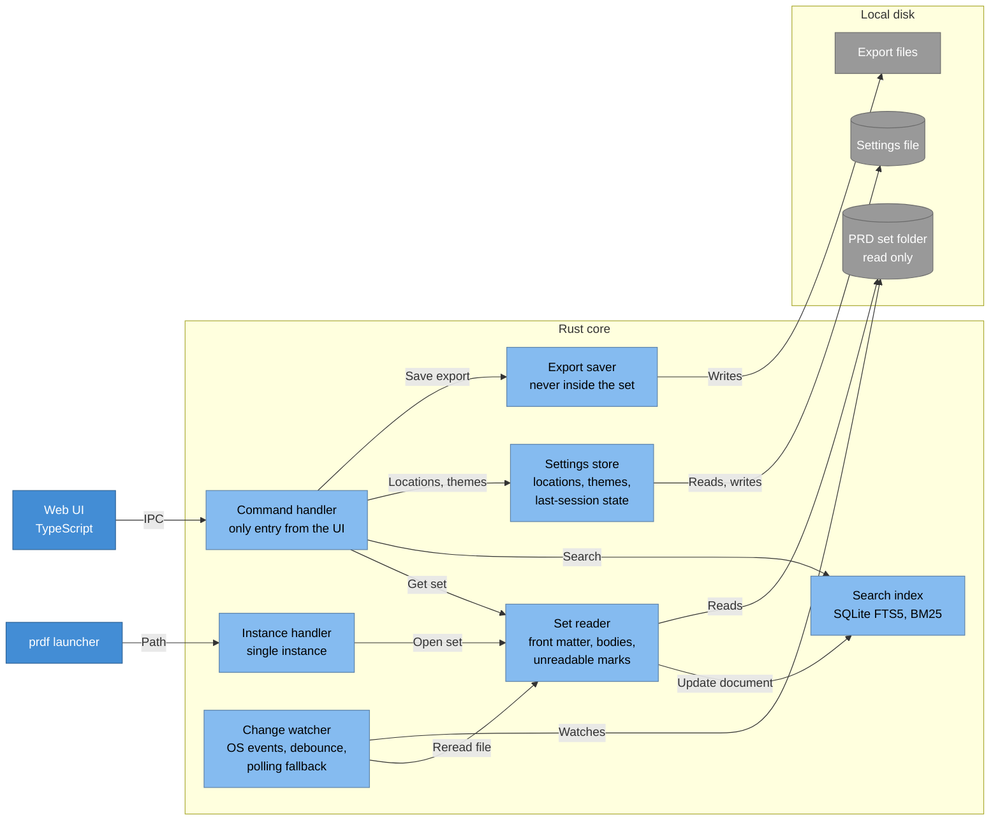

# Architecture diagram: Rust core components

> **Template Origin**: Official | **ArcKit Version**: 6.18.3 | **Command**: `/arckit:diagram`

## Document Control

| Field | Value |
|-------|-------|
| **Document ID** | ARC-001-DIAG-003-v1.0 |
| **Document Type** | Architecture Diagram (C4 Component) |
| **Project** | PRD Forge Viewer (Project 001) |
| **Classification** | PUBLIC |
| **Status** | DRAFT |
| **Version** | 1.0 |
| **Created Date** | 2026-10-26 |
| **Last Modified** | 2026-10-26 |
| **Review Cycle** | On-Demand |
| **Next Review Date** | 2026-11-25 |
| **Owner** | Richard Hightower, PRD owner |
| **Reviewed By** | [PENDING] |
| **Approved By** | [PENDING] |
| **Distribution** | Project Team, Architecture Team |

## Revision History

| Version | Date | Author | Changes | Approved By | Approval Date |
|---------|------|--------|---------|-------------|---------------|
| 1.0 | 2026-10-26 | ArcKit AI | Initial creation from `/arckit:diagram` command | [PENDING] | [PENDING] |

## Diagram

**Type**: C4 Component. **Format**: Mermaid.

**Legend**: dark blue = person, blue = this system or its containers, light
blue = component, gray = external system or store. A cylinder is a store. The
diagram is a Mermaid flowchart with the C4 colors, because the Mermaid C4 layout
gave more than 5 line crossings.

## Component Inventory

| Component | Responsibility | Requirements | Decision |
|-----------|----------------|--------------|----------|
| Command handler | The only entry from the UI. No write command on the set | NFR-SEC-002 | ADR-001 |
| Instance handler | Receives paths from `prdf` | FR-021 | ADR-004 |
| Set reader | Parses front matter and bodies. Marks unreadable files with the name and reason | FR-001, FR-003, FR-004, NFR-I-001 | ADR-001 |
| Change watcher | OS events, per-file debounce, polling fallback. Rereads one file | FR-002, FR-009, NFR-P-002 | ADR-005 |
| Search index | SQLite FTS5 with BM25, category filter, relevance 0 to 100 | FR-007, FR-008, NFR-P-003 | ADR-003 |
| Settings store | Known locations, themes, last-session state. Atomic write | FR-002, FR-016 to FR-018, FR-020, FR-022, NFR-A-002 | ADR-004 |
| Export saver | Writes export bytes to the chosen path. Refuses paths inside the set | FR-010 to FR-012, NFR-SEC-002 | ADR-002 |

## Architecture Decisions

### Key Design Decisions

- The set reader is the only component that reads the set. The watcher only tells it which file to reread.
- The index updates per document, from the reader.
- No component holds a write handle on the set.

### Technology Choices

See DIAG-002 and the ADRs.

## Requirements Traceability

See the Component Inventory. Every FR in REL-001 that needs the core maps to a component.

## Integration Points

### External Systems

| System | Component |
|--------|-----------|
| PRD set folder | Set reader, change watcher |
| Settings file | Settings store |
| Export files | Export saver |

### APIs and Endpoints

| Command group | Component |
|---------------|-----------|
| Open set, get document | Set reader |
| Search | Search index |
| Locations, themes | Settings store |
| Save export | Export saver |

## Data Flow

### Data Sources

- PRD set folder.

### Data Sinks

- Settings file, export files, the SQLite index file.

### PII Handling (UK GDPR / GDPR Compliance)

No personal data.

## Security Architecture

### Security Zones

| Zone | Contents | Trust |
|------|----------|-------|
| PRD set folder | Documents from the authoring tools, any source | Untrusted input (principle 4) |
| Viewer | Web UI and Rust core | Trusted |
| App config folder | Settings file | Trusted, viewer only |

### Security Controls

- Tauri capabilities allow read on the opened set folder and read and write on the app config folder only (ADR-001).
- A content security policy with no remote source. Document content cannot run scripts or load remote content (NFR-SEC-003, PRD NFR-010).
- The export saver refuses a path inside the set (NFR-SEC-002).
- No network use for any feature (NFR-SEC-001, NFR-A-001).

### Authentication & Authorization

None. One local user. Operating system file permissions apply.

## Deployment Architecture

The viewer is a desktop app on the author's computer. No cloud, no server. The
test computer is an Apple silicon Mac with 16 GB. Release packages are signed
(principle 16).

## Non-Functional Requirements

### Performance

| ID | Target | How the design meets it |
|----|--------|-------------------------|
| NFR-P-001 | Open a set, p95 at most 2 seconds | Rust reader. Index built after the first view if needed (ADR-003) |
| NFR-P-002 | Change on screen, p95 at most 2 seconds | OS file events with per-file debounce (ADR-005) |
| NFR-P-003 | Search, p95 at most 0.5 seconds | SQLite FTS5 BM25 (ADR-003) |
| NFR-P-004 | Export, p95 at most 10 seconds | Word writer and HTML to PDF, measured in the NFR-P-004 test (ADR-002) |

### Scalability

Not in the PRD. All targets are for 18 documents.

### Availability & Resilience

- Works with no network (NFR-A-001).
- One unreadable file does not stop the others (NFR-A-003).
- Themes survive a restart with an atomic settings write (NFR-A-002, ADR-004).

### Security & Compliance

See Security Architecture. No compliance framework applies. No personal data.

## Diagram quality gate

| # | Criterion | Target | Result | Status |
|---|-----------|--------|--------|--------|
| 1 | Edge crossings | fewer than 5 | 3 | PASS |
| 2 | Visual hierarchy | Container boundary prominent | Rust core boundary | PASS |
| 3 | Grouping | Related elements together | Core components, local disk | PASS |
| 4 | Flow direction | Consistent | Left to right | PASS |
| 5 | Relationship traceability | Each line clear | Yes. Three crossings accepted to keep the disk stores together | PASS |
| 6 | Abstraction level | One C4 level | Component | PASS |
| 7 | Edge label readability | No overlap | No overlap | PASS |
| 8 | Node placement | No long edges | Edges to the local disk are long | PASS |
| 9 | Element count | 12 or fewer per container | 7 components/12 | PASS |

**Accepted trade-off**: Three crossings stay so that the three disk stores
stay in one group.

## UK Government Compliance (if applicable)

Not applicable. The viewer is not a government system.

## Wardley Map Integration

No Wardley map exists for this project. The ADRs record the evolution stage of
each option: the Tauri shell, BM25, and OS file events are Commodity or Product.
The export assembly layer and the set reader are Custom-Built, because they are
specific to the PRD Forge format.

## Linked Artifacts

- `ARC-001-REQ-v1.0.md`, requirements
- `ARC-001-DATA-v1.0.md`, data model
- `decisions/ARC-001-ADR-001-v1.1.md` to `ARC-001-ADR-005-v1.1.md`
- `projects/000-global/ARC-000-PRIN-v1.0.md`, principles

## Change Log

| Version | Date | Change |
|---------|------|--------|
| 1.0 | 2026-10-26 | First version |

## External References

### Document Register

| Doc ID | Filename | Type | Source Location | Description |
|--------|----------|------|-----------------|-------------|
| PFVP | prd-forge-viewer-prd.pdf | PRD | `projects/001-prd-forge-viewer/external/` | The PRD, version 0.3.2 |

### Citations

| Citation ID | Doc ID | Page/Section | Category | Quoted Passage |
|-------------|--------|--------------|----------|----------------|
| PFVP-C1 | PFVP | Section 9, C-002 | Constraint | The viewer does not change any document of a PRD set. |

### Unreferenced Documents

| Filename | Source Location | Reason |
|----------|-----------------|--------|
| README.md | `projects/001-prd-forge-viewer/external/` | Describes the PDF |

---

**Generated by**: ArcKit `/arckit:diagram` command
**Generated on**: 2026-10-26
**ArcKit Version**: 6.18.3
**Project**: PRD Forge Viewer (Project 001)
**Model**: claude-opus-5-5
**Generation Context**: ARC-001-REQ-v1.0, ARC-001-DATA-v1.0, ADR-001 to ADR-005.
