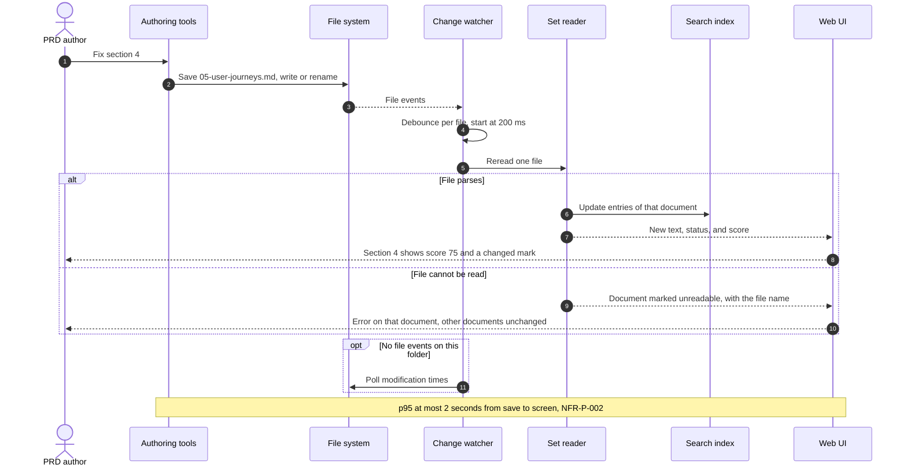

# Architecture diagram: File-change refresh (FR-009)

> **Template Origin**: Official | **ArcKit Version**: 6.18.3 | **Command**: `/arckit:diagram`

## Document Control

| Field | Value |
|-------|-------|
| **Document ID** | ARC-001-DIAG-004-v1.0 |
| **Document Type** | Architecture Diagram (Sequence) |
| **Project** | PRD Forge Viewer (Project 001) |
| **Classification** | PUBLIC |
| **Status** | DRAFT |
| **Version** | 1.0 |
| **Created Date** | 2026-10-26 |
| **Last Modified** | 2026-10-26 |
| **Review Cycle** | On-Demand |
| **Next Review Date** | 2026-11-25 |
| **Owner** | Richard Hightower, PRD owner |
| **Reviewed By** | [PENDING] |
| **Approved By** | [PENDING] |
| **Distribution** | Project Team, Architecture Team |

## Revision History

| Version | Date | Author | Changes | Approved By | Approval Date |
|---------|------|--------|---------|-------------|---------------|
| 1.0 | 2026-10-26 | ArcKit AI | Initial creation from `/arckit:diagram` command | [PENDING] | [PENDING] |

## Diagram

**Type**: Sequence. **Format**: Mermaid.

**Legend**: solid arrow = call or write, dashed arrow = result or event.

## Component Inventory

| Lifeline | Element | Decision |
|----------|---------|----------|
| PRD author | PER-001 | |
| Authoring tools | External | INT-001 |
| File system | Operating system | |
| Change watcher | Rust core component | ADR-005 |
| Set reader | Rust core component | ADR-001 |
| Search index | Rust core component | ADR-003 |
| Web UI | Container | ADR-001 |

## Architecture Decisions

### Key Design Decisions

- Debounce per file, starting at 200 milliseconds. A design value, tuned in the NFR-P-002 test (ADR-005).
- A file that fails to parse shows its error. The other documents stay as they were (FR-003).
- Polling is a fallback only.

### Technology Choices

OS file events and polling (ADR-005).

## Requirements Traceability

| Requirement | Step |
|-------------|------|
| FR-009 | Steps 2 to 7: new score with no action |
| FR-003 | Error branch |
| NFR-P-002 | The whole flow, p95 at most 2 seconds |
| SC-003 | The happy path: score 61 to 75 |

## Integration Points

### External Systems

- Authoring tools write the file. No message passes between them and the viewer.

### APIs and Endpoints

None.

## Data Flow

### Data Sources

- One changed file.

### Data Sinks

- Search index, Web UI.

### PII Handling (UK GDPR / GDPR Compliance)

No personal data.

## Security Architecture

### Security Zones

| Zone | Contents | Trust |
|------|----------|-------|
| PRD set folder | Documents from the authoring tools, any source | Untrusted input (principle 4) |
| Viewer | Web UI and Rust core | Trusted |
| App config folder | Settings file | Trusted, viewer only |

### Security Controls

- Tauri capabilities allow read on the opened set folder and read and write on the app config folder only (ADR-001).
- A content security policy with no remote source. Document content cannot run scripts or load remote content (NFR-SEC-003, PRD NFR-010).
- The export saver refuses a path inside the set (NFR-SEC-002).
- No network use for any feature (NFR-SEC-001, NFR-A-001).

### Authentication & Authorization

None. One local user. Operating system file permissions apply.

## Deployment Architecture

The viewer is a desktop app on the author's computer. No cloud, no server. The
test computer is an Apple silicon Mac with 16 GB. Release packages are signed
(principle 16).

## Non-Functional Requirements

### Performance

| ID | Target | How the design meets it |
|----|--------|-------------------------|
| NFR-P-001 | Open a set, p95 at most 2 seconds | Rust reader. Index built after the first view if needed (ADR-003) |
| NFR-P-002 | Change on screen, p95 at most 2 seconds | OS file events with per-file debounce (ADR-005) |
| NFR-P-003 | Search, p95 at most 0.5 seconds | SQLite FTS5 BM25 (ADR-003) |
| NFR-P-004 | Export, p95 at most 10 seconds | Word writer and HTML to PDF, measured in the NFR-P-004 test (ADR-002) |

### Scalability

Not in the PRD. All targets are for 18 documents.

### Availability & Resilience

- Works with no network (NFR-A-001).
- One unreadable file does not stop the others (NFR-A-003).
- Themes survive a restart with an atomic settings write (NFR-A-002, ADR-004).

### Security & Compliance

See Security Architecture. No compliance framework applies. No personal data.

## Diagram quality gate

| # | Criterion | Target | Result | Status |
|---|-----------|--------|--------|--------|
| 1 | Edge crossings | Not applicable to sequences | Not applicable | PASS |
| 2 | Visual hierarchy | Main flow clear | Happy path first | PASS |
| 3 | Grouping | Related steps together | alt and opt blocks | PASS |
| 4 | Flow direction | Top to bottom | Top to bottom | PASS |
| 5 | Relationship traceability | Each message clear | Numbered | PASS |
| 6 | Abstraction level | One scenario | FR-009 refresh | PASS |
| 7 | Edge label readability | No overlap | No overlap | PASS |
| 8 | Node placement | Lifelines in call order | Yes | PASS |
| 9 | Element count | 8 lifelines or fewer | 7/8 | PASS |

## UK Government Compliance (if applicable)

Not applicable. The viewer is not a government system.

## Wardley Map Integration

No Wardley map exists for this project. The ADRs record the evolution stage of
each option: the Tauri shell, BM25, and OS file events are Commodity or Product.
The export assembly layer and the set reader are Custom-Built, because they are
specific to the PRD Forge format.

## Linked Artifacts

- `ARC-001-REQ-v1.0.md`, requirements
- `ARC-001-DATA-v1.0.md`, data model
- `decisions/ARC-001-ADR-001-v1.1.md` to `ARC-001-ADR-005-v1.1.md`
- `projects/000-global/ARC-000-PRIN-v1.0.md`, principles

## Change Log

| Version | Date | Change |
|---------|------|--------|
| 1.0 | 2026-10-26 | First version |

## External References

### Document Register

| Doc ID | Filename | Type | Source Location | Description |
|--------|----------|------|-----------------|-------------|
| PFVP | prd-forge-viewer-prd.pdf | PRD | `projects/001-prd-forge-viewer/external/` | The PRD, version 0.3.2 |

### Citations

| Citation ID | Doc ID | Page/Section | Category | Quoted Passage |
|-------------|--------|--------------|----------|----------------|
| PFVP-C1 | PFVP | Section 6, OUT-001 | Out of scope | Release 1 does not edit any document of a PRD set. |

### Unreferenced Documents

| Filename | Source Location | Reason |
|----------|-----------------|--------|
| README.md | `projects/001-prd-forge-viewer/external/` | Describes the PDF |

---

**Generated by**: ArcKit `/arckit:diagram` command
**Generated on**: 2026-10-26
**ArcKit Version**: 6.18.3
**Project**: PRD Forge Viewer (Project 001)
**Model**: claude-opus-5-5
**Generation Context**: ARC-001-REQ-v1.0, ARC-001-DATA-v1.0, ADR-001 to ADR-005.
